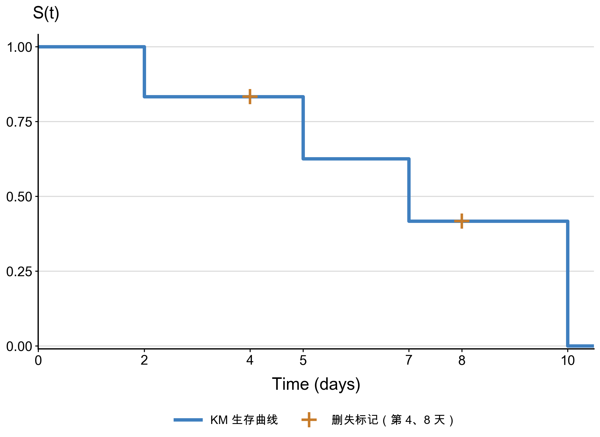

# Day 14｜生存分析原理一：删失、KM、log-rank（进行中）

> 今日完成概念打底，已生成 `notes/survival-analysis.md`（531 行），并完成 6 人 KM 手算。
> `lifelines`（radiomics 环境 0.30.0）已用于小例子复算；分组 KM 图和 log-rank 结果尚未落地，D14 未收尾。

## 今日目标

- 能解释“为什么生存分析不能直接用 t 检验”；
- 理解事件、生存时间、右删失、生存函数、风险函数；
- 掌握 KM 估计与 log-rank 检验的原理；
- 能手算小样本 KM，并用真数据画分组 KM 曲线；
- 报告中位生存、p 值、样本量与结论边界。

## 进度快照

| 步骤 | 状态 | 说明 |
|---|---|---|
| 1. 概念打底 | ✅ | 阅读 Chapter 2（2.1–2.5）及 KM/log-rank 补充材料，整理成 13 节笔记 |
| `notes/survival-analysis.md` | ✅ | 531 行，含公式、5 人 KM 示例、参数模型、项目分析流程 |
| 2. 6 人 KM 手算 | ✅ | 已完成手算并用 `lifelines` 复算：`1.0000 → 0.8333 → 0.6250 → 0.4167 → 0` |
| 3. `lifelines` 环境 | ✅ | `radiomics` 环境 0.30.0 可用；base 环境未装 |
| 3. `code/03_km_baseline.py` | ⬜ | 尚未创建 |
| 3. 分组 KM 图 | ⬜ | 尚未生成；需风险表、中位线、CI、图例、时间单位 |
| 3. log-rank p 值 | ⬜ | 尚未计算；需同时报告每组样本量与事件数 |
| 4. 4 句结论 | ⬜ | 尚未写入报告素材 |
| `journal/day14.md` | 🟡 | 本文件，进行中 |
| `journal/INDEX.md` + commit | 🟡 | INDEX 尚未更新，收尾 commit 待做 |

## 今日完成

1. 阅读 Chapter 2 的生存分析基础，按“定义—公式—项目对应—常见错误”的结构整理；
2. 新建 `notes/survival-analysis.md`，覆盖：
   - Survival Analysis 的研究对象与 Time-to-Event 数据结构；
   - Event、Survival Time、右删失；
   - Survival Function、Hazard Function、Cumulative Hazard；
   - KM 估计、log-rank 检验、中位生存；
   - Exponential / Weibull 参数模型；
   - 本项目的 7 步分析流程与必背公式表。
3. 明确了本项目字段：
   - `Survival.time`：从治疗开始到死亡或随访结束，单位**天**；
   - `deadstatus.event = 1`：死亡；`= 0`：右删失；
   - 可用分组变量：`Overall.Stage`、`Histology`、`gender` 等。
4. 完成 6 人 KM 手算：第 4、8 天为删失，事件时点为第 2、5、7、10 天；
   KM 阶梯值为 `1.0000 → 0.8333 → 0.6250 → 0.4167 → 0`，中位生存 7 天；
5. 用 `lifelines 0.30.0` 复算 6 人示例，KM 阶梯值和中位生存（7 天）与手算一致；
6. 明确了 D14 尚未完成的部分：真实队列的分组 KM 图、log-rank 和 4 句结论。

## 概念要点

### 1. Event（事件）

- 本项目终点事件是**死亡**，不是复发；
- `deadstatus.event = 1` 表示观察到死亡，`= 0` 表示右删失；
- Event = 0 不等于“患者永远不会死亡”，只表示观察期内没有记录到死亡。

### 2. Survival Time（生存时间）

设真实事件时间为 `T`，删失时间为 `C`，实际观察时间为 `Y`：

```text
Y = min(T, C)
δ = I(T ≤ C)
```

- 时间必须有明确起点、终点和单位；
- 本项目起点是治疗开始，单位是天；
- 报告里不能只写“生存时间”，要写清起点与单位。

### 3. Right Censoring（右删失）

- 只知道 `T > 观察时间`，不知道真实死亡时间；
- 常见原因：研究结束时仍存活、失访、退出研究；
- **删失 ≠ 缺失数据**：删失者提供了“至少活到 t”的信息，必须进入风险集；
- **不能删除删失者**：会丢弃随访信息，高估事件发生率；
- **不能把删失当死亡**：会低估生存。

### 4. Survival Function（生存函数）

```text
S(t) = P(T > t)
S(t) = 1 − F(t)
f(t) = −dS(t)/dt
```

- `S(t)` 是存活超过 `t` 的概率，不是“在 t 时刻死亡的概率”；
- `S(t)` 单调不增，`S(0) = 1`；
- 连续模型下 `S(t) = ∫_t^∞ f(u) du`。

### 5. Hazard Function（风险函数）

```text
h(t) = f(t) / S(t) = −d/dt ln S(t)
H(t) = ∫_0^t h(u) du
S(t) = exp(−H(t))
```

- `h(t)` 是“已经活到 t 的人，在下一瞬间发生事件的瞬时风险率”；
- Hazard 不是普通概率，可以大于 1；
- `S(t)` 描述“活过某时刻的概率”，`h(t)` 描述“某时刻的瞬时风险”。

### 6. Kaplan–Meier（KM）

```text
Ŝ(t) = ∏_{t_i ≤ t} (1 − d_i / n_i)
```

- `t_i`：第 i 个不同的事件时点；
- `d_i`：该时点发生事件的人数；
- `n_i`：该时点仍在风险集的人数；
- 死亡时曲线下降，删失时曲线不下降，但删失者退出后续风险集；
- KM 曲线是单调不增的阶梯函数；
- KM 的核心是**条件生存概率连乘**，不是“存活人数 / 总人数”。

### 7. Log-rank 检验

- 比较两组或多组**整条生存曲线**，不是比较某个时间点；
- 在每个事件时点计算观测事件数与期望事件数，再综合成检验统计量；
- `p < 0.05` 只说明有统计学差异，不说明差异大小；
- 曲线明显交叉时，传统 log-rank 的效能会下降；
- 报告 p 值时必须同时报告每组样本量和事件数。

### 8. 中位生存时间

```text
t_median = inf{ t : Ŝ(t) ≤ 0.5 }
```

- 即 KM 曲线第一次达到或低于 0.5 的时间；
- 如果整条曲线始终高于 0.5，中位生存**不可估计**；
- 报告写 **Median survival was not reached (NR)**，不能写 0、NA，也不能拿最大随访时间冒充；
- 中位生存时间 ≠ 平均生存时间。

## 公式速查

| 概念 | 公式 |
|---|---|
| Survival Function | `S(t) = P(T > t)` |
| CDF 关系 | `S(t) = 1 − F(t)` |
| 密度函数 | `f(t) = −S'(t)` |
| Hazard Function | `h(t) = f(t) / S(t)` |
| Cumulative Hazard | `H(t) = ∫_0^t h(u) du` |
| Survival–Hazard | `S(t) = exp(−H(t))` |
| Mean Survival Time | `E(T) = ∫_0^∞ S(t) dt` |
| Mean Residual Life | `mrl(t) = ∫_t^∞ S(u) du / S(t)` |
| Kaplan–Meier | `Ŝ(t) = ∏(1 − d_i/n_i)` |
| Median Survival | `inf{t : Ŝ(t) ≤ 0.5}` |

## 6 人 KM 手算示例（已完成）

假设研究患者从治疗开始到死亡或随访结束的时间，单位为天。

| 患者 ID | Time（天） | Event | 说明 |
|---|---:|---:|---|
| A | 2 | 1 | 第 2 天死亡 |
| B | 4 | 0 | 第 4 天右删失 |
| C | 5 | 1 | 第 5 天死亡 |
| D | 7 | 1 | 第 7 天死亡 |
| E | 8 | 0 | 第 8 天右删失 |
| F | 10 | 1 | 第 10 天死亡 |

其中：

- `Event = 1`：死亡；
- `Event = 0`：右删失；
- `Time`：实际观察时间。

逐个事件时点计算：

| 时点 | 风险集 `n_i` | 事件数 `d_i` | 删失 | 条件生存 `1 − d_i/n_i` | KM 阶梯值 `Ŝ(t)` |
|---|---:|---:|---:|---:|---:|
| 2 | 6 | 1 | 0 | `5/6 = 0.8333` | **0.8333** |
| 4 | 5 | 0 | 1（B） | `1` | 0.8333 |
| 5 | 4 | 1 | 0 | `3/4 = 0.75` | **0.6250** |
| 7 | 3 | 1 | 0 | `2/3 ≈ 0.6667` | **0.4167** |
| 8 | 2 | 0 | 1（E） | `1` | 0.4167 |
| 10 | 1 | 1 | 0 | `0/1 = 0` | **0** |

计算过程：

```text
Ŝ(2)  = 1 × (1 − 1/6) = 5/6 = 0.8333
Ŝ(4)  = 0.8333 × 1 = 0.8333          # B 删失，曲线不下降
Ŝ(5)  = 0.8333 × (1 − 1/4) = 0.6250
Ŝ(7)  = 0.6250 × (1 − 1/3) = 0.4167
Ŝ(8)  = 0.4167 × 1 = 0.4167          # E 删失，曲线不下降
Ŝ(10) = 0.4167 × (1 − 1/1) = 0
```

最终 KM 阶梯值：

| 时间区间 | `Ŝ(t)` |
|---|---:|
| `0 ≤ t < 2` | 1.0000 |
| `2 ≤ t < 5` | 0.8333 |
| `5 ≤ t < 7` | 0.6250 |
| `7 ≤ t < 10` | 0.4167 |
| `t ≥ 10` | 0 |

```text
         ⎧ 1.0000,   0 ≤ t < 2
         ⎪ 0.8333,   2 ≤ t < 5
Ŝ(t) =  ⎨ 0.6250,   5 ≤ t < 7
         ⎪ 0.4167,   7 ≤ t < 10
         ⎩ 0,        t ≥ 10
```

- 第 4 天（B）和第 8 天（E）是删失，曲线不下降，只把该患者移出后续风险集；
- 第 2、5、7、10 天是事件时点，曲线按 `1 − d_i/n_i` 下降；
- 手算结果与阶梯图一致：`1.0000 → 0.8333 → 0.6250 → 0.4167 → 0`；
- 中位生存时间是 **7 天**，因为 `Ŝ(7) = 0.4167 ≤ 0.5`；
- 手算表已完成；已用 `lifelines 0.30.0` 复算，软件结果与上表一致，中位生存 `median = 7.0` 天。



> 图：按 6 人手算结果绘制；蓝线为 KM 生存曲线，橙色 `+` 为第 4、8 天删失标记。

## 与项目数据的对应

`results/tables/cohort.csv` 已有生存分析所需字段：

| 字段 | 用途 |
|---|---|
| `Survival.time` | 生存时间，单位天 |
| `deadstatus.event` | 事件指示：1 死亡，0 右删失 |
| `Overall.Stage` | 候选分组变量（早期/晚期） |
| `Histology` | 候选分组变量（组织学类型） |
| `age`、`gender` | 候选协变量，D15 Cox 使用 |

注意事项：

- `Overall.Stage` 与 TNM 的编码含义在数据说明中有丢失，分组前先看取值分布；
- 分组后每组样本量和事件数都要报告，避免小样本组过度解读；
- 本项目是回顾性、单中心数据，KM/log-rank 结论只能作内部描述，不能直接外推。

## 环境与卡点

### 卡点 1：`lifelines` 未安装

当前本机 Python：

```text
ModuleNotFoundError: No module named 'lifelines'
```

需要先安装到实际运行分析的环境：

```bash
python3 -m pip install lifelines
# 或在项目 conda 环境内：
conda activate <env>
pip install lifelines
```

安装后用下面命令确认：

```bash
python3 -c "import lifelines; print(lifelines.__version__)"
```

### 卡点 2：D14 还没真正“跑起来”

目前只有概念笔记，还没有：

- `code/03_km_baseline.py`；
- 分组 KM 图；
- log-rank p 值；
- 每组样本量/事件数；
- 4 句报告结论。

因此本日的验收标准还不能全部打勾。

## 待办（收尾前）

1. 用 `lifelines` 在 `results/tables/cohort.csv` 上画真实队列的分组 KM 曲线；
2. 新建 `code/03_km_baseline.py`：
   - 读取 `results/tables/cohort.csv`；
   - `event = deadstatus.event.astype(int)`；
   - `T = Survival.time.astype(float)`；
   - 按 `Overall.Stage` 或 `Histology` 分组；
   - `KaplanMeierFitter.fit` + `plot_survival_function(ci_show=True)`；
   - `add_at_risk_counts` 加风险人数表；
   - 画中位生存线，标注时间单位（天/月）；
3. 用 `logrank_test` 输出 p 值，并打印每组 `n` 与事件数；
4. 写 4 句结论：
   - 分组依据；
   - 各组中位生存（未达到写 NR）；
   - log-rank p；
   - 回顾性、单中心的结论边界；
5. 更新 `journal/INDEX.md`，提交：

```bash
git add notes/survival-analysis.md code/03_km_baseline.py \
        results/figures journal/day14.md journal/INDEX.md
git commit -m "day14: 生存分析基础与 km 分组曲线"
```

## 验收对照（当前）

| 验收标准 | 状态 | 证据 |
|---|---|---|
| 6 人小例子 KM 手算表 + 软件结果一致 | ✅ | 手算与 `lifelines 0.30.0` 复算一致；中位生存 7 天 |
| KM 图含风险表、CI、单位、样本量 | ⬜ | 图和代码尚未生成 |
| 能解释删失 ≠ 缺失数据 | ✅ | 见 `notes/survival-analysis.md` 第 4 节 |
| 能解释 log-rank 优于“是否死亡”卡方 | ✅ | 笔记第 8 节：利用事件顺序与时点，正确处理删失 |
| 能说出中位生存“不可估计”时怎么写 | ✅ | 笔记第 9.2 节：写 NR，不写 0/NA/最大随访时间 |

## 今日结论（暂定）

- 生存分析的核心是同时利用**事件时间**和**删失信息**；
- 右删失不是缺失，也不是死亡，删失者必须保留在风险集中；
- KM 通过各事件时点的条件生存概率连乘估计 `S(t)`，删失只影响后续风险集；
- log-rank 比较整条曲线，比“是否死亡”的卡方多利用了时间信息；
- 中位生存未达到时报告 **NR**，不能伪造数值；
- 6 人示例的手算已完成，并用 `lifelines` 复算，中位生存为 7 天；
- 目前概念、笔记、6 人手算和示例图已完成，D14 的真实队列 KM 图与 log-rank 尚未完成。
