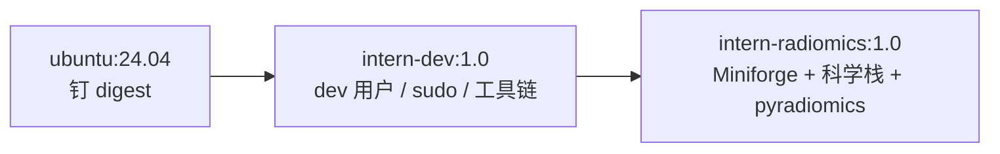

# Day 16｜锁定复现目标 + 镜像 v1

> 今日完成 D16 的步骤 1–2：用 Supplementary Information 把「复现目标」写成
> 可验收的数字，并构建、验证 radiomics 镜像 v1。
> 步骤 3–4（`params.yaml`、`05_extract_features.py`、10 例提取与 QC）尚未开始。

## 今日目标

- 把"要复现什么"写成**可验收的数字**，每一格都有论文原值与出处；
- 构建镜像 v1，容器内跑通 `import radiomics`；
- （未完成）特征提取管线跑通 10 例，产出特征表与每例耗时；
- （未完成）QC：掩膜体积、NaN/inf、特征数量、未匹配 ROI 清单。

## 进度快照

| 步骤 | 状态 | 说明 |
|---|---|---|
| 1. 获取补充材料 | ✅ | Supplementary Information，32 页，Open access |
| 2. `results/repro/target.md` v1.2 | ✅ | 7 项目标值补齐，commit `48e96fb` |
| 3. 同步 `notes/paper-aerts2014.md` | ✅ | 修正 3 处特征定义，同 commit |
| 4. `env/Dockerfile.radiomics` | ✅ | Miniforge + conda-forge + 源码编译 pyradiomics |
| 5. 镜像构建与验证 | ✅ | 4.14 GB；`radiomics v3.0.1 \| numpy 1.26.4`；commit `df4131a` |
| 6. `code/params.yaml` | ⬜ | 待写 |
| 7. `code/05_extract_features.py` | ⬜ | 待写 |
| 8. 10 例提取 + QC | ⬜ | 待跑 |

## 一、补充材料核对（今日最实质的进展）

### 1. 获取情况

| 项 | 内容 |
|---|---|
| 入口 | `https://www.nature.com/articles/ncomms5006#MOESM716` |
| 内容 | Supplementary Methods（特征定义 #1–#55）、Figs 1–4、Tables 1–7 |
| 大小 / 页数 | 1,252,817 B / 32 页 |
| 权限 | Open access，无需登录 |
| 本地 | `data/paper/ncomms5006_supplementary.pdf`（已被 `.gitignore` 排除，不入库） |

### 2. 三处必须修正的认知

| 项 | 之前的理解 | 原文实际 | 影响 |
|---|---|---|---|
| 形状特征 | Compactness（未区分 1/2） | **#16 = Compactness 2**（#15 才是 Compactness 1）；Fig. 1 图注为 `Shape_compactness2` | 选错会使形状特征完全失真 |
| 纹理特征 | 正文写 "Feature 48" | **#47 = Gray Level Non-Uniformity**；#48 是 Run Length Non-Uniformity | 正文与补充材料编号 **off-by-one**，实际取 GLRLM 的 GLN |
| 强度特征 | Figure 4b 写作 "Statistics (Total) Energy" | **#1 = Energy（ΣX²）**，不是 Total Energy | PyRadiomics 的 `TotalEnergy` 会多乘体素体积，量级差约 3 倍 |

### 3. 三项目标值定案

| 项 | 结论 | 出处 |
|---|---|---|
| Lung1 训练集 C-index | **论文未报告**——正文只给三个验证集；Supplementary Table 1 标题即 "Prognostic performance in **validation datasets**"，只含 Lung2 / H&N1 / H&N2 | 正文 + Table 1 |
| 重采样 / spacing | **论文未做重采样**，直接用原始体素（Lung1 层厚 3 mm；Lung3 1.5–5 mm） | Supplementary Methods 全文无 resampling 描述 |
| binWidth | **25 HU**（"equally spaced bins using a bin-width of 25 Hounsfield Units"） | Supplementary Methods, Group 3 |

### 4. 其他确认

- **Cox 权重未公开**：补充材料只给 #1–#55 的数学定义，无拟合系数 → 复现一律在训练折内自拟合，标注「自拟合」；
- **小波参数**：Coiflet 1、离散、一层、非降采样，8 个分解；每次分解计算一阶 + 纹理，与 PyRadiomics `wavelet` 默认一致；
- **纹理方向**：26 邻域、13 方向，每个 3D 特征取 13 方向均值，与 PyRadiomics `distances=[1]` 一致；
- **Fig. 1 的 Lung1 中位数**（可作量纲校验锚点）：
  `Stats_energy` = 1.21×10¹⁰、`Shape_compactness2` = 0.24、
  `RLGL_grayLevelNonuniformity` = 984.67、`Wavelet_HLH_rlgl_...` = 1110.68；
- **Corrigendum**（`10.1038/ncomms5644`）仅为作者姓名拼写更正（Sara Cavalho → Sara Carvalho），**不影响任何数值**；
- **H&N1 样本量内部不一致**：正文 136，Supplementary Table 5 为 135（治疗 100 + 35）；本项目无该队列，仅引用时注明；
- **「440」无法逐项复原**：按编号可数出 55 + 8×47 = 431，与 440 差 9，公开材料无法解释，不作推测。

### 5. `target.md` v1.2 的结构变化

- §2.2 新增 D16 要求的 7 项目标值表（论文原值 / 出处 / 我们的实现 / 结果 / 差异）；
- §2.3 新增 Supplementary Table 1 完整对照（TNM / Volume / Radiomics / 两种联合模型）；
- §3 特征定义改写为 4 列映射表（正文名 / 补充材料编号 / 数学定义 / PyRadiomics 名）；
- §3.1 新增量纲校验锚点，并限定「只能校验、不可当分组阈值」；
- §3.3 新增风险评分公式 `risk = Σβᵢxᵢ`；
- §4 新增方法细节对照表（含指标定义行）；
- §6.1 新增队列画像核对，§6.2 新增临床基线三口径表，§6.6 新增 6 条复现成功判据；
- §9 记录补充材料出处与获取信息。

## 二、队列数据一致性核对

用论文 Table 4 对照 `results/tables/cohort.csv`：

| 项 | 论文 | 本数据集 | 结论 |
|---|---|---|---|
| 男 | 68.7%（290） | 290（68.7%） | 一致 |
| 女 | 31.3%（132） | 132（31.3%） | 一致 |
| I / II / IIIa | 22.0 / 9.5 / 26.5% | 93 / 40 / 112（22.0 / 9.5 / 26.5%） | 一致 |
| IIIb | 41.9% | 176（41.7%） | 差 0.2pp，由 1 例 stage 缺失解释 |

93 + 40 + 112 + 176 = 421，比 422 少 1 例，与 399 分析集排除的 stage 缺失 1 例吻合。
**结论：索引表与论文 Lung1 队列一致，不存在接错队列的风险。**

## 三、镜像 v1

### 1. 分层设计



- `env/Dockerfile`（旧）：开发底座，**不含任何 Python 科学栈**，D12 建立；
- `env/Dockerfile.radiomics`（新）：在底座之上装环境，今日新建；
- 两个 tag 各司其职，重建科学栈时无需重跑 apt 与用户配置。

### 2. 与 Day16 计划模板的偏离（必须记录）

| 项 | 计划模板 | 实际做法 | 原因 |
|---|---|---|---|
| 基础镜像 | `continuumio/miniconda3:24.1.2-0` | `ubuntu:24.04` 固定 digest + 自建 dev 用户，再用 **Miniforge** | Miniconda 在 conda≥25 下会因 `repo.anaconda.com` 的 ToS 预检查直接失败；Miniforge 的默认渠道就是 conda-forge |
| featureClass | 七类（含 glszm / gldm / ngtdm） | **只开 firstorder / shape / glcm / glrlm** | 论文只定义这四类；多开与论文口径不符，且显著拖慢提取 |
| resampledPixelSpacing | `[1, 1, 1]` | **不写（不重采样）** | 补充材料确认论文未重采样；按 1mm 重采样会引入系统性偏移，破坏 D19 的差异归因 |
| binWidth | 25 | 25 | 一致，已有原文出处 |

> 计划模板是通用骨架；三处偏离都以论文原文为准，已在 `target.md` §2.2 / §4 留证。

### 3. 关键技术点

- **Miniforge 替代 Miniconda**：`nodefaults` 只在求解期生效，挡不住 ToS 预检查；
  `conda config --set default_channels` 在新版 conda 已不可写（`CondaKeyError: invalid parameter`）。
- **pyradiomics 3.0.1 源码编译**：无 py3.10 轮子，必须 `versioneer` + `--no-build-isolation`；
  且直接调用 `/opt/conda/envs/radiomics/bin/pip`，不用 `conda run`（后者缓冲输出）。
- **构建期自检**：`RUN python -c "import ...; assert numpy 1.26"`，失败则镜像不生成。
- **架构自适应**：`ARG TARGETARCH` 选择 aarch64 / x86_64 安装包，换服务器不改文件。
- **上下文控制**：`.dockerignore` 排除 `data/`（920 MB），构建上下文降到几 MB。

## 四、验证记录

```text
$ docker images intern-radiomics
intern-radiomics:1.0  f7ee2f9daa9e  4.14GB (disk) / 979MB (content)

$ docker run --rm intern-radiomics:1.0 python -c "import numpy, radiomics, lifelines, sksurv; ..."
radiomics v3.0.1 | numpy 1.26.4

$ docker run --rm -u dev -e HOME=/home/dev intern-radiomics:1.0 bash -lc 'conda env list; which python; python -V'
base        /opt/conda
radiomics   /opt/conda/envs/radiomics
/opt/conda/envs/radiomics/bin/python
Python 3.10.22

$ docker run --rm -u dev -e HOME=/home/dev -v "$PWD":/work -w /work -v "$PWD/data/raw":/data:ro ...
3.0.1
10           ← data/raw/full 有 10 例
WRITE_OK     ← /work 可写
```

说明：`conda env list` 中 `radiomics` 前没有 `*`，因为我们是改 `PATH` 而非 `conda activate`；
`which python` 已指向环境解释器，功能等价。如需严格一致，可补 `ENV CONDA_PREFIX` 与
`ENV CONDA_DEFAULT_ENV`（不影响本项目任何功能，暂未加）。

## 卡点与排查

| # | 现象 | 原因 | 处置 |
|---|---|---|---|
| 1 | `CondaToSNonInteractiveError`（main / r 渠道 ToS） | conda≥25 在求解前对 `default_channels` 做 ToS 预检查 | 换 **Miniforge**（默认渠道即 conda-forge）；`nodefaults` 无效，`conda config --set default_channels` 报 `CondaKeyError` |
| 2 | build 两次在下载/编译阶段无错误中断 | 客户端 `docker build` 被 Ctrl-C 或窗口关闭，buildkit 随即取消 | 改 `nohup ... &` 脱离终端 + `caffeinate -dis` 防休眠 + `--progress=plain` |
| 3 | 编译阶段日志长时间无输出 | `conda run` 缓冲子进程 stdout | 改用 `/opt/conda/envs/radiomics/bin/pip` 直接调用 |
| 4 | 构建上下文可能达 920 MB | `data/raw` 默认会被打包 | 根目录 `.dockerignore` 排除 `data/`，并补 `journal`、`notes`、`*.pdf` |
| 5 | 本机 `CONDA_PREFIX` 被改成容器路径 | 误把 Dockerfile 的 `ENV ...` 粘进终端执行 | `unset CONDA_PREFIX CONDA_DEFAULT_ENV CONDA_SHLVL && conda activate base` |

经验：**"日志不动"不能判定死活**。唯一可靠判据是 `docker ps` 里有没有 buildkit 容器；
`conda run`、`conda` 的 `\r` 进度条都会让日志看起来冻结。

## 产出文件

| 文件 | 内容 |
|---|---|
| `results/repro/target.md` | 复现目标 v1.2：7 项目标值、特征映射、方法对照、成功判据 |
| `notes/paper-aerts2014.md` | 论文笔记同步：特征定义修正、Table 1 对照、待核实清单关闭 |
| `env/Dockerfile.radiomics` | radiomics 镜像层（Miniforge + 源码编译 pyradiomics + 自检） |
| `env/environment.docker.yml` | 镜像用依赖清单（conda-forge + nodefaults，去掉 jupyter/seaborn） |
| `.dockerignore` | 补 `journal`、`notes`、`*.pdf` |
| `data/paper/ncomms5006_supplementary.pdf` | 补充材料（本地，不入库） |
| `logs/build2.log` / `build3.log` / `build4.log` | 三次构建日志，保留中断现场（本地，已被 `logs/*.log` 忽略） |

## 环境与运行

```bash
# 构建（上下文必须是项目根目录）
docker build --progress=plain -f env/Dockerfile.radiomics -t intern-radiomics:1.0 .

# 验收
docker run --rm intern-radiomics:1.0 python -c \
  "import numpy, radiomics, lifelines, sksurv; print(radiomics.__version__, numpy.__version__)"

# 交互式进入（代码与数据都挂载，镜像只装环境）
docker run --rm -it -u dev -e HOME=/home/dev \
  -v "$PWD":/work -w /work -v "$PWD/data/raw":/data:ro \
  intern-radiomics:1.0 bash
```

## 验收对照（Day 16）

| 验收标准 | 状态 | 证据 |
|---|---|---|
| `target.md` 所有"论文原值"格都填了且标了出处 | ✅ | 7 项均填，含「未报告 / N/A」的显式结论 |
| 镜像能跑通 `import radiomics` | ✅ | `radiomics v3.0.1 \| numpy 1.26.4`；另验证 lifelines / sksurv |
| 10 例特征表生成，无 NaN | ⬜ | 待步骤 3 |
| 每例耗时有记录，能外推全量时间 | ⬜ | 待步骤 3 |
| 未匹配 ROI 清单已产出（预期含 LUNG1-128） | ⬜ | 待步骤 3 |

## 今日结论

- 复现目标的关键不是"抄数字"，而是**把每个数字的出处钉死**：本轮补齐 7 项后，
  唯一缺失的 Lung1 训练集 C-index 被明确判定为「论文未报告」，
  而不是留一个待查占位符；
- 论文与补充材料之间存在**编号不一致**（正文 "Feature 48" vs 补充材料 #47 GLN），
  正确做法是如实记录、按 Fig. 1 图注取特征本体，而不是替作者圆整；
- 论文**未重采样、未归一化**，这与常见做法相反，直接决定了 `params.yaml` 的写法；
- 镜像构建的难点不在 Python 包，而在 **conda 25 的 ToS 机制**；
  绕开（Miniforge）比接受条款更合适，也更适合放进可复现的 Dockerfile；
- `target.md` 已能回答"复现成功与否"：量纲校验 + 方向一致 + CV CI 不含 0.5 +
  同集比较 + 五类差异归因，六条都可验收。

## 待办（D16 剩余）

1. 写 `code/params.yaml`：binWidth 25、`normalize: false`、四类特征、不写 `resampledPixelSpacing`；
2. 写 `code/05_extract_features.py`：RTSTRUCT → mask、`normalize_roi()` 容错、逐例计时、失败不中断；
3. 跑 `data/raw/full` 的 10 例，产出 `results/tables/features_10.csv` + 计时表；
4. QC 四项：掩膜体积 vs D13 的 Slicer、NaN/inf、特征数量、4 个特征中位数 vs Fig. 1；
5. 产出未匹配 ROI 清单（预期含 `LUNG1-128`，其 ROI 名为 `gtv-pre-operat`；
   已在 `results/tables/gtv_volume_check.csv` 中标注「D16 alias fix」）；
6. 回填 `journal/INDEX.md` 的 D16 行；
7. 收尾 commit：`day16: 复现目标定义、镜像 v1 与 10 例特征提取`
   （步骤 1–2 已分别提交为 `48e96fb`、`df4131a`）。
