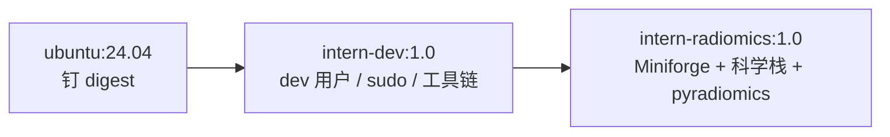
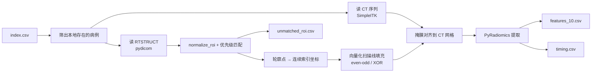

# Day 16｜锁定复现目标 + 镜像 v1 + 管线跑通 10 例

> 今日完成 D16 四步：用 Supplementary Information 把「复现目标」写成可验收的数字；
> 构建并验证 radiomics 镜像 v1；写参数文件与提取脚本；在容器内跑通 10 例并完成 QC。

## 今日目标

- 把"要复现什么"写成**可验收的数字**，每一格都有论文原值与出处；
- 构建镜像 v1，容器内跑通 `import radiomics`；
- 特征提取管线跑通 10 例，产出特征表与每例耗时；
- QC：掩膜体积、NaN/inf、特征数量、未匹配 ROI 清单。

## 进度快照

| 步骤 | 状态 | 说明 |
|---|---|---|
| 1. 获取补充材料 | ✅ | Supplementary Information，32 页，Open access |
| 2. `results/repro/target.md` v1.2 | ✅ | 7 项目标值补齐，commit `48e96fb` |
| 3. 同步 `notes/paper-aerts2014.md` | ✅ | 修正 3 处特征定义，同 commit |
| 4. `env/Dockerfile.radiomics` | ✅ | Miniforge + conda-forge + 源码编译 pyradiomics |
| 5. 镜像构建与验证 | ✅ | 4.14 GB；`radiomics v3.0.1 \| numpy 1.26.4`；commit `df4131a` |
| 6. `code/params.yaml` | ✅ | binWidth 25、不重采样、四类 + Wavelet |
| 7. `code/05_extract_features.py` | ✅ | RTSTRUCT 栅格化、ROI 容错、逐例计时、失败不中断 |
| 8. 10 例提取 + QC | ✅ | 10/10 成功，0 NaN，容器内 22.4 s/例 |

## 一、补充材料核对（今日最实质的进展）

### 1. 获取情况

| 项 | 内容 |
|---|---|
| 入口 | `https://www.nature.com/articles/ncomms5006#MOESM716` |
| 内容 | Supplementary Methods（特征定义 #1–#55）、Figs 1–4、Tables 1–7 |
| 大小 / 页数 | 1,252,817 B / 32 页 |
| 权限 | Open access，无需登录 |
| 本地 | `data/paper/ncomms5006_supplementary.pdf`（已被 `.gitignore` 排除，不入库） |

### 2. 三处必须修正的认知

| 项 | 之前的理解 | 原文实际 | 影响 |
|---|---|---|---|
| 形状特征 | Compactness（未区分 1/2） | **#16 = Compactness 2**（#15 才是 Compactness 1）；Fig. 1 图注为 `Shape_compactness2` | 选错会使形状特征完全失真 |
| 纹理特征 | 正文写 "Feature 48" | **#47 = Gray Level Non-Uniformity**；#48 是 Run Length Non-Uniformity | 正文与补充材料编号 **off-by-one**，实际取 GLRLM 的 GLN |
| 强度特征 | Figure 4b 写作 "Statistics (Total) Energy" | **#1 = Energy（ΣX²）**，不是 Total Energy | PyRadiomics 的 `TotalEnergy` 会多乘体素体积，量级差约 3 倍 |

### 3. 三项目标值定案

| 项 | 结论 | 出处 |
|---|---|---|
| Lung1 训练集 C-index | **论文未报告**——正文只给三个验证集；Supplementary Table 1 标题即 "Prognostic performance in **validation datasets**"，只含 Lung2 / H&N1 / H&N2 | 正文 + Table 1 |
| 重采样 / spacing | **论文未做重采样**，直接用原始体素（Lung1 层厚 3 mm；Lung3 1.5–5 mm） | Supplementary Methods 全文无 resampling 描述 |
| binWidth | **25 HU**（"equally spaced bins using a bin-width of 25 Hounsfield Units"） | Supplementary Methods, Group 3 |

### 4. 其他确认

- **Cox 权重未公开**：补充材料只给 #1–#55 的数学定义，无拟合系数 → 复现一律在训练折内自拟合，标注「自拟合」；
- **小波参数**：Coiflet 1、离散、一层、非降采样，8 个分解；每次分解计算一阶 + 纹理，与 PyRadiomics `wavelet` 默认一致；
- **纹理方向**：26 邻域、13 方向，每个 3D 特征取 13 方向均值，与 PyRadiomics `distances=[1]` 一致；
- **Fig. 1 的 Lung1 中位数**（可作量纲校验锚点）：
  `Stats_energy` = 1.21×10¹⁰、`Shape_compactness2` = 0.24、
  `RLGL_grayLevelNonuniformity` = 984.67、`Wavelet_HLH_rlgl_...` = 1110.68；
- **Corrigendum**（`10.1038/ncomms5644`）仅为作者姓名拼写更正（Sara Cavalho → Sara Carvalho），**不影响任何数值**；
- **H&N1 样本量内部不一致**：正文 136，Supplementary Table 5 为 135（治疗 100 + 35）；本项目无该队列，仅引用时注明；
- **「440」无法逐项复原**：按编号可数出 55 + 8×47 = 431，与 440 差 9，公开材料无法解释，不作推测。

### 5. `target.md` v1.2 的结构变化

- §2.2 新增 D16 要求的 7 项目标值表（论文原值 / 出处 / 我们的实现 / 结果 / 差异）；
- §2.3 新增 Supplementary Table 1 完整对照（TNM / Volume / Radiomics / 两种联合模型）；
- §3 特征定义改写为 4 列映射表（正文名 / 补充材料编号 / 数学定义 / PyRadiomics 名）；
- §3.1 新增量纲校验锚点，并限定「只能校验、不可当分组阈值」；
- §3.3 新增风险评分公式 `risk = Σβᵢxᵢ`；
- §4 新增方法细节对照表（含指标定义行）；
- §6.1 新增队列画像核对，§6.2 新增临床基线三口径表，§6.6 新增 6 条复现成功判据；
- §9 记录补充材料出处与获取信息。

## 二、队列数据一致性核对

用论文 Table 4 对照 `results/tables/cohort.csv`：

| 项 | 论文 | 本数据集 | 结论 |
|---|---|---|---|
| 男 | 68.7%（290） | 290（68.7%） | 一致 |
| 女 | 31.3%（132） | 132（31.3%） | 一致 |
| I / II / IIIa | 22.0 / 9.5 / 26.5% | 93 / 40 / 112（22.0 / 9.5 / 26.5%） | 一致 |
| IIIb | 41.9% | 176（41.7%） | 差 0.2pp，由 1 例 stage 缺失解释 |

93 + 40 + 112 + 176 = 421，比 422 少 1 例，与 399 分析集排除的 stage 缺失 1 例吻合。
**结论：索引表与论文 Lung1 队列一致，不存在接错队列的风险。**

## 三、镜像 v1

### 概述：它是什么、做了什么、怎么搭的

**一句话**：把一个能在任何机器上复现的 PyRadiomics 运行环境固化成 Docker 镜像，
镜像只装依赖、不装代码和数据。

**要解决什么**：项目要用 PyRadiomics 3.0.1 + numpy 1.26 + SimpleITK + lifelines +
scikit-survival 跑特征提取与生存建模；这套组合在本机 conda 里调通容易，换台机器
（例如实习的 Linux 服务器）就未必。`Dockerfile.radiomics` 把这份环境写成可重建的配方，
产出 `intern-radiomics:1.0`，保证"我这儿能跑"和"别人那儿能跑"是同一套依赖。

**做了什么**：在已有的开发底座（ubuntu 24.04 固定 digest + 非 root 用户 `dev` + sudo +
`/work`）之上，安装 Miniforge，用 conda-forge 建 `python 3.10 / numpy 1.26` 的
`radiomics` 环境，再**从源码编译 pyradiomics 3.0.1**（该版本无 py3.10 轮子），
最后加一条构建期自检——`import radiomics / lifelines / sksurv` 且断言 numpy 为 1.26，
任一失败镜像就不生成。成品 4.14 GB，容器内验证输出 `radiomics v3.0.1 | numpy 1.26.4`。

**怎么搭起来的**：三层决策。

1. **分层**：复用 D12 的 `intern-dev:1.0` 作为第一层，只在其上追加科学栈。
   底座几乎不变，重建环境时不用重跑 apt 与用户配置。
2. **换 Miniforge**：conda ≥ 25 会对 `repo.anaconda.com` 做 ToS 预检查，容器里没有
   "点同意"的途径；`nodefaults` 只在求解期生效、`conda config --set default_channels`
   已被禁用，所以直接改用默认渠道即 conda-forge 的 Miniforge——绕开而不是接受条款。
3. **绕开两个已知坑**：pyradiomics 必须"先装 versioneer、再 `--no-build-isolation`"
   才能编译；且用 `/opt/conda/envs/radiomics/bin/pip` 直接调用，而不是 `conda run`
   ——后者会缓冲输出，让编译期日志完全静默，无法判断死活。

两个补充细节：`ARG TARGETARCH` 自动在 aarch64 / x86_64 之间切换安装包，
将来上 x86 服务器不用改文件；根目录 `.dockerignore` 排除 `data/`，
把构建上下文从 920 MB 压到几 MB。

验证方式与真实输出见 §四：镜像体积、三项 import、`conda env list` 与 `which python`、
数据挂载与工作区写入，四项均已通过。

### 1. 分层设计



- `env/Dockerfile`（旧）：开发底座，**不含任何 Python 科学栈**，D12 建立；
- `env/Dockerfile.radiomics`（新）：在底座之上装环境，今日新建；
- 两个 tag 各司其职，重建科学栈时无需重跑 apt 与用户配置。

### 2. 与 Day16 计划模板的偏离（必须记录）

| 项 | 计划模板 | 实际做法 | 原因 |
|---|---|---|---|
| 基础镜像 | `continuumio/miniconda3:24.1.2-0` | `ubuntu:24.04` 固定 digest + 自建 dev 用户，再用 **Miniforge** | Miniconda 在 conda≥25 下会因 `repo.anaconda.com` 的 ToS 预检查直接失败；Miniforge 的默认渠道就是 conda-forge |
| featureClass | 七类（含 glszm / gldm / ngtdm） | **只开 firstorder / shape / glcm / glrlm** | 论文只定义这四类；多开与论文口径不符，且显著拖慢提取 |
| resampledPixelSpacing | `[1, 1, 1]` | **不写（不重采样）** | 补充材料确认论文未重采样；按 1mm 重采样会引入系统性偏移，破坏 D19 的差异归因 |
| binWidth | 25 | 25 | 一致，已有原文出处 |

> 计划模板是通用骨架；三处偏离都以论文原文为准，已在 `target.md` §2.2 / §4 留证。

### 3. 关键技术点

- **Miniforge 替代 Miniconda**：`nodefaults` 只在求解期生效，挡不住 ToS 预检查；
  `conda config --set default_channels` 在新版 conda 已不可写（`CondaKeyError: invalid parameter`）。
- **pyradiomics 3.0.1 源码编译**：无 py3.10 轮子，必须 `versioneer` + `--no-build-isolation`；
  且直接调用 `/opt/conda/envs/radiomics/bin/pip`，不用 `conda run`（后者缓冲输出）。
- **构建期自检**：`RUN python -c "import ...; assert numpy 1.26"`，失败则镜像不生成。
- **架构自适应**：`ARG TARGETARCH` 选择 aarch64 / x86_64 安装包，换服务器不改文件。
- **上下文控制**：`.dockerignore` 排除 `data/`（920 MB），构建上下文降到几 MB。

## 四、验证记录

```text
$ docker images intern-radiomics
intern-radiomics:1.0  f7ee2f9daa9e  4.14GB (disk) / 979MB (content)

$ docker run --rm intern-radiomics:1.0 python -c "import numpy, radiomics, lifelines, sksurv; ..."
radiomics v3.0.1 | numpy 1.26.4

$ docker run --rm -u dev -e HOME=/home/dev intern-radiomics:1.0 bash -lc 'conda env list; which python; python -V'
base        /opt/conda
radiomics   /opt/conda/envs/radiomics
/opt/conda/envs/radiomics/bin/python
Python 3.10.22

$ docker run --rm -u dev -e HOME=/home/dev -v "$PWD":/work -w /work -v "$PWD/data/raw":/data:ro ...
3.0.1
10           ← data/raw/full 有 10 例
WRITE_OK     ← /work 可写
```

说明：`conda env list` 中 `radiomics` 前没有 `*`，因为我们是改 `PATH` 而非 `conda activate`；
`which python` 已指向环境解释器，功能等价。如需严格一致，可补 `ENV CONDA_PREFIX` 与
`ENV CONDA_DEFAULT_ENV`（不影响本项目任何功能，暂未加）。

## 五、10 例提取与 QC

### 概述：这套管线在做什么、怎么搭的

**一句话**：把「检查报告里的 GTV 轮廓变成一行影像组学特征」这件事，拆成
「参数文件 + 提取脚本 + 三张结果表」，让 10 例能在容器内一键跑通，并自带质控证据。

**四个产出分别做什么**

| 文件 | 它解决的问题 | 实际内容 |
|---|---|---|
| `code/params.yaml` | **算什么、按什么口径算** | binWidth 25、normalize false、Original + Wavelet、四类特征、label 1；**不写重采样** |
| `code/05_extract_features.py` | **怎么算、算不出来怎么办** | 读索引 → 读 CT → 读 RTSTRUCT → 匹配 ROI → 栅格化 → 提取 → 记录耗时与失败 |
| `results/tables/features_10.csv` | **结果本体** | 10 行 × 538 列（PatientID + 537 个特征，其中 1 个为补算的 Compactness2） |
| `results/tables/features_10_timing.csv` | **成本与几何证据** | 每例耗时、掩膜体素与体积，用于外推全量时间、对照 Slicer |
| `results/tables/unmatched_roi.csv` | **匹配失败清单** | 本次为空表：10 例全部命中，LUNG1-128 靠别名匹配 |

**数据流**



**六条搭建思路**

1. **参数先对齐论文，再写代码**：`params.yaml` 每条都有出处（`target.md` §2.2/§4）。
   先定参数，避免"跑完才发现口径错了"。
2. **ROI 匹配做成"容错 + 有优先级"**：`normalize_roi()` 去掉大小写/连字符/下划线，
   把 `GTV-1`、`GTV1`、`gtv_1` 归一到 `gtv1`；再按 `gtv1` > 含 `pre` 的别名 >
   唯一 `gtv*` 的顺序挑。LUNG1-128 的 `gtv-pre-operat` 靠第二优先级命中。
3. **栅格化自己实现，不引依赖**：镜像里没有 rt-utils / dcmqi，于是用 pydicom 读轮廓点、
   SimpleITK 把毫米坐标转索引坐标、numpy 做向量化扫描线填充（even-odd）。
   同一层多轮廓用 XOR 合并，天然支持孔洞；掩膜与 CT 天然同网格。
4. **失败不中断，但必须留痕**：每例单独 try/except，失败写入
   `features_10_failures.csv`（本次 0 例），未匹配单独汇总。
   批处理最怕"第 7 例挂了、前 6 例白跑"。
5. **QC 内置在脚本里**：跑完自动打印特征总数与构成、NaN/inf 计数、平均耗时与外推时间、
   4 个 signature 特征与论文中位数的比值——每次重跑都自带一份质检报告。
6. **处理论文没提、但必须处理的实现差异**：PyRadiomics 3.x 删掉了 Compactness1/2，
   而 signature 第 2 个特征正是 Compactness 2；用 `36π·V²/A³` 从 MeshVolume 与
   SurfaceArea 现算，列名加 `_derived`，**补算并标注**而不是换库或假装不存在。

**这套东西的价值**：不只是"跑出 10 行数字"，而是建立一条可重复、可审计、
可扩展到 422 例的链路——参数有出处、ROI 匹配有清单、失败有记录、耗时能外推、
异常有解释。D17 只需去掉 `--limit 10`（或分批），产出的表即可直接进 D18 建模。

具体结果见下面 1–5 节。

### 1. 总览（容器内正式结果）

| 指标 | 本机（预跑） | **容器（正式）** |
|---|---|---|
| 成功 / 总数 | 10 / 10 | **10 / 10** |
| 特征数 / 例 | 537 | **537** |
| NaN / inf | 0 | **0** |
| 总耗时 | 89.8 s | **224.4 s** |
| 单例均值 | 9.0 s | **22.4 s** |
| 外推 422 例 | ≈ 63 min | **≈ 158 min** |

两侧的掩膜体积完全相同，特征值在浮点误差内一致（最大相对差 1.5×10⁻¹¹，
来自 osx-arm64 与 linux-aarch64 的 ITK 数值差异），说明管线确定、容器化没有改变结果。

耗时逐次波动约 ±2 s（同一例两次运行 27.2–27.6 s），不影响外推结论；
上表数字对应 `features_10_timing.csv` 的当前版本。

**容器比本机慢约 2.4 倍**：Linux aarch64 跑在 Docker Desktop 的 VM 里，
ITK 计算与 virtiofs 读取 DICOM 都有开销。结论：D17 跑全量优先用本机原生或服务器，
容器用于环境一致性验证（10 例已证明等价）。

### 2. 逐例结果

| # | 病例 | 选中 ROI | 掩膜体积 (cm³) | 提取 (s) | 合计 (s) |
|---:|---|---|---:|---:|---:|
| 1 | LUNG1-001 | GTV-1 | 156.2 | 27.2 | 28.2 |
| 2 | LUNG1-009 | GTV-1 | 98.5 | 20.0 | 21.0 |
| 3 | LUNG1-010 | GTV-1 | 16.1 | 15.8 | 16.6 |
| 4 | LUNG1-014 | GTV-1 | 8.5 | 15.1 | 15.8 |
| 5 | LUNG1-021 | GTV-1 | 209.2 | 39.6 | 40.8 |
| 6 | LUNG1-085 | GTV-1 | 12.1 | 19.0 | 20.6 |
| 7 | LUNG1-103 | GTV-1 | 8.9 | 20.7 | 21.9 |
| 8 | LUNG1-128 | **gtv-pre-op**（别名） | 2.8 | 18.4 | 19.0 |
| 9 | LUNG1-203 | GTV-1 | 26.0 | 19.9 | 20.7 |
| 10 | LUNG1-217 | GTV-1 | 176.9 | 19.0 | 19.9 |

特征构成（每例 537）：original 73（firstorder 18 / glcm 24 / glrlm 16 / shape 15）
+ wavelet 464（8 个分解 × 58）。

### 3. 掩膜体积 vs D13 的 Slicer 值

| 病例 | 本管线 (cm³) | Slicer (cm³) | 相对差 | D13 备注 |
|---|---:|---:|---:|---|
| LUNG1-001 | 156.2 | 156.3 | **−0.07%** | 几何干净 |
| LUNG1-128 | 2.76 | 2.73 | **+1.2%** | 别名病例 |
| LUNG1-021 | 209.2 | 214.3 | −2.4% | 缺 1 层 |
| LUNG1-014 | 8.54 | 9.57 | −10.7% | geometry suspect |
| LUNG1-085 | 12.11 | 16.56 | −26.9% | 缺 10 层、拉伸网格 |

差异全部集中在 D13 已标注几何异常的病例，方向一致（Slicer 因补层而偏大），
**不是栅格化错误**；两例几何干净的相差 <1.3%。

### 4. 4 个 signature 特征（量纲校验）

| 特征 | 本批中位数 | 论文 Fig. 1 | 比值 |
|---|---:|---:|---:|
| `original_firstorder_Energy` | 4.245×10⁸ | 1.213×10¹⁰ | **×0.03** |
| `original_shape_Compactness2_derived` | 0.1813 | 0.24 | ×0.76 |
| `original_glrlm_GrayLevelNonUniformity` | 508.9 | 984.7 | ×0.52 |
| `wavelet-HLH_glrlm_GrayLevelNonUniformity` | 1059 | 1111 | ×0.95 |

### 5. 两个新发现

**(1) PyRadiomics 3.x 移除了 Compactness1/2**
shape 只剩 14 个特征，`original_shape_Compactness2` 不存在。已改为用
`MeshVolume` 与 `SurfaceArea` 现算 `36π·V²/A³`，列名带 `_derived`；
`target.md` §3 已标注。

**(2) Energy 差 30 倍，其余三个特征同量级**
Energy 是唯一对"灰度零点"敏感的求和量。LUNG1-001 若把 HU 加 1024
（即未减 DICOM rescale intercept 的存储值），ΣX² 从 2.28×10⁹ 变为 5.29×10¹⁰，
量级进入 10¹⁰，提示论文可能在**未转成 HU 的存储像素值**上计算 Energy。
已写入 `target.md` §4 的残余差异，待 D17 全量确认。

### 6. 本批样本的局限

这 10 例是 D10/D11 小样本阶段下载的，**不是随机抽样**：

- 体积跨度 2.8–209.2 cm³，中位数约 21 cm³，但 3 例 >150 cm³，分布很偏；
- `LUNG1-085` 有 5 个 GTV 相关 ROI（`gtv-2_4r`、`gtv_3_2l2`…），提示多病灶，
  我们取 `GTV-1`，与论文"单原发灶"假设未必一致；
- 因此上述中位数只能作为「同量级」证据，**不能当作 Lung1 的代表值**，
  更不能据此声称数值复现。

## 六、参数文件与计划模板的偏离

`code/params.yaml` 与 Day16 模板有三处不同，均以论文原文为准
（`target.md` §2.2 / §4 有出处）：

| 项 | 计划模板 | 实际 | 原因 |
|---|---|---|---|
| `resampledPixelSpacing` / `interpolator` | `[1,1,1]` / `sitkBSpline` | **不写** | 论文未重采样；1 mm 重采样会引入系统偏移，破坏 D19 的差异归因 |
| `featureClass` | 七类（含 glszm / gldm / ngtdm） | **四类** + Wavelet | 论文只定义 firstorder / shape / glcm / glrlm |
| Compactness 2 | 模板未提 | **脚本补算** | PyRadiomics 3.x 已移除该特征，用 `36πV²/A³` 现算 |

`binWidth: 25`、`normalize: false`、`label: 1` 与模板一致。模板本身要求
"这些参数必须在 `target.md` 里对齐论文/文献"，因此上述偏离是**对齐的结果**，
不是随意改动。

## 卡点与排查

| # | 现象 | 原因 | 处置 |
|---|---|---|---|
| 1 | `CondaToSNonInteractiveError`（main / r 渠道 ToS） | conda≥25 在求解前对 `default_channels` 做 ToS 预检查 | 换 **Miniforge**（默认渠道即 conda-forge）；`nodefaults` 无效，`conda config --set default_channels` 报 `CondaKeyError` |
| 2 | build 两次在下载/编译阶段无错误中断 | 客户端 `docker build` 被 Ctrl-C 或窗口关闭，buildkit 随即取消 | 改 `nohup ... &` 脱离终端 + `caffeinate -dis` 防休眠 + `--progress=plain` |
| 3 | 编译阶段日志长时间无输出 | `conda run` 缓冲子进程 stdout | 改用 `/opt/conda/envs/radiomics/bin/pip` 直接调用 |
| 4 | 构建上下文可能达 920 MB | `data/raw` 默认会被打包 | 根目录 `.dockerignore` 排除 `data/`，并补 `journal`、`notes`、`*.pdf` |
| 5 | 本机 `CONDA_PREFIX` 被改成容器路径 | 误把 Dockerfile 的 `ENV ...` 粘进终端执行 | `unset CONDA_PREFIX CONDA_DEFAULT_ENV CONDA_SHLVL && conda activate base` |

经验：**"日志不动"不能判定死活**。唯一可靠判据是 `docker ps` 里有没有 buildkit 容器；
`conda run`、`conda` 的 `\r` 进度条都会让日志看起来冻结。

## 产出文件

| 文件 | 内容 |
|---|---|
| `results/repro/target.md` | 复现目标 v1.2：7 项目标值、特征映射、方法对照、成功判据 |
| `notes/paper-aerts2014.md` | 论文笔记同步：特征定义修正、Table 1 对照、待核实清单关闭 |
| `env/Dockerfile.radiomics` | radiomics 镜像层（Miniforge + 源码编译 pyradiomics + 自检） |
| `env/environment.docker.yml` | 镜像用依赖清单（conda-forge + nodefaults，去掉 jupyter/seaborn） |
| `code/params.yaml` | 与论文对齐的提取参数（binWidth 25、不重采样、四类 + Wavelet） |
| `code/05_extract_features.py` | RTSTRUCT → mask、ROI 名容错、逐例计时、失败不中断 |
| `results/tables/features_10.csv` | 10 例 × 537 特征 |
| `results/tables/features_10_timing.csv` | 每例耗时、掩膜体素与体积 |
| `results/tables/unmatched_roi.csv` | 未匹配清单（本次为空：10 例全部命中） |
| `.dockerignore` | 补 `journal`、`notes`、`*.pdf` |
| `data/paper/ncomms5006_supplementary.pdf` | 补充材料（本地，不入库） |
| `logs/build2.log` / `build3.log` / `build4.log` | 三次构建日志，保留中断现场（本地，已被 `logs/*.log` 忽略） |

## 环境与运行

镜像 `intern-radiomics:1.0`（ID `f7ee2f9daa9e`）内的版本：

| 组件 | 版本 |
|---|---|
| Python | 3.10.22 |
| numpy | 1.26.4 |
| SimpleITK | 2.5.6（用于序列读取与物理坐标→索引换算） |
| pydicom | 3.0.2（用于解析 RTSTRUCT） |
| pyradiomics | 3.0.1（源码编译） |
| lifelines / scikit-survival | 随 conda 环境安装 |

掩膜实现方式：**pydicom 解析轮廓 + SimpleITK 坐标换算 + numpy 向量化扫描线填充**
（未用 rt-utils / dcmqi；生成的是同一网格上的 even-odd 掩膜）。

```bash
# 构建（上下文必须是项目根目录）
docker build --progress=plain -f env/Dockerfile.radiomics -t intern-radiomics:1.0 .

# 验收
docker run --rm intern-radiomics:1.0 python -c \
  "import numpy, radiomics, lifelines, sksurv; print(radiomics.__version__, numpy.__version__)"

# 10 例提取（正式结果由这条产生）
docker run --rm -u dev -e HOME=/home/dev \
  -v "$PWD":/work -w /work \
  -v "$PWD/data/raw":/data:ro \
  intern-radiomics:1.0 \
  python code/05_extract_features.py --limit 10

# 交互式进入（代码与数据都挂载，镜像只装环境）
docker run --rm -it -u dev -e HOME=/home/dev \
  -v "$PWD":/work -w /work -v "$PWD/data/raw":/data:ro \
  intern-radiomics:1.0 bash
```

## 验收对照（Day 16）

| 验收标准 | 状态 | 证据 |
|---|---|---|
| `target.md` 所有"论文原值"格都填了且标了出处 | ✅ | 7 项均填，含「未报告 / N/A」的显式结论 |
| 镜像能跑通 `import radiomics` | ✅ | `radiomics v3.0.1 \| numpy 1.26.4`；另验证 lifelines / sksurv |
| 10 例特征表生成，无 NaN | ✅ | `features_10.csv`，10 × 537，非有限值 0 |
| 每例耗时有记录，能外推全量时间 | ✅ | `features_10_timing.csv`；22.4 s/例 → 422 例约 158 min |
| 未匹配 ROI 清单已产出（预期含 LUNG1-128） | ✅ | `unmatched_roi.csv` 为空：`normalize_roi()` 把 `gtv-pre-operat` 匹配成功 |

## 今日结论

- 复现目标的关键不是"抄数字"，而是**把每个数字的出处钉死**：本轮补齐 7 项后，
  唯一缺失的 Lung1 训练集 C-index 被明确判定为「论文未报告」，
  而不是留一个待查占位符；
- 论文与补充材料之间存在**编号不一致**（正文 "Feature 48" vs 补充材料 #47 GLN），
  正确做法是如实记录、按 Fig. 1 图注取特征本体，而不是替作者圆整；
- 论文**未重采样、未归一化**，这与常见做法相反，直接决定了 `params.yaml` 的写法；
- 镜像构建的难点不在 Python 包，而在 **conda 25 的 ToS 机制**；
  绕开（Miniforge）比接受条款更合适，也更适合放进可复现的 Dockerfile；
- `target.md` 已能回答"复现成功与否"：量纲校验 + 方向一致 + CV CI 不含 0.5 +
  同集比较 + 五类差异归因，六条都可验收；
- 管线在容器与本机给出**在浮点误差内一致**的特征值（掩膜体积完全相同，
  最大相对差 1.5×10⁻¹¹），说明环境可复现；但容器单例 22.4 s 比本机 9.0 s 慢约 2.5 倍，
  D17 全量应优先本机原生或服务器，容器保留作一致性验证；
- 10 例是历史小样本，**不是随机抽样**（体积 2.8–209.2 cm³，含多病灶病例），
  因此中位数对照只能证明"同量级"，不能证明"数值复现"；
- PyRadiomics 3.x 移除 Compactness1/2 是一个必须显式处理的实现差异——
  用 `36πV²/A³` 补算并在文档中标注，比直接换库或忽略更稳妥；
- Energy 与论文相差约 30 倍，而其余三个特征在 0.5–1.0 倍内；
  "+1024 偏移"能把量级拉回 10¹⁰，提示差异来自**灰度零点**而非算法错误，
  这是 D19/D20 归因的第一条实证线索。

## 待办（D17 开工前）

1. 回填 `journal/INDEX.md` 的 D16 行；
2. 收尾 commit：`day16: 复现目标定义、镜像 v1 与 10 例特征提取`
   （步骤 1–2 已分别提交为 `48e96fb`、`df4131a`）；
3. D17 全量 422 例：优先本机原生或服务器（容器内约 158 min）；
   运行前先确认磁盘与中断策略（`nohup` + 日志），并保留 `--limit` 分批能力；
4. D17 顺带做两件加分项：
   - 用 SEG 与 RTSTRUCT 掩膜做一次 Dice 对照（2 例即可），独立验证栅格化；
   - 用全量数据复核 Energy 的 +1024 偏移假设，确认后写入 `target.md` 差异表。
