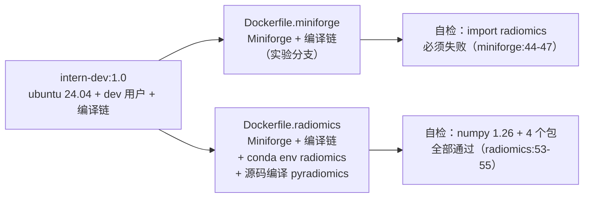

# Day 17｜全量 422 例特征提取

> 今日目标：把 D16 跑通的 10 例管线放大到 422 例，做到可续跑、有质控、结果可复算。
> 本文件随当天进度更新：开工前先完成「运行环境核对」（§一），提取与 QC 待执行。

## 今日目标

- 把 `code/05_extract_features.py` 从「取前 10 例」扩成「全量 + 并行 + 幂等续跑」；
- 在 `intern-radiomics:1.0` 内跑完 422 例，产出 `features_all.csv`；
- 写 `code/06_qc_features.py`：行数校验、缺失率、零方差、分布直方图；
- 抽 5 例用 `--jobs 1` 复算，证明并行不引入差异；
- 产出 `features_qc.md` 与 `logs/`，当日 commit。

## 进度快照

| 步骤 | 状态 | 说明 |
|---|---|---|
| 0. 运行环境核对 | ✅ | 确认用 `intern-radiomics:1.0`；`Dockerfile.miniforge` 只是调试底座（§一） |
| 1. 并行化 + 幂等改造 | ✅ | `--all` / `--jobs` / 逐例缓存已实现，2 例小样本验证通过（§二） |
| 1b. 数据落地 | ✅ | 190 → 本机 `data/raw/full`，26 GiB（排除 SEG），8.0 MB/s、约 56 min |
| 1c. 并行度定档 | ✅ | 实测 2 进程在 8 GB 下必 OOM；12 GB 调整失败，**改用 1 进程**（§二.4/§二.6）；1 进程仍 OOM，见 1f |
| 1d. 容器首跑（2 进程） | ❌ | 35 例成功后进程池被 OOM 杀死，388 例标记失败；`--expect` 拦截（§二.5） |
| 1e. Docker Desktop 启动失败 | ✅ | 已恢复（Docker Desktop 4.97.0，linux/arm64）；`MemTotal` 仍 8 GB，决定不再调内存 |
| 1f. 第二跑（1 进程）仍 OOM | ❌ | 62 例成功后死在 LUNG1-058；`OOMKilled=true`，说明问题不是进程数（§二.7） |
| 2. 全量 422 例提取 | 🟡 | 待"分块重建进程池"后重跑，缓存可续（62 例已完成） |
| 3. `code/06_qc_features.py` | ✅ | 已实现并用 35 行残缺表验证（§三）；待全量后正式运行 |
| 4. 5 例 `--jobs 1` 复算 | ⬜ | 一致性证据 |
| 5. `results/tables/features_qc.md` | ⬜ | 缺失与剔除记录 |
| 6. INDEX 回填 + 收尾 commit | 🟡 | 本文件已建，结果待填 |

## 一、运行环境核对：为什么今天只能用 Dockerfile.radiomics

### 1. 结论

今天全量提取与质控的**唯一运行镜像是 `intern-radiomics:1.0`**（由 `env/Dockerfile.radiomics` 构建）。
`env/Dockerfile.miniforge` 构建出的镜像不能用于今日任何一步，包括 `06_qc_features.py` 这种"只画图"的脚本。

### 2. 两份文件是兄弟，不是父子

两份都 `FROM intern-dev:1.0`，各自独立安装一遍 Miniforge；
`Dockerfile.radiomics` **不依赖** miniforge 镜像，所以选择 radiomics 不会"少用" miniforge 的任何层：



`Dockerfile.miniforge` 的 commit `09d087e` 标题即写明"实验用，非交付镜像"，它从未进入交付链。

### 3. 逐层差异

| 层 | `Dockerfile.miniforge` | `Dockerfile.radiomics` | 今日影响 |
|---|---|---|---|
| 底座 | `FROM intern-dev:1.0`（17） | 同（8） | 相同 |
| 编译链 | `gcc g++ make bzip2`（24-26） | 同（14-16） | 相同 |
| Miniforge | PATH = `/opt/conda/bin`（29-41） | 同（22-34） | 相同 |
| **conda 环境** | **无** | `conda env create`（36-40）→ python 3.10 / numpy 1.26 / pandas / scipy / sklearn / matplotlib / pydicom / SimpleITK / lifelines / scikit-survival | 缺全部科学栈 |
| **pyradiomics** | **无** | `versioneer` + `pip --no-build-isolation pyradiomics==3.0.1`（46-47） | 缺 `import radiomics` |
| **运行时解释器** | base 自带 Python（非项目钉的 3.10） | PATH 前置 `/opt/conda/envs/radiomics/bin`（50） | 版本与 ABI 完全不同 |
| 自检方向 | 反向：radiomics 不可导入（44-47） | 正向：5 个包 + numpy 1.26（53-55） | 前者绿=空壳，后者绿=可用 |

### 4. 若误用 miniforge 镜像：失败点逐级

构建会**成功且自检通过**（因为自检要求 `import radiomics` 失败），所以"build 绿"不能作为环境就绪的证据。

| 脚本 | 需要 | miniforge 镜像下的结果 |
|---|---|---|
| `00_download.py` | 纯标准库 | ✅ 能跑（与镜像无关） |
| `01_check_dicom.py:21` | pydicom | ❌ `ModuleNotFoundError` |
| `02_build_index.py:18` | pandas | ❌ |
| `03_km_baseline.py:1-5` | pandas / matplotlib / lifelines | ❌ |
| `05_extract_features.py:32-37` | numpy / pandas / pydicom / radiomics / SimpleITK | ❌ **在 `import numpy` 即退出**，不读索引、不算任何一例 |
| `06_qc_features.py`（今日待写） | pandas / matplotlib | ❌ |

注意 `--jobs` 不是问题所在：多进程的每个子进程都要重新 import radiomics，缺环境时连并发都起不来。

### 5. 手动补装为何不划算

在 miniforge 容器里手工 `conda create` / `pip install`，会依次踩到 D16 已记录的三件事：

1. base 的 Python 不是项目钉的 3.10（`env/environment.docker.yml:7`），换版本后特征数值不再与 D16 基线可比；
2. base 的 numpy 是 2.x 或缺失，而 pyradiomics 3.0.1 用了 `np.float`（numpy 2 已移除），必须钉 1.26；
3. pip 默认 build isolation 拿不到 numpy 头文件，源码编译失败，必须 `versioneer` + `--no-build-isolation`（`env/rebuild.sh:11-13`）。

补完这些等于把 `Dockerfile.radiomics:36-50` 手抄一遍，但没有写进文件、没有构建期自检、没有层缓存；
容器一删环境即失，用 `docker commit` 固化又会产生不可重建的脏层——正好否掉 G4 要的"可复现"。

### 6. 为什么今天必须与 D16 同镜像

1. **可比性**：`features_10.csv` 是 10 行 × 538 列（1 个 `PatientID` + 537 特征），由 `intern-radiomics:1.0` 产出；换 Python / numpy / SimpleITK 版本会改变浮点结果，D16 基线与 D19 的差异归因失去参照。
2. **验收要求**：今日要抽 5 例用 `--jobs 1` 复算并要求"完全一致"；该检查只在同一镜像内才有意义，否则 diff 会被归因成"镜像差异"而非"并行不确定性"。
3. **交付与门禁**：G4/D20 的交付镜像就是 `intern-radiomics:1.0`（4.14 GB，`radiomics v3.0.1 | numpy 1.26.4`），日志证据来自它的构建期自检。

### 7. 一个必须避免的顺序陷阱

`Dockerfile.radiomics:2` 的前置是 `docker tag intern-radiomics:1.0 intern-dev:1.0`。
若把 miniforge 产物误打成 `intern-radiomics:1.0`，再 tag 成 `intern-dev:1.0`，radiomics 镜像会在
miniforge 之上**再装一遍 Miniforge**：`/opt/conda` 被覆盖安装、层重复、体积更大，
而且不再是 D16 验收的那个 ID（`f7ee2f9daa9e`）。

### 8. miniforge 镜像的正确用途

只作**调试底座与层缓存**：验证 Miniforge 能否绕过 conda≥25 的 ToS 预检查；试新依赖
（如给 QC 加 seaborn、试别的 pyradiomics 版本）时在容器里折腾，不污染交付镜像；
确认后写回 `env/environment.docker.yml` 再重建 `intern-radiomics:1.0`。
"正式结果生产"不走这条分支。

### 9. 今日运行方式

沿用 D16 验收过的挂载方式（代码与数据都在宿主机，镜像只提供环境）：

```bash
docker run --rm -u dev -e HOME=/home/dev \
  -v "$PWD":/work -w /work \
  intern-radiomics:1.0 \
  python code/05_extract_features.py --all --jobs 1 \
    --expect 422
```

三点补充：

- 今天实际使用的镜像 ID 为 `sha256:2ed4703c1549…`（4.14 GB），与 D16 记录的
  `f7ee2f9daa9e` 不同——中途重建过；容器内实测版本仍为
  `radiomics v3.0.1 | numpy 1.26.4`，与 D16 一致，因此结果仍可与 `features_10.csv` 比对；
- D16 实测容器内单例 22.4 s、本机原生 9.0 s（约 2.4×）；今天实测容器串行 23.9 s/例，
  全量单进程约 168 min；最终使用 `--jobs 1` + 分块重建进程池（§二.7）；
- 若为省时改用本机 conda，必须先确认版本一致（radiomics 3.0.1 / numpy 1.26.4），
  且**并行度与一致性复算必须同一平台**，避免把平台差异写进结果；
- 多进程会同时放大内存：每个 worker 独占一份 CT + 掩膜 + 小波分解中间数组，
  实测 2 个 worker 峰值已达 7.46 GiB，**并行度由内存决定，不是核数**（§二.4）。

## 二、并行化与幂等实现

### 1. 改造前的差距

`code/05_extract_features.py` 原先只有 `--limit`（默认 10）与 `--patients`，
无 `--all`、无 `--jobs`、无跳过逻辑；结果在循环结束后一次性写
`features_10.csv` / `features_10_timing.csv`，中途崩溃则前功尽弃。

### 2. 已实现的改动

| 改动 | 做法 | 目的 |
|---|---|---|
| `--all` | 忽略 `--limit`，处理索引中全部本地存在的病例 | 全量入口 |
| `--jobs N` | `ProcessPoolExecutor`；每个 worker 在 `init_worker()` 里只建一个 extractor | 并行，且 extractor 不跨进程传递 |
| 逐例缓存 | 成功即原子写 `results/cache/features/{PatientID}.json`（`.tmp` + `replace`）；重跑命中即跳过 | 幂等、可续跑，崩溃只丢一例 |
| 参数/代码失效 | 缓存记录 `params.yaml` 与脚本自身的 sha256，任一不一致自动重算 | 防止改参数或改提取逻辑后误用旧缓存 |
| `--force` / `--cache-dir` | 忽略缓存 / 换缓存目录 | 供 5 例 `--jobs 1` 复算使用 |
| `--out-name` | 默认 `--all` 用 `features_all`，否则 `features_10` | 不覆盖 D16 基线结果 |
| `--expect N` | 成功例数不符时打印后非零退出 | 防止"本地只有 10 例却静默成功" |
| ITK 线程 | worker 内 `SetGlobalDefaultNumberOfThreads(1)` | 避免 N 进程 × 多线程过度订阅 |
| 缓存目录 | `.gitignore` 增 `results/cache/` | 中间产物不入库 |

### 3. 小样本验证（本机 conda，非容器）

用 `LUNG1-001`、`LUNG1-009` 两例，输出写入临时目录：

| 检查 | 结果 |
|---|---|
| `--jobs 2` 两例成功 | 537 特征/例，0 NaN，掩膜体积与 D16 一致（156.2 / 98.5 cm³） |
| 同命令重跑 | 两例均"缓存命中，跳过"，输出 CSV 与首跑**逐值完全相同** |
| `--jobs 1 --force` 复算 | 与 `--jobs 2` 结果**逐值完全相同**（列顺序也一致） |
| 与 D16 `features_10.csv` 对照 | 最大相对差 `1.39×10⁻¹²`，即平台浮点差异（D16 容器为 linux-aarch64） |

结论：并行与缓存都不改变数值；`--jobs 1` 复算可作为 D17 的一致性证据。
按本机原生 10.8 s/例外推，422 例单进程约 76 min；容器实测见 §二.4。

### 4. 并行度定档：曾选 2 进程，最终改为 1 进程

#### (1) 容器内实测

同一批病例、同一镜像、同一参数，只改 `--jobs`：

| 配置 | 病例数 | 墙钟 | 加速比 | 单例均值 | 峰值内存 | 外推 422 例 |
|---|---:|---:|---:|---:|---:|---:|
| `--jobs 1` | 10 | 243.9 s | 1.00 | 23.9 s | — | 168 min |
| `--jobs 2` | 10 | 141.5 s | **1.72** | 27.4 s | **7.46 GiB** | **≈ 100 min** |
| `--jobs 4` | 10 / 4 | 20 s 内全灭 | — | — | > 8 GiB | — |

`--jobs 4` 的 `docker inspect` 结果：`OOMKilled=true`。宿主 16 GB，Docker Desktop 仅分配
8 GB（`MemTotal=8,319,770,624`）；`--jobs 2` 时 cgroup `memory.peak` 已达
`8,014,667,776 B ≈ 7.46 GiB`，只剩约 0.3 GiB 余量，4 个 worker 同时加载 CT、建掩膜、
做 8 组小波分解时直接触发 VM 层 OOM killer。

#### (2) 排除的替代解释

- **不是 fork/ITK 不兼容**：容器内 `fork` 起子进程（`exitcode 0`）与 `spawn` 都正常；
  `--jobs 2` 走同一条 fork 路径也能跑完。之前"Linux 默认 fork 导致 ITK 段错误"的假设不成立；
- **不是 `/dev/shm` 太小**：shm 不足会在建池阶段直接抛 `OSError`，而不是任务跑起来后突然
  `BrokenProcessPool`；`OOMKilled=true` 已给出直接解释；
- **spawn 不是解法**：spawn 每个 worker 要重新 import numpy/SimpleITK/radiomics，
  RSS 更高，只会让 OOM 更早发生。

#### (3) 为什么不用 3 进程

- 单 worker 常驻加峰值约 3.5–4 GiB（7.46 GiB / 2）；3 进程预计 10–11 GiB，
  需要把 VM 提到 12 GB，而宿主只有 16 GB，留给 macOS 的只剩 4 GB，影响交互与稳定性；
- 单例耗时从 23.9 s（串行）升到 27.4 s（2 进程），说明已经接近内存带宽上限，
  继续加进程的边际收益递减：3 进程最多再省 ~25 min，却要重启 VM 并承担再 OOM 的风险；
- 全量跑在后台，100 min 与 75 min 对当天收尾没有差别（14:10 启动 → 约 15:50 结束）。

#### (4) 最终配置：放弃 2 进程，改用 `--jobs 1`

**决定：今天用 `--jobs 1` 跑全量，不再调 Docker 内存。**

决策依据按优先级：

1. **8 GB 下 2 进程已被实测证伪**：全量在 35 例处 OOM，388 例失败（§二.5）；
2. **12 GB 方案不可靠**：两次尝试都没有生效（`MemTotal` 始终是 `8,319,770,624`），
   且改设置后 Docker Desktop 一度无法启动（§五 卡点 4）；继续调参的时间成本高于收益；
3. **1 进程是唯一确定能跑完的配置**：单 worker 峰值 4.3 GiB，8 GB 余量充足，
   12 例实测全部成功，单例 20.9 s；
4. **任务目标从"最快"改为"今天/明天确定跑完"**：147 min 只是慢，
   而再失败一次要重新排查环境，代价更高。

代价与影响：全量约 140–150 min（`--jobs 2` 理论 85–100 min）；特征值、行数、列与
D18/D19 使用的数据完全不受影响，只有 `*_timing.csv` 的耗时列不同。
缓存与并行度无关，未来内存可用时随时能切回 `--jobs 2` 续跑，已算病例不重算。

判定规则留给之后复用：`jobs 上限 ≈ (VM 内存 − 1.5 GB) / 单 worker 峰值`，
其中单 worker 峰值用 `--jobs 1` 或 `--jobs 2` 跑一次、读容器内 `/sys/fs/cgroup/memory.peak`
测得，不要按核数猜。

### 5. 全量首跑：2 进程在 8 GB 下仍然 OOM

按 §二.4 的配置启动 `--all --jobs 2`（8 GB VM，14:22 开始）：

- 前 10 例为缓存命中，随后正常计算；
- 前 3.6 分钟完成 9 例（约 2.5 例/分钟），之后降到约 0.7 例/分钟，**越跑越慢**；
- 第 35 例成功后（日志 `25/412` 完成，`26/412` 起）所有任务瞬间 `BrokenProcessPool`，
  18 分钟后结束：成功 35、失败 388，`--expect 422` 以非零码退出。

**排除"某个病例特殊"**：第一个失败病例 `LUNG1-031` 只有 79 MB / 153 层，比已成功的
`LUNG1-002`（359 cm³ 肿瘤）小得多；`LUNG1-032`（61 MB / 117 层）也正常。

**排除"内存泄漏"**：用 `--jobs 1` 重跑 12 例并采样内存，曲线是锯齿状而非单调上升：

```text
4.29 → 2.43 → 1.26 → 0.98 → 3.53 → 2.47 → 2.48 → 0.88 → 4.04 → 2.93 → 2.35 → 1.76 → 1.57 → 0.83 → 3.87 GiB
```

单 worker 的瞬态峰值约 **4.3 GiB**（小波分解时的全 bbox 数组），算完即回落。
2 个 worker 的峰值一旦重叠就超过 7.75 GiB 可用内存 → 整个进程池被 OOM 杀死。
`--jobs 2` 只跑 10 例时没撞上峰值，所以测速阶段看不出来；跑久了撞上的概率累积，
同时 page cache 被反复回收导致"越跑越慢"。

**当时的修正**：先把 VM 内存提到 **12 GB**、仍用 `--jobs 2`（推导见 §二.6）。
但 12 GB 两次都未生效，最终按 §二.4(4) 改为 `--jobs 1`（约 147 min）。
进度不会丢，缓存已有 35 例。

**流程教训**：全量运行不要用 `--rm`，加 `--name` 保留容器，事故后可用
`docker inspect --format 'OOMKilled={{.State.OOMKilled}} ExitCode={{.State.ExitCode}}'`
直接定位；本次因 `--rm` 只能事后推断。

> 修正：当时把原因归结为"两个 worker 峰值重叠"，但 §二.7 的单进程重跑同样在约 27 例
> 后 OOM，说明峰值重叠只是**加速因素**，根因是随例数累积的内存。结论以 §二.7 为准。

### 6. 为什么会考虑升到 12 GB（最终未采用）

升到 12 GB 不是优化，是被两次 OOM 和一次未生效的设置逼出来的。按发生顺序：

| 尝试 | 配置 | 结果 | 暴露的问题 |
|---|---|---|---|
| 1 | 8 GB，`--jobs 4` | 20 s 内全灭，`OOMKilled=true` | 4 个 worker 同时加载 CT 就超限 |
| 2 | 8 GB，`--jobs 2`，10 例测速 | 通过（141.5 s） | **短程测速是假象**，没撞上两个 worker 的峰值重叠 |
| 3 | 8 GB，`--jobs 2`，全量 | 35 例后 388 例 `BrokenProcessPool` | 跑久了必然撞上峰值重叠，8 GB 不够 |
| 4 | 尝试改 10 GB | `MemTotal` 仍是 `8,319,770,624` | **设置没生效**，全量首跑实际仍在 8 GB 下进行 |

第 4 条是关键：改过 10 GB 后没有验证，`docker info` 一直显示 8 GB，所以首跑并不是
"10 GB 不够"，而是"根本没跑在 10 GB 上"。真正被测到的失败只有 8 GB 这一档。

**从失败数据反推需要多少**：

- 单 worker 瞬态峰值实测 4.29 GiB（`--jobs 1` 12 例采样）；
- 2 个 worker 峰值重叠 = 8.6 GiB，而 8 GB VM 只有 7.75 GiB 可用 → 必死；
- 10 GB 减去 8.6 GiB 只剩约 0.4 GiB，而 4.29 只是采样峰值，真实瞬时峰值更高，
  等于把失败点从第 35 例往后推几十例，**并没有解决问题**；
- 任务要求一次跑完 422 例，不能接受"可能在第 200 例挂掉再续跑"。

宿主 16 GB 上可调的只有 VM 内存：8 GB 已证伪，10 GB 余量不足，往上是 12 GB
（给 macOS 留 4 GB）。按失败数据推导，12 GB 是消除"峰值重叠"的最小可行值。

**但 12 GB 最终没有采用**：

- 第一次把设置改到 10 GB，`MemTotal` 未变（仍是 8 GB），等于没改；
- 第二次改到 12 GB 并重启后，Docker Desktop 无法启动（§五 卡点 4），
  恢复后 `MemTotal` 仍是 `8,319,770,624`，说明 12 GB 也没有真正写入生效；
- 继续调参需要反复重启应用/虚拟机，单次失败就可能再耗 30–60 分钟，
  而任务要求是"今天或明天确定跑完"，不是"跑得最快"。

因此放弃 12 GB 方案，改回 `--jobs 1`：单 worker 峰值 4.3 GiB，8 GB VM 确定可容纳，
全量约 147 min（后续加入分块后仍约 140 min，见 §二.7）。
12 GB 只作为**未来可选优化**记录在这里，不作为今天的执行前提。

### 7. 第二跑（1 进程）仍然 OOM：推翻"峰值重叠"解释

按 §二.4(4) 用 `--all --jobs 1` 重跑（15:24 启动），结果：

| 项 | 数值 |
|---|---|
| 缓存命中 | 35 例 |
| 新算成功 | **27 例**（最后一个是 `LUNG1-057`） |
| 死亡点 | `LUNG1-058`（日志 `28/387` 起全部 `BrokenProcessPool`） |
| 总成功 / 失败 | 62 / 360 |
| `docker inspect extract2` | `OOMKilled=true`，`ExitCode=1`（脚本 `SystemExit`） |

**关键对比**：

| 运行 | worker 数 | 新算成功数 | 死亡点 |
|---|---:|---:|---|
| 首跑 | 2 | 25 | LUNG1-031 |
| 第二跑 | **1** | **27** | **LUNG1-058** |

单 worker 也死在约 27 例，说明：

- **不是"两个 worker 峰值重叠"**（这次只有一个 worker）；
- **不是某个特定病例**（两次死亡病例不同，且 LUNG1-058 体积/掩膜并无异常）；
- 是**随处理例数累积的内存**：常驻进程里的 PyRadiomics/ITK 缓存或 page cache 压力，
  涨到 8 GB VM 的临界点后，OOM killer 杀掉 worker。之前 12 例采样只到 4.29 GiB、
  未见单调上升，是因为还没跨过 ~25–27 例的临界点。

**修正方案：分块重建进程池（尚未实现）**

不改变提取逻辑，只改调度：每处理 `--chunk`（默认 10）例就销毁并重建一次
`ProcessPoolExecutor`，worker 退出即释放累积内存，永远到不了 ~27 例的上限；
若某块内 worker 崩溃，也只影响这一块，其余块继续。

代价：每块多一次 extractor 构建（2–3 秒），387 例分 39 块约多 2 分钟。
验证方式：先跑 `--limit 70 --jobs 1 --chunk 10`，能越过 27 例死亡点即说明有效，
再全量 `--all --jobs 1 --chunk 10`。

62 例缓存完整保留，重跑从第 63 例继续。

## 三、QC 脚本：`code/06_qc_features.py`

### 1. 定位

输入特征表与索引，输出一份可判定的质控报告：**行数是否齐、哪些列不能用于建模、
结果与 D16 基线是否一致、并行是否改变数值**。行数不符时以非零码退出，
避免"少跑却显示通过"（与 `05` 的 `--expect` 同一思路）。

### 2. 函数结构

| 函数 | 输入 | 作用 / 输出 |
|---|---|---|
| `load_features()` | `features_all.csv` | 校验 `PatientID` 列；缺失则 `SystemExit` |
| `load_optional()` | 时序表 / 失败表 / 基线 / 并行结果 | 不存在时返回 `None`，对应小节自动跳过 |
| `expected_patients()` | `index.csv` + `data/raw/full` | 应有例数 = `has_rtstruct=True` 且本地存在目录 |
| `missing_reasons()` | 应有病例、实际病例、失败表 | 缺例逐条归因（提取失败 / RTSTRUCT 缺失 / 无记录），写 `qc_missing_patients.csv` |
| `numeric_block()` | 特征表 | 去掉 `PatientID`，全部转数值 |
| `missing_table()` | 数值块 | 每列缺失率，降序，>阈值标记；写 `feature_missing_rate.csv` |
| `zero_variance_table()` | 数值块 | `nunique <= 1` 或全缺失的列；写 `feature_zero_variance.csv` |
| `feature_breakdown()` | 列名 | 按（影像类型, 特征类）统计，核对 537 的构成 |
| `compare_tables()` | 两张特征表 | 按 PatientID 对齐，逐列算最大相对/绝对差、超阈值列数、Top5 差异列 |
| `plot_random_histograms()` | 数值块 + seed | 固定 seed 抽 6 个非零方差特征，输出 `hist_random6.png` |
| `build_report()` | 以上全部结果 | 生成 `features_qc.md`（9 节：行数/缺失/零方差/非有限值/基线一致性/并行一致性/分布/构成/结论） |

### 3. 命令行参数

| 参数 | 默认值 | 说明 |
|---|---|---|
| `--features` | `results/tables/features_all.csv` | 待检特征表 |
| `--timing` | `results/tables/features_all_timing.csv` | 用于核对每例特征数 |
| `--failures` | `results/tables/features_all_failures.csv` | 缺失原因来源 |
| `--baseline` | `results/tables/features_10.csv` | D16 基线，取交集比对 |
| `--parallel-a/b` | `results/tables/speedtest/speed_j1.csv` / `speed_j2.csv` | 并行一致性证据 |
| `--missing-threshold` | `0.2` | 缺失率标记阈值 |
| `--seed` / `--n-hist` | `17` / `6` | 直方图抽样，保证可复现 |
| `--out` | `results/tables/features_qc.md` | 报告路径 |

### 4. 产出

| 文件 | 内容 |
|---|---|
| `results/tables/features_qc.md` | 质控报告（含结论与剔除建议） |
| `results/tables/feature_missing_rate.csv` | 每列缺失率 |
| `results/tables/feature_zero_variance.csv` | 零方差 / 全缺失列 |
| `results/tables/qc_missing_patients.csv` | 缺例清单（PatientID + 原因） |
| `results/figures/qc/hist_random6.png` | 随机 6 特征直方图 |

### 5. 用 35 行残缺表做的验证

| 检查 | 结果 |
|---|---|
| 行数 | 应有 422、实际 35 → 缺例 387，**非零退出**（预期行为） |
| 缺失率 / 零方差 / 非有限值 | 0 列 / 0 列 / 0 |
| 与 `features_10` 交集 | 10 例 × 537 列，最大相对差 **1.486×10⁻¹¹** |
| `speed_j1` vs `speed_j2` | 10 例，最大相对差 **0**（并行不改变数值） |
| 特征构成 | original 73 + wavelet 464 = 537，每例 `n_features` 唯一值 537 |
| 直方图 | `hist_random6.png` 正常生成（65 KB） |

### 6. 运行方式

```bash
docker run --rm -u dev -e HOME=/home/dev \
  -v "$PWD":/work -w /work \
  intern-radiomics:1.0 \
  python code/06_qc_features.py
```

等全量提取结束后再跑，避免与 `--jobs 1` 抢 CPU。届时期望行数自动变为 422、
缺例为 0；若仍有缺失，报告 §1 会给出每个 PatientID 的原因。

## 四、结果（两次首跑均未完成，待分块重跑回填）

| 指标 | 数值 |
|---|---|
| 首跑（2 进程）成功 / 失败 | 35 / 388（OOM，`--expect 422` 拦截） |
| 第二跑（1 进程）成功 / 失败 | **62 / 360**（OOM 于 `LUNG1-058`） |
| `features_all.csv` 行 × 列 | 62 × 538（残缺，重跑后覆盖） |
| NaN / inf | 0（62 例样本内） |
| 单例均值 | 20–30 s（`--jobs 1` 12 例实测 20.9 s） |
| 最终计划配置 | `--jobs 1` + **分块重建进程池**（`--chunk 10`），预计约 140 min |
| 缺例数及原因 | 待重跑后统计；两次失败均为 `BrokenProcessPool`（OOM） |
| 零方差列数 / 缺失率 >20% 列数 | 待 06 回填 |
| 5 例 `--jobs 1` 复算最大相对差 | 待回填 |

## 五、卡点与排查

| # | 现象 | 原因 | 处置 |
|---|---|---|---|
| 1 | 容器内 `--jobs 4` 时 10 例在 20 s 内全部 `BrokenProcessPool`，`--jobs 1/2` 正常 | 不是 fork/ITK 问题，而是内存打爆：`docker inspect` → `OOMKilled=true`；Docker VM 仅 8 GB，2 worker 峰值已达 7.46 GiB | 当时定档 `--jobs 2`（后又因内存不足改为 1 进程，见卡点 3）；**不要改用 spawn**（每 worker 重新 import，内存更高） |
| 2 | 探针命令 `--cache-dir results/cache/probe2` 全命中缓存、未产生内存数据 | 该目录此前已写入同一批病例的缓存；缓存只校验 params/脚本哈希，不区分用途 | 探针统一加 `--force` + 全新缓存目录，并用容器内 `/sys/fs/cgroup/memory.peak` 读峰值 |
| 3 | 全量 `--jobs 2` 跑 18 分钟后 388 例 `BrokenProcessPool`，成功 35；吞吐从 2.5 降到 0.7 例/分钟 | 单 worker 瞬态峰值 4.3 GiB，2 worker 峰值重叠超过 8 GB VM；page cache 回收导致先变慢、后被 OOM kill（根因后续被卡点 5 修正为"随例数累积"）。`--rm` 导致无法 `docker inspect` 复核 | 先试 12 GB；12 GB 未生效后改用 `--jobs 1`（约 147 min）；全量一律加 `--name`、不用 `--rm` |
| 4 | 内存从 10 GB 改到 12 GB 并 Apply & restart 后，点击 Docker Desktop 图标无反应，`docker` 命令不可用 | 未定。候选：① 12 GB 分配在 16 GB 宿主上启动失败；② 虚拟机框架卡死（本机 uptime 已 11 天）；③ 旧进程残留占用 socket | **已恢复**：Docker Desktop 4.97.0 起、引擎 `linux/arm64` 正常；但 `MemTotal` 仍是 `8,319,770,624`，12 GB 未生效。**决定不再调内存**，改用 `--jobs 1`；未使用 Reset to factory defaults（会删 `intern-radiomics:1.0`） |
| 5 | `--jobs 1` 重跑，62 例成功后从 `LUNG1-058` 起 360 例 `BrokenProcessPool`；`docker inspect extract2` → `OOMKilled=true` | **随例数累积的内存**：两次都在新算 25–27 例后 OOM，单进程也一样；不是峰值重叠，也不是特定病例（两次死亡病例不同） | 待实现"分块重建进程池"（`--chunk 10`），每块结束 worker 退出、内存清零；先 `--limit 70` 验证越过 27 例死亡点，再全量 |

> 卡点 4 的真实代价不是报错，而是**两次改内存都没有生效**：配置文件里找不到
> `memoryMiB`（Docker Desktop 4.97 换了存储位置/字段），GUI 设置也未被应用。
> 今天的时间预算不足以继续排查，最终以 `--jobs 1` 收束；但卡点 5 证明 1 进程也会
> 累积 OOM，因此真正的解法是分块回收 worker，而不是继续调内存或降并发。

排查方法沉淀：判断"并行失败"先分三类——**代码/并发 bug**（可复现且与资源无关）、
**OOM**（`OOMKilled=true` 或退出码 -9）、**段错误**（退出码 -11）。
本次用"保留容器 + `docker inspect`"一条命令即定位到 OOM，比反复改代码快得多。

## 产出文件

| 文件 | 状态 | 内容 |
|---|---|---|
| `journal/day17.md` | ✅ | 本文件 |
| `code/05_extract_features.py` | 🟡 | `--all` / `--jobs` / 逐例缓存已实现；**`--chunk` 分块待实现**（§二.7） |
| `results/cache/features/*.json` | 🟡 62 例 | 逐例缓存（续跑依据，不入库） |
| `results/tables/features_all.csv` | 🟡 残缺 | 第二跑 62 行（OOM 中断），重跑后覆盖 |
| `results/tables/features_all_timing.csv` | 🟡 残缺 | 每例耗时与掩膜几何 |
| `results/tables/features_all_failures.csv` | 🟡 临时 | 第二跑 360 例 `BrokenProcessPool` 失败清单 |
| `code/06_qc_features.py` | ✅ | 行数 / 缺失率 / 零方差 / 一致性 / 直方图（§三） |
| `results/tables/feature_missing_rate.csv` | ⬜ | 缺失率明细（06 运行后生成） |
| `results/tables/feature_zero_variance.csv` | ⬜ | 零方差列（06 运行后生成） |
| `results/tables/qc_missing_patients.csv` | ⬜ | 缺例清单（06 运行后生成） |
| `results/figures/qc/hist_random6.png` | ⬜ | 6 特征直方图（06 运行后生成） |
| `results/tables/features_qc.md` | ⬜ | 质控报告（06 运行后生成） |
| `logs/extract_2026-11-11.log` | 🟡 | 首跑日志（35 例后 OOM） |
| `logs/extract-retry.log` | 🟡 | 第二跑日志（62 例后 OOM，`LUNG1-058`） |
| `logs/extract-chunk.log` | ⬜ | 分块重跑日志 |

## 验收对照（Day 17）

| 验收标准 | 状态 | 证据 |
|---|---|---|
| `features_all.csv` 行数 = 成功例数，缺例有解释 | ⬜ | 首跑 35 行，`--expect 422` 拦截；待重跑 |
| 幂等性已验证（续跑不重复计算） | 🟡 | 两次重跑分别跳过 10 / 35 例缓存；分块重跑将跳过 62 例 |
| 抽 5 例 `--jobs 1` 复算结果一致 | ⬜ | 待填：最大相对差 |
| `features_qc.md` 含缺失率、剔除记录、异常值说明 | ⬜ | 待填 |

## 待办

0. ~~恢复 Docker Desktop~~：已完成，引擎 `linux/arm64` 正常；`MemTotal` 仍 8 GB，
   **不再调整内存**，直接进入第 1 条；
1. 补做数据计数校验：患者目录 422、CT 422、RTSTRUCT 422（SEG 已按计划排除）；
2. 先给 `code/05_extract_features.py` 加 **`--chunk`**（默认 10）：每块重建
   `ProcessPoolExecutor`，worker 退出即释放累积内存；块内崩溃只影响该块；
3. 验证分块：`--limit 70 --jobs 1 --chunk 10`（约 25 min），必须越过 27 例死亡点；
4. 通过后全量重跑：`--all --jobs 1 --chunk 10 --expect 422`，
   容器加 `--name extract3`、去掉 `--rm`，日志写 `logs/extract-chunk.log`；约 140 min；
   中断后重跑会跳过已完成病例；
5. 全量结束后运行 `code/06_qc_features.py`（§三），生成报告与各明细表；
6. 抽 5 例 `--jobs 1 --cache-dir results/cache/features_recheck` 复算，
   回填本文件 §四/§五/§验收；
7. 回填 `journal/INDEX.md` 的 D17 行，收尾 commit：`day17: 全量 422 例特征提取与质控报告`。

## 今日结论（进行中）

- 运行环境不是"二选一"，而是**分层各司其职**：`Dockerfile.miniforge` 负责证明 Miniforge 可用、
  承担调试与层缓存；`Dockerfile.radiomics` 负责可运行的交付环境；
- 误用 miniforge 的危险不在报错（报错很直接），而在**构建日志全绿**：
  它的自检是反向断言，构建成功不代表环境可用；
- 今日所有结果必须与 D16 的 10 例基线同镜像产生，否则"复算一致"这条验收失去参照系；
- 全量跑的工程重点是可续跑：逐例缓存比"跑完一次性写表"更重要，
  因为 422 例是数小时量级，中断概率不低；
- 并行度不是按核数拍的，而是由**内存**决定：单 worker 瞬态峰值 4.3 GiB，
  两个 worker 峰值重叠就会超过 8 GB VM；4 进程则必 OOM。实测加速比 1.72，
  但 12 GB 设置两次都未生效（且导致 Docker Desktop 启动失败），
  **最终放弃调参，用 `--jobs 1` 跑全量**；
- 单进程也会 OOM：两次运行都在新算 25–27 例后死亡（35 例 / 62 例），
  说明根因是**随例数累积的内存**，不是并发峰值；正确解法是分块重建进程池，
  让 worker 定期退出，而不是继续降并发或加内存；
- 8 GB 下全量首跑在 35 例处被 OOM 杀死，但 `--expect 422` 让失败显式化，
  缓存让重跑只需补算剩余病例——**失败可见 + 断点续跑** 比一次跑完更重要；
- 诊断顺序应当是"先分资源问题与代码问题"：`OOMKilled`/退出码 -9 是 OOM，
  -11 是段错误，`BrokenProcessPool` 本身只是症状，不能直接当作 fork/并发 bug；
- 工具层故障（Docker Desktop 起不来）与任务层失败要分开处理：前者不产生也不破坏结果，
  只是挡住执行；判断依据是"数据和缓存是否完好"，而不是"能不能马上跑"。
