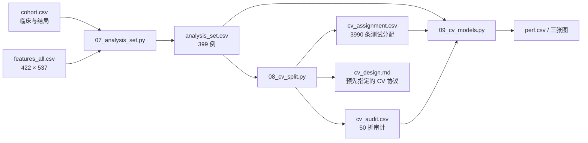

# Day 18 工作日志

- 日期：2026-11-13
- 主题：固定建模分析集 + 外层交叉验证划分
- 状态：数据准备与 CV 折划分完成；**建模尚未开始**

## 1. 今日目标

为 Day 18 的四个模型（仅临床、路线 1 签名、路线 2 LASSO-Cox、临床+影像）准备：

1. 唯一、固定的建模人群；
2. 建模前预先指定的交叉验证折；
3. 可审计的数据与划分证据。

本日**不产生任何模型性能数字**。

## 2. 今日完成

### 2.1 固定分析集

脚本：`code/07_analysis_set.py`

- 原始队列：422 例（cohort ∩ features，PatientID 一一对应）
- 排除 23 例：
  - 缺 `age`：22 例（其中 20 events / 2 censored）
  - 缺 `Overall.Stage`：1 例（`LUNG1-272`，event=1）
- 固定分析集：**399 例 / 352 events / 47 censored**
- 特征：537 个，全部有限

纳入者描述：

- 年龄：中位 68.7 岁（IQR 61.4–75.9；范围 33.7–91.7）
- 男性 273（68.4%），女性 126（31.6%）
- Stage III 278（69.7%），Stage I–II 121（30.3%）
- 组织学：adeno 49（12.3%）、squamous 149（37.3%）、large 109（27.3%）、nos 59（14.8%）、unknown 33（8.3%）

### 2.2 外层 CV 划分

脚本：`code/08_cv_split.py`

- 协议：`RepeatedStratifiedKFold(n_splits=5, n_repeats=10, random_state=42)`
- 分层变量：`deadstatus.event`
- 外层测试折：50 个
- 每个病人被测试 10 次
- 训练折：319–320 例
- 测试折：79–80 例
- 测试折 events：70–71
- 测试折 censored：9–10
- 测试分配：3990 行
- 审计：50 折全部通过（无交集、每例每轮恰好测试一次、事件与删失均非空）

## 3. 关键决策

1. **完整病例分析**：只对预先声明的建模变量 `age / gender / Overall.Stage / Survival.time / deadstatus.event` 做缺失排除，不对全表 `dropna()`。
2. **不纳入 T/N/M**：
   - `T=5` 有 2 例、`N=4` 有 3 例，编码含义已丢失；
   - `clinical.T.Stage` 另缺 1 例（`LUNG1-085`，event=1）；
   - 纳入会进一步缩小分析集，并与 Day 15 v1 不可比。
3. **组织学缺失不排除**：42 例原始 `Histology` 为空，统一编码为 `unknown`；分析集中 33 例。
4. **分期编码**：`I/II → 0`，`IIIa/IIIb → 1`。
5. **CV 主方案**：5×10 重复分层 K 折，主结果用 50 折的均值 ± SD；7:3 留出仅作为可选稳定性补充。
6. **特征选择必须在折内**：本日不产出“全队列选好的特征列表”，后续所有筛选写入 `09` 的外层训练折内部。

## 4. 产物

| 文件 | 内容 |
|---|---|
| `code/07_analysis_set.py` | 合并、缺失审计、编码锁定、报告生成 |
| `results/tables/analysis_set.csv` | 399 例建模人群 |
| `results/tables/excluded_patients.csv` | 23 例排除清单及原因 |
| `results/tables/feature_columns.txt` | 537 个特征列名与顺序 |
| `results/tables/analysis_set.md` | 分析集报告 |
| `code/08_cv_split.py` | 外层 CV 划分与审计 |
| `results/tables/cv_assignment.csv` | 3990 条测试折分配 |
| `results/tables/cv_audit.csv` | 50 折规模与事件数 |
| `results/tables/cv_design.md` | 建模前预先指定的 CV 协议 |

运行命令：

```bash
/home/jiaqiwang/miniconda3/envs/radiomics/bin/python code/07_analysis_set.py
/home/jiaqiwang/miniconda3/envs/radiomics/bin/python code/08_cv_split.py
```

## 5. 问题与风险

1. **缺失并非完全随机**：排除组事件率 91.3%（纳入 88.2%）、Stage III 比例 45.5%（纳入 69.7%）、组织学 unknown 比例 39.1%（纳入 8.3%）。排除仅 23 例，但外推需谨慎。
2. **`LUNG1-272` 分期缺失且 T=5**：已排除，不进入主分析。
3. **`target.md` 仍缺失**：无法完成与论文数字的并排对比；需要补论文的验证集定义与 C-index。
4. **路线 1 的 Compactness1 不存在**：PyRadiomics 只保留 `original_shape_Compactness2`，后续需在方法中声明替代。
5. **wavelet 子带未指定**：路线 1 需固定一个子带，建议 `wavelet-HLH_glrlm_GrayLevelNonUniformity`，并记录理由。
6. **高维小样本**：537 特征 / 399 例，LASSO 选择可能不稳定；后续需报告每折选择频率，不能只解释某一折的 signature。
7. **CV 折间相关**：50 折共享病人，SD 不是 95% CI；报告时需说明。

## 6. 下一步

1. 写 `code/09_cv_models.py`，从 `cv_assignment.csv` 读取固定折；
2. 在每个外层训练折内实现：
   - 方差/缺失过滤
   - `|r| > 0.9` 去冗余
   - 单变量 Cox `p < 0.05`
   - `StandardScaler`
   - LASSO-Cox（内层 5 折选 alpha）
   - 最终 Cox 拟合
3. 四个模型共用同一份折：
   - 仅临床
   - 路线 1：4 特征签名
   - 路线 2：LASSO-Cox
   - 临床 + 影像
4. 产出：
   - `perf.csv` / `perf.md`
   - `cv_folds.csv`
   - `selection_stability.csv`
   - KM、森林图、C-index 箱线图
5. 补 `target.md`，完成与论文数字的并排记录（D19 再解释差异）。

## 7. 验收对照

| 验收项 | 状态 |
|---|---|
| 分析集固定且可审计 | 完成 |
| CV 方案与随机种子记录 | 完成 |
| 每折事件/删失非空、无泄漏划分 | 完成 |
| 特征选择在折内完成 | 未开始 |
| 性能表均值 ± SD | 未开始 |
| KM / 森林图 / CV 箱线图 | 未开始 |
| 过拟合解释 | 未开始 |

## 8. 当日结论

Day 18 的**数据与评估协议**已经固定：399 例、352 events、537 特征、5×10 重复分层 CV、seed=42。当前尚未训练任何模型，所有 C-index 与图形留待 `09_cv_models.py` 产出。

后续任何脚本都必须：

- 从 `analysis_set.csv` 读取病人；
- 从 `cv_assignment.csv` 读取折；
- 不在全量数据上做特征选择或标准化；
- 不因结果好看而更换 seed 或折划分。

---

# 附录：07 与 08 的设计说明

可以把 07 和 08 理解成建模前的两道“封板”：

- **07 锁定的是“谁进入分析”**：确定 399 例分析集，锁定临床变量编码；
- **08 锁定的是“这些人怎么分折评估”**：确定 5×10 的外层 CV，锁定随机种子和每折成员。

两者都**不训练模型、不选特征、不算 C-index**；它们是为 09 的建模准备可复现、可审计的输入。



## A.1 07 是什么

### 1. 定位

`code/07_analysis_set.py` 是**分析集定义脚本**，负责：

- 把临床表和特征表按 `PatientID` 合并；
- 按预先声明的规则排除缺失病例；
- 锁定性别、分期、组织学的编码；
- 输出唯一一份建模人群清单和审计报告。

### 2. 为什么必须单独写

如果每个模型脚本各自 `dropna()`、各自编码分期、各自决定组织学怎么处理，会出现三个问题：

1. **病人不一致**：临床模型用 399 例，影像模型用 422 例，C-index 不可比；
2. **编码不一致**：一个脚本把 IIIa/IIIb 合成一类，另一个脚本分四类，结果无法对齐；
3. **不可审计**：最后没人说得清 23 例为什么被排除。

07 的作用就是把这些决定**一次性写死**，后面 09 只读结果，不再重新筛人。

### 3. 它做了什么

按代码顺序：

1. **键检查**：两表 `PatientID` 唯一、病例集合一致；
2. **一一合并**：`validate="one_to_one"`，防止一对多导致行数膨胀；
3. **声明排除变量**：`age / gender / Overall.Stage / Survival.time / deadstatus.event`；
4. **逐项记录排除原因**：不是直接 `dropna()`，而是生成 `exclude_reason`；
5. **编码锁定**：
   - `gender_num`：male=1，female=0；
   - `stage_bin`：I/II=0，IIIa/IIIb=1；
   - `histology`：adeno/squamous/large/nos/unknown，原始缺失→unknown；
6. **质量断言**：event 只能是 0/1、time > 0、特征 537 列且全部有限；
7. **写出四份产物**，并用 `--expect-n 399`、`--expect-events 352` 做最终校验。

注意：`--expect-n 399` 不是“取前 399 例”，而是**审计断言**。如果规则或数据变化导致不是 399，脚本会直接报错。

### 4. 输出及意义

| 文件 | 内容 | 回答什么问题 |
|---|---|---|
| `analysis_set.csv` | 399 行 × 10 列 | 谁进入分析？结局和临床变量是什么？ |
| `excluded_patients.csv` | 23 行 | 谁被排除？为什么？ |
| `feature_columns.txt` | 537 行 | 用哪些特征？顺序是什么？ |
| `analysis_set.md` | 分析集报告 | 分析集怎么来的？有无选择偏倚？ |

关键数字：

- 422 → 排除 23（22 例缺 age，1 例缺 stage）→ **399 例 / 352 events / 47 censored**；
- 537 个特征，全部有限；
- 年龄中位 68.7 岁（IQR 61.4–75.9）；
- 组织学 unknown 33 例（原始 `Histology` 为空，编码后为 `histology="unknown"`）。

`analysis_set.csv` 里同时保留 `Overall.Stage` 和 `stage_bin`、`Histology` 和 `histology`，是为了：

- 原始列用于审计和核对；
- 编码列用于建模；
- 下游应使用 `stage_bin`、`gender_num`、`histology`，不要误用原始 `Histology`（它有 33 个空值）。

## A.2 08 是什么

### 1. 定位

`code/08_cv_split.py` 是**外层交叉验证划分脚本**，只做一件事：

> 在 399 例上生成固定的 5×10 折，并证明划分没有重叠、没有空事件折。

它不读取 537 个特征，只读取 `PatientID` 和 `deadstatus.event`。

### 2. 为什么必须单独写

1. **先定后跑**：切分必须在看模型结果之前固定，避免“哪个划分结果好就用哪个”；
2. **四个模型同折比较**：仅临床、路线 1、路线 2、临床+影像必须共用同一份 `cv_assignment.csv`；
3. **按事件分层**：保证每折都有 event 和 censored，避免测试折没有事件导致 C-index 无法计算；
4. **可复现**：seed=42 记录在案，换人重跑得到相同折；
5. **可审计**：`cv_audit.csv` 能证明每折规模、事件数、删失数都正常。

它只使用 `deadstatus.event` 做分层，不使用任何影像特征或模型分数，所以**不会把影像信息泄漏到折划分里**。用结局做分层是为了平衡每折的事件比例，这是标准做法，且折划分对所有模型完全相同。

### 3. 它做了什么

1. 读取 `analysis_set.csv`，校验 399 例、PatientID 唯一、event 为 0/1；
2. 构造 `RepeatedStratifiedKFold(n_splits=5, n_repeats=10, random_state=42)`；
3. 对每个外层折检查：
   - 训练集与测试集无交集；
   - 训练集 ∪ 测试集 = 全部 399 例；
   - 训练折和测试折都至少有 1 个 event、1 个 censored；
4. 记录测试折分配和每折审计信息；
5. 校验每个 repeat 中每例恰好被测试一次；
6. 写出三份产物。

### 4. 输出及意义

| 文件 | 内容 | 回答什么问题 |
|---|---|---|
| `cv_assignment.csv` | 3990 行：`PatientID, repeat, fold` | 每一轮中，谁在哪个测试折？ |
| `cv_audit.csv` | 50 行：每折 n_train/n_test/events/censored | 折划分是否健康、是否可比较？ |
| `cv_design.md` | CV 协议 | 用了什么切分、种子、内层 CV、指标口径？ |

关键数字：

- 5 × 10 = **50 个外层测试折**；
- 每个病人被测试 **10 次**（每个 repeat 一次）；
- 训练折 **319–320** 例；
- 测试折 **79–80** 例；
- 测试折 events **70–71**，censored **9–10**；
- `cv_assignment.csv` = 399 × 10 = **3990 条**测试分配。

`cv_assignment.csv` 只存测试折，不存训练折，因为训练折 = 该 repeat 中除测试折外的其余病人，可以无损重建，避免文件翻倍。

`cv_audit.csv` 的列含义：

| 列 | 含义 |
|---|---|
| `repeat`, `fold` | 第几轮、第几折 |
| `n_train`, `n_test` | 训练/测试规模 |
| `events_train`, `events_test` | 训练/测试事件数 |
| `censored_train`, `censored_test` | 训练/测试删失数 |
| `event_rate_test` | 测试折事件率，用于检查分层是否失衡 |

## A.3 07 和 08 的关系

一句话：

> **07 决定“谁参加考试”，08 决定“怎么分考场”，09 才是“考试并打分”。**

- 如果 07 改了（分析集、编码、排除规则变化），必须重跑 08，因为折必须建立在新的 399 例上；
- 如果 08 改了（seed、折数、重复次数变化），所有模型结果都必须重跑，不能和旧结果混在一起；
- 如果 09 改了（模型、特征选择、超参数），07 和 08 不需要动，折保持固定，结果仍然可比。

## A.4 它们不做什么

07 和 08 都**不**：

- 不做方差/相关/单变量 Cox 筛选；
- 不做标准化；
- 不拟合 LASSO-Cox 或最终 Cox；
- 不计算 C-index 或 log-rank；
- 不生成 KM/森林图/CV 箱线图。

这些全部属于 09。尤其注意：**不要**用 07 或 08 的产物去生成一份“全队列选好的特征列表”；特征选择必须写在 09 的每个外层训练折内部。

## A.5 下游使用约定

09 及以后的所有脚本只能这样取数：

```python
analysis = pd.read_csv("results/tables/analysis_set.csv")
features = pd.read_csv("results/tables/features_all.csv")
feature_cols = pd.read_csv(
    "results/tables/feature_columns.txt", header=None
)[0].tolist()
folds = pd.read_csv("results/tables/cv_assignment.csv")

model_data = analysis.merge(
    features[["PatientID"] + feature_cols],
    on="PatientID", validate="one_to_one",
)
```

并遵守：

- 不再 `dropna()` 或按其他变量筛人；
- 不再重新编码 `gender/stage/histology`；
- 不改变 `cv_assignment.csv` 的折；
- 不在全量数据上 fit 任何预处理或特征选择。

这样，07 和 08 就构成了 Day 18 的**数据与评估证据链**：前者证明“人群定义是干净的”，后者证明“折划分是预先指定且无重叠的”。
