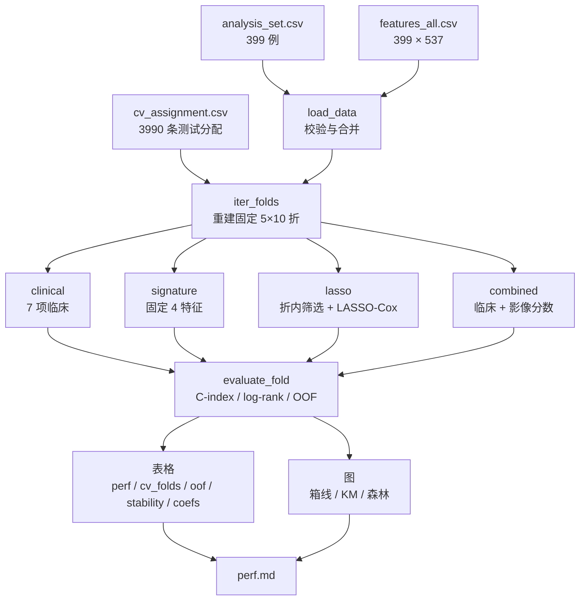

# Day 19 工作日志

- 日期：2026-11-16
- 主题：固定折上的四模型全量评估
- 状态：5×10 全量运行完成；性能表、逐折结果、系数表与图形已产出并提交；**本日志按要求暂未提交**

## 1. 今日目标

在 Day 18 封板的 399 例分析集和 5×10 外层折上，完成四个模型的全量评估：

1. 仅临床：`age + gender + stage_bin + histology`
2. 路线 1：论文固定 4 特征签名
3. 路线 2：折内 LASSO-Cox
4. 临床 + 影像分数（联合模型）

本日只使用 `07` 固定的分析集、`08` 固定的折和 `09` 的预设流程；不重新筛人、不重新切分、不在全量数据上做特征选择或标准化。

## 2. 运行配置

| 项目 | 设置 |
|---|---|
| 分析集 | 399 例 / 352 events / 47 censored |
| 特征 | 537 个影像特征，全部有限 |
| 外层 CV | `RepeatedStratifiedKFold(n_splits=5, n_repeats=10, random_state=42)` |
| 外层测试折 | 50 个；每例被测试 10 次 |
| 内层 CV | 5 折，仅用于 LASSO 的 alpha 选择 |
| 折内流程 | 方差过滤 → `|r| > 0.9` 去冗余 → 单变量 Cox `p < 0.05` → 标准化 → LASSO / 最终 Cox |
| 分层变量 | `deadstatus.event` |
| 环境 | conda `radiomics`；lifelines 0.30.0；scikit-survival 0.25.0 |
| 耗时 | 2936.0 秒（约 49 分钟） |
| 日志 | `logs/cv_models_2026-11-16_1023.log` |

运行命令：

```bash
cd /home/jiaqiwang/nsclc-cox
/home/jiaqiwang/miniconda3/envs/radiomics/bin/python code/09_cv_models.py \
  > logs/cv_models_2026-11-16_1023.log 2>&1
```

运行前对 `09_cv_models.py` 做了三处修正，本次结果对应修正后的版本：

1. LASSO 空选择回退改为按单变量 p 值升序取前 `fallback_k` 个特征；
2. 子集运行（`--repeats < 10` 或 `--models` 不完整）默认拒绝写入 `results/tables` 与 `results/figures/cv`；
3. LASSO 回退折不再写入逐折系数表和森林图，使 `coefficient_summary.freq` 与 `selection_stability.freq` 同口径。

## 3. 结果

### 3.1 性能总表

50 折均值 ± SD：

| 模型 | 折数 | C-index (mean ± SD) | 中位数 | train−test gap | log-rank p<0.05 的折 | 特征数 mean [min–max] | alpha 中位数 [范围] | fallback 折 |
|---|---|---|---|---|---|---|---|---|
| clinical | 50 | 0.530 ± 0.026 | 0.524 | 0.026 | 10% | 7.0 [7–7] | – | 0 |
| signature | 50 | 0.581 ± 0.038 | 0.583 | 0.003 | 20% | 4.0 [4–4] | – | 0 |
| lasso | 50 | 0.583 ± 0.035 | 0.589 | 0.049 | 18% | 11.3 [2–42] | 5.63e-02 [7.60e-03–2.00e-01] | 1 |
| combined | 50 | 0.581 ± 0.034 | 0.585 | 0.057 | 28% | 8.0 [8–8] | 5.63e-02 [7.60e-03–2.00e-01] | 1 |

补充数字：

- 训练折 C-index 均值：clinical 0.556、signature 0.584、lasso 0.632、combined 0.637；
- 所有模型的最终 Cox 实际生效惩罚值中位数均为 0.1，没有折需要升级到 1.0 或 10.0；
- 唯一一次 LASSO 空选择回退发生在 `repeat 4 / fold 3`，该折回退到 10 个特征，LASSO C-index 0.602、联合 C-index 0.571。

### 3.2 逐折分布

`results/figures/cv/cindex_boxplot.png` 显示：

- clinical 整体最低，箱体约在 0.515–0.550，且下界接近 0.46；
- signature、lasso、combined 的中位数都在 0.58 左右，箱体高度相近；
- lasso 与 combined 各有少数折低于 0.50，说明单一划分下仍可能失效；
- 50 折共享病人，箱线图的 SD 描述折间波动，不是 95% CI。

### 3.3 LASSO 稳定性

`selection_stability.csv` 中，99 个特征至少被选中过一次；下表为前 10：

| 特征 | 被选折数 | 频率 | 平均 LASSO 系数 |
|---|---|---|---|
| `wavelet-HHL_firstorder_TotalEnergy` | 43 | 0.86 | +0.158 |
| `wavelet-LHL_firstorder_Skewness` | 39 | 0.78 | −0.088 |
| `wavelet-LLH_firstorder_Variance` | 34 | 0.68 | −0.048 |
| `wavelet-LHL_glcm_MCC` | 30 | 0.60 | +0.079 |
| `wavelet-LHH_glcm_Correlation` | 28 | 0.56 | −0.085 |
| `original_shape_Maximum3DDiameter` | 24 | 0.48 | +0.062 |
| `wavelet-HHL_firstorder_Skewness` | 21 | 0.42 | +0.036 |
| `wavelet-HLH_firstorder_TotalEnergy` | 20 | 0.40 | +0.119 |
| `wavelet-LHH_glcm_MCC` | 17 | 0.34 | +0.047 |
| `wavelet-HHH_glcm_Idn` | 16 | 0.32 | +0.038 |

要点：

- 只有 1 个特征入选率超过 80%，5 个超过 50%，4 个达到或超过 60%；
- 50 折平均选 11.3 个特征，范围 2–42，折间波动很大；
- 回退折计入稳定性分母，但不贡献入选次数。

### 3.4 固定签名与 LASSO 的重叠

路线 1 的 4 个固定特征中，只有 `original_shape_Compactness2_derived` 出现在 LASSO 稳定性表（4/50，8%）。其余三个特征未出现在表中，说明它们要么未通过折内单变量 `p < 0.05`，要么被 LASSO 置零。

也就是说：固定签名与 LASSO 选出的特征集几乎不重叠，但两条路线的 C-index 相当（0.581 vs 0.583）。这更像“多个弱相关特征都能达到同一水平的判别力”，而不是某一组特征特别关键。

### 3.5 联合模型系数

`coefficient_summary.csv` 中，联合模型各项的 HR（跨折中位数，10–90 分位）：

| 项 | HR [10–90 pct] |
|---|---|
| `radiomics_score` | 1.51 [1.39–1.69] |
| `gender_num` | 1.09 [1.02–1.16] |
| `age` | 1.01 [1.01–1.02] |
| `hist_squamous` | 1.06 [0.96–1.16] |
| `hist_unknown` | 1.25 [1.13–1.40] |
| `hist_large` | 0.95 [0.85–1.06] |
| `hist_nos` | 0.95 [0.86–1.08] |
| `stage_bin` | 0.97 [0.93–1.01] |

临床模型单独拟合时 `stage_bin` 的 HR 为 1.03 [1.00–1.10]；加入影像分数后变为 0.97 [0.93–1.01]，方向反转且跨过 1。提示分期与影像分数存在共线，联合模型基本由影像分数驱动。

### 3.6 固定签名系数

| 特征 | HR [10–90 pct] |
|---|---|
| `original_firstorder_Energy` | 1.08 [1.06–1.12] |
| `original_glrlm_GrayLevelNonUniformity` | 1.10 [1.07–1.12] |
| `original_shape_Compactness2_derived` | 0.95 [0.92–0.97] |
| `wavelet-HLH_glrlm_GrayLevelNonUniformity` | 1.06 [1.03–1.09] |

## 4. 关键发现

1. **影像比临床多约 0.05 的判别力**：clinical 0.530，三条影像路线约 0.581–0.583。
2. **三条影像路线基本打平**：固定签名 0.581、LASSO 0.583、联合 0.581；联合模型没有带来增量。
3. **LASSO 不稳定**：特征数 2–42，只有 1 个特征入选率 > 80%；不能把某一折的 signature 当作最终 signature。
4. **固定签名与 LASSO 特征集几乎不重叠**，但性能相同；这削弱了“某个影像 signature 具有唯一性”的解释。
5. **过拟合随筛选自由度上升**：固定签名 gap 0.003，LASSO 0.049，联合 0.057。
6. **C-index 与 log-rank 不一致**：即使 C-index 约 0.58，折内中位数分组只有 10%–28% 的折达到 `p < 0.05`，说明连续风险排序的区分力没有转化为稳定的高低危二分。
7. **临床模型偏低且分期效应接近零**：0.530 的临床 C-index 和 `stage_bin` HR 1.03 需要核对编码与 Day 15 v1 的口径。

## 5. 解释与限制

1. **SD 不是 95% CI**：50 折共享病人，每例被测试 10 次，折间不独立；`mean ± SD` 只描述折间波动。
2. **主结果是外层测试折的 C-index**；训练折 C-index 仅用于计算乐观偏差，不作为性能。
3. **log-rank 的高低危阈值取训练折风险中位数**，在测试折上分组；显著比例低不等于 C-index 无效，两者回答的问题不同。
4. **KM 图只使用 repeat 0 的折外预测**，每例出现一次；没有把 10 个 repeat 的 3990 条记录合并，避免同一病人重复计入。
5. **所有 Cox 都带 0.1 惩罚**，包括固定签名；与论文的无惩罚 Cox 并排比较时需要在方法中声明。
6. **路线 1 的 4 个特征是论文先验指定的**，不是在本队列上选出来的；因此它 0.581 的结果不构成“在本数据上独立验证出的 signature”。
7. **`hist_unknown` 可能携带信息性缺失**：联合模型中 HR 1.25，解释时需要区分“未知组织学”与真实组织学效应。
8. **`target.md` 仍未建立**，目前无法完成与论文验证集数字的并排对比。

## 6. 产物

| 文件 | 内容 |
|---|---|
| `results/tables/cv_folds.csv` | 200 条模型-折记录：C-index、训练 C-index、gap、log-rank p、特征数、alpha、惩罚值、notes |
| `results/tables/oof_predictions.csv` | 每例每轮折外风险、高低危标签与阈值 |
| `results/tables/selection_stability.csv` | 99 个特征的入选折数、频率、平均 LASSO 系数 |
| `results/tables/cv_coefficients.csv` | 逐折最终 Cox 系数（LASSO 回退折不写入） |
| `results/tables/coefficient_summary.csv` | 系数跨折中位数与 10–90 分位 |
| `results/tables/perf.csv` | 机器可读性能汇总 |
| `results/tables/perf.md` | 自动生成的性能报告与口径说明 |
| `results/figures/cv/cindex_boxplot.png` | 四模型 50 折 C-index 分布 |
| `results/figures/cv/km_oof_*_repeat0.png` | 各模型 repeat 0 的折外 KM |
| `results/figures/cv/forest_*.png` | 各模型逐折 Cox 系数森林图 |

本次运行没有改动 `analysis_set.csv`、`cv_assignment.csv` 或任何 `07/08` 的产物。各文件的列含义、图形读法和代码流程见附录 A。

## 7. 问题与风险

1. **临床模型 0.530 偏低**：`stage_bin` HR 仅 1.03，联合模型降到 0.97。需要先核对分期编码方向、与 `Overall.Stage` 的对应，以及 Day 15 v1 的临床基线，再决定是否在报告中解释为“本队列分期判别力弱”。
2. **LASSO 高 churn**：99 个特征至少入选一次，平均 11.3 个/折。后续只能报告入选频率，不能只解释某一折的系数。
3. **固定签名与 LASSO 几乎不重叠**：不能同时声称“复现了论文 signature”和“LASSO 找到了同一组特征”；两条路线的叙事需要分开。
4. **联合模型没有增量**：C-index 未超过 LASSO，且 gap 最大（0.057）。如果报告联合模型，需要明确它没有带来性能收益，而不是选择性强调 log-rank 显著比例 28%。
5. **log-rank 显著比例低**：C-index 约 0.58 但中位数分组只有 10%–28% 的折显著，说明风险分层在二分后不稳定。
6. **折间相关**：不能把 50 折 SD 当作 95% CI；如需区间，应在病人层面做 bootstrap 或先按 repeat 汇总。
7. **`target.md` 缺失**：论文验证集定义、C-index、wavelet 子带和 Compactness 对应关系都还没有落文档。
8. **KM 只展示 repeat 0**：图形是描述性的，不能用来挑选“最好看”的 repeat。

## 8. 下一步

1. 补 `results/repro/target.md`：论文验证集定义、signature C-index、wavelet 子带选择、`Compactness1 → Compactness2_derived` 的方法说明。
2. 核对临床模型：`stage_bin` 的单变量 log-rank / Cox、分期分布与事件率，确认 0.530 不是编码问题；与 Day 15 v1 对齐口径。
3. 可选敏感性分析：先算每个 repeat 的 5 折均值，再报告 10 个 repeat 的均值 ± SD，作为折间相关的补充；主结果仍保持 50 折。
4. 写面向报告的叙事：以固定签名与 LASSO 的对比为主线，明确 LASSO 的不稳定性；联合模型作为“无增量”的结果报告。
5. 结果与图形已提交（`12c00bf`、`92f7342`）；本日志按要求暂不提交。

## 9. 验收对照

| 验收项 | 状态 |
|---|---|
| 分析集与折划分未改动 | 完成 |
| 特征选择、标准化、alpha 选择在折内 | 完成 |
| 四模型 50 折性能表 | 完成 |
| 均值 ± SD、逐折分布 | 完成 |
| KM / 森林图 / C-index 箱线图 | 完成 |
| 过拟合解释（train−test gap） | 完成 |
| LASSO 稳定性报告 | 完成 |
| 与论文数字并排对比 | 未完成（缺 `target.md`） |
| 结果提交 | 已完成（`12c00bf`、`92f7342`）；本日志未提交 |

## 10. 当日结论

在固定分析集、固定 5×10 折和固定流程下，第一次得到了可复现的四模型性能：临床 0.530 ± 0.026，固定签名 0.581 ± 0.038，LASSO 0.583 ± 0.035，联合 0.581 ± 0.034。影像特征相对临床有约 0.05 的提升，但三条影像路线没有分出高下；LASSO 的特征选择高度不稳定，固定签名与 LASSO 选出的特征几乎不重叠却性能相当。

因此，后续报告应把“影像有信号”和“某个 signature 稳定”分开陈述：前者有证据，后者目前没有。下一步优先补 `target.md` 和核对临床/分期口径，而不是调整 seed、折或筛选阈值去追求更高的 C-index。

---

# 附录 A：09 的代码结构与产物说明

本附录回答两个问题：`09_cv_models.py` 每一步在做什么；它输出的每个表格和图在回答什么问题。主文 §3 是本次结果，§6 是文件清单，本附录是方法与阅读说明。

## A.1 定位

`09` 是**固定折上的模型评估器**，不是最终模型训练脚本：

- 人群和折由 `07`、`08` 决定；
- `09` 只读这些固定输入（分析集、特征表、特征列、折分配），在 50 个外层折上拟合四个模型；
- 输出的是“这套流程在这批数据上的内部交叉验证表现”，不是外部验证结论，也不是可直接部署的模型。



## A.2 输入与硬约束

| 输入 | 内容 |
|---|---|
| `analysis_set.csv` | 399 例 / 352 events；已锁定 `age / gender_num / stage_bin / histology / Survival.time / deadstatus.event` |
| `features_all.csv` | 399 × 537 影像特征，全部有限 |
| `feature_columns.txt` | 537 个特征列及固定顺序 |
| `cv_assignment.csv` | 3990 条测试分配；每个 repeat 中每例恰好被测试一次 |

启动时校验：患者唯一、特征列齐全、`one_to_one` 合并、事件只能为 0/1、特征数 537、分析集与折分配的病例集合完全一致、每个 repeat 的折数为 5。任何一项不满足直接退出。

三条不可协商的约束：

1. 不再 `dropna()` 或按其他变量筛人；
2. 不重新编码 `gender / stage / histology`；
3. 不改变 `cv_assignment.csv` 的折。

## A.3 一次外层折内部发生了什么

对 50 个外层折中的每一个，训练集是“该 repeat 中除测试折外的其余病人”，测试集只用于预测和打分：

1. **训练折内筛选**（`feature_pipeline`）：
   - 去掉方差为 0 的特征；
   - 按方差从大到小做贪心相关过滤，保留与已选特征 `|r| ≤ 0.9` 的列；
   - 对每个剩余特征拟合单变量 Cox，保留 `p < 0.05`；
   - 用训练折拟合 `StandardScaler`，测试折只做 `transform`。
2. **LASSO 的 alpha 选择**（`choose_alpha`）：在外层训练折内部再做 5 折，**每个内层训练折重新做一遍上面的筛选和标准化**，用内层验证折的 C-index 平均分选择 alpha。
3. **最终拟合**：
   - 临床 / 固定签名：直接拟合带惩罚的 Cox；
   - LASSO：在选定 alpha 上拟合 Coxnet，非零系数特征再用最终 Cox（带惩罚）重拟合；
   - 联合：把 LASSO 的风险分数取对数、按训练集标准化成 `radiomics_score`，再和 7 个临床变量一起拟合 Cox。
4. **打分**（`evaluate_fold`）：在测试折上算 C-index；用训练折风险中位数切高低危，算 log-rank p；保留每例的折外风险与高低危标签。

实现细节：

- 单变量 Cox 用 `penalizer=0.01`，拟合失败按 `p=1` 处理；
- 相关过滤是“按方差降序贪心”，不是层次聚类；换一种顺序可能得到不同的入选集；
- alpha 网格由外层训练折的 `alpha_max` 生成，共 30 个对数等距候选，范围到 `alpha_max × 10⁻³`；
- 若没有特征通过单变量 `p < 0.05`，pipeline 会保留 p 最小的前 10 个；这种情况不会单独写入 `notes`，只能通过 `n_after_univariate` 间接判断；
- LASSO 选中 0 个特征时，按单变量 p 值升序回退到前 10 个，并在 `notes` 写入 `lasso_empty_fallback_topk`；
- 最终 Cox 使用 0.1 → 1 → 10 的惩罚阶梯，记录实际生效的值；本次 50 折全部停在 0.1。

一个容易混淆的点：**LASSO 路线最终用于打分的不是 Coxnet 系数本身，而是“被 LASSO 选中的特征再拟合的 Cox”**。`selection_stability.csv` 里的系数是 LASSO 系数，`cv_coefficients.csv` 里的是最终 Cox 系数，两者不是同一个东西。

## A.4 四个模型与命名对应

| 代码名 | 中文含义 | 输入 | 特征选择 | 最终模型 |
|---|---|---|---|---|
| `clinical` | 仅临床基线 | `age`、`gender_num`、`stage_bin`、4 个组织学 dummy（adeno 为参考） | 无 | 7 项惩罚 Cox |
| `signature` | 路线 1：签名型 | 论文固定 4 特征 | 无 | 4 项惩罚 Cox |
| `lasso` | 路线 2：LASSO-Cox | 537 个影像特征 | 折内方差 → 相关 → 单变量 p → 内层选 alpha → LASSO | 选中特征上的 Cox |
| `combined` | 临床 + 影像 | 7 项临床 + **一个** `radiomics_score` | 复用同一次 LASSO 拟合 | 8 项惩罚 Cox |

两个容易混淆的点：

1. `combined` 不是“临床 + 537 个影像特征”，而是“临床 + LASSO 路线压缩出的一个影像分数”；它衡量的是**在路线 2 之上，临床变量还能不能带来增量**。
2. `signature` 是论文先验固定的 4 个特征，不是在本队列上用 LASSO 选出来的；`lasso` 才是数据驱动路线。两者特征集几乎不重叠，所以不能同时声称“复现了论文 signature”和“LASSO 找到了同一组特征”。

## A.5 输出表格：每个文件在回答什么

### A.5.1 `perf.csv` / `perf.md`：主结果

`perf.csv` 每个模型一行，是机器可读的主表；`perf.md` 是同一批数字的人类可读版本，并写明口径和限制。核心列：

| 列 | 含义 |
|---|---|
| `n_folds` | 该模型参与的外层折数，完整运行为 50 |
| `cindex_mean / sd / median` | 50 折测试 C-index 的均值、标准差、中位数 |
| `cindex_train_mean` | 训练折 C-index 均值，用于对照 |
| `cindex_gap_mean` | 训练 − 测试的平均差，描述乐观偏差 |
| `logrank_p_median` | 50 个折内 log-rank p 的中位数 |
| `logrank_pct_sig` | p<0.05 的折所占比例 |
| `n_features_mean/min/max` | 每折最终特征数及其范围 |
| `alpha_median/min/max` | LASSO 选中 alpha 的跨折分布 |
| `cox_penalizer_median` | 最终 Cox 实际生效的惩罚值 |
| `n_fallback_folds` | LASSO 选中 0 个特征、触发回退的折数 |

读法：

- `cindex_sd` 描述折间波动，**不是 95% CI**，因为 50 折共享病人；
- `logrank_pct_sig` 是“50 个折里有多少折显著”，不是一个合并后的 p 值；
- `cindex_gap_mean` 越大，筛选自由度带来的乐观偏差越明显。

### A.5.2 `cv_folds.csv`：逐折审计

200 行 = 4 模型 × 50 折。一行代表“某个模型在某一个外层折上的一次完整拟合”：

| 列 | 含义 |
|---|---|
| `model / repeat / fold` | 哪条路线、哪一轮、哪一折 |
| `n_train / n_test` | 该折训练/测试规模 |
| `n_features` | 最终进入 Cox 的特征数 |
| `n_after_variance / corr / univariate` | 筛选每一步剩多少列；临床和固定签名没有这一步，所以为空 |
| `alpha` | 该折 LASSO 选中的 alpha |
| `cox_penalizer` | 最终 Cox 实际用的惩罚值 |
| `cindex_train / cindex / cindex_gap` | 训练、测试 C-index 及差值 |
| `logrank_p` | 该折中位数分组的 log-rank p |
| `notes` | 例如 `lasso_empty_fallback_topk` |

它解决的问题是**可审计**：可以查某一折为什么特征特别多、为什么 C-index 特别低、哪一折触发了回退。本次唯一回退在 `repeat 4 / fold 3`，该折回退到 10 个特征。

### A.5.3 `oof_predictions.csv`：折外预测

15,960 行 = 4 模型 × 10 repeat × 399 例。每行是“某模型在某一轮对某病人的折外预测”：

| 列 | 含义 |
|---|---|
| `risk` | 该折模型给出的 partial hazard，越大越高危 |
| `high_risk` | 测试风险是否高于**该折训练集风险中位数** |
| `risk_threshold` | 该折使用的训练集中位数阈值 |

用途：KM、校准曲线、决策曲线等按病人的下游分析。关键限制：`risk` 是折内尺度，**不能把不同折的原始 risk 直接拼在一起比较**；这也是表里同时存了折内定义的 `high_risk` 的原因，KM 图用的是这个标签。

### A.5.4 `selection_stability.csv`：LASSO 稳定性

99 个特征至少被选中过一次，每个特征一行：

| 列 | 含义 |
|---|---|
| `n_selected` | 在多少个非回退折中被 LASSO 选中 |
| `freq` | `n_selected / 该次运行实际跑 LASSO 的折数`（完整运行为 50）；分母包含回退折，但回退折不贡献入选次数，所以偏保守 |
| `mean_coef` | 跨折平均 LASSO 系数 |

它回答的是**“这个特征是否反复被选中”**，而不是“最终 signature 是什么”。本次只有 1 个特征入选率超过 80%，5 个超过 50%，说明高维小样本下 LASSO 的选择很不稳定；只看某一折的系数会严重高估结论的稳定性。

### A.5.5 `cv_coefficients.csv`：逐折最终 Cox 系数

1,507 条记录，每行是“某模型、某折、某个 term”的最终 Cox 系数：

| 列 | 含义 |
|---|---|
| `term` | 变量名；影像特征是标准化后的列名 |
| `coef` | 最终 Cox 的 log-HR |
| `hr` | `exp(coef)` |
| `cox_penalizer` | 该次拟合实际惩罚值 |

它的作用是给森林图提供**不依赖全量重拟合**的数据源。LASSO 回退折不写入这里，这样它的入选频率和 `selection_stability.csv` 才是同一口径。

### A.5.6 `coefficient_summary.csv`：系数跨折汇总

按 `model + term` 汇总，共 118 行：

| 列 | 含义 |
|---|---|
| `n_folds` | 该 term 出现在多少折的最终模型里 |
| `freq` | `n_folds / 该模型总折数` |
| `coef_median / q10 / q90` | 系数的跨折中位数与 10–90 分位 |
| `hr_median / q10 / q90` | HR 的跨折中位数与 10–90 分位 |

它回答“这个变量的方向和量级稳不稳”。例如本次联合模型的 `radiomics_score` 是 1.51 [1.39–1.69]，而 `stage_bin` 是 0.97 [0.93–1.01]，方向跨过 1；临床模型单独拟合时 stage 是 1.03 [1.00–1.10]，说明加入影像分数后分期效应被吸收。

`radiomics_score` 的 HR 是“每增加 1 个训练折标准差的分数”，不是某个原始影像特征每增加 1 单位。

## A.6 输出图：每张图在回答什么

### A.6.1 `cindex_boxplot.png`：性能稳不稳

四个模型各 50 个点：箱体是 IQR，红线是中位数，蓝色菱形是均值，散点是每一折，虚线是 0.5。

- 回答：**同一模型换一个折，C-index 会波动多少？四个模型的分布是否重叠？**
- 本次：clinical 整体最低；signature / lasso / combined 中位数都在 0.58 左右，箱体大量重叠，说明三条影像路线没有明显高下。
- 注意：50 折共享病人，这不是 50 个独立样本，不能从箱线图读置信区间。

### A.6.2 `km_oof_<model>_repeat0.png`：风险分组有没有分开

用 repeat 0 的折外预测，按该折训练集风险中位数分高低危，画 Kaplan-Meier，标题里是 log-rank p。

- 回答：**C-index 的连续排序，转化成“高低危二分”后还能不能看出生存差异？**
- 本次：即使 C-index 约 0.58，很多折的 log-rank 并不显著；图中 p 值只是 repeat 0 的单次描述。
- 注意：只用一个 repeat，不能挑“最好看”的 repeat；高低危组也不一定各占一半（阈值来自训练折中位数）。

### A.6.3 `forest_<model>.png`：变量方向和一致性

横轴是 HR（范围超过 2 倍时用对数轴，否则用线性轴），点是用跨折中位数，横线是 10–90 分位，虚线是 HR=1。

- 回答：**哪些变量在反复推动风险，方向是否一致？**
- 本次：联合模型里 `radiomics_score` 明显在 1 右侧，临床项大多贴近 1，`stage_bin` 甚至跨到 1 以下；LASSO 森林图只展示入选频率 ≥ 0.5 的前 20 个特征，因此图和 `selection_stability.csv` 要一起看。
- 注意：LASSO 的 term 集合逐折变化，森林图展示的是“出现过的 term 的中位数”，不是某一个固定模型的系数。

## A.7 为什么这样设计

1. **先定折、后建模**：避免“哪个划分好看就用哪个”。
2. **所有筛选在折内**：测试折不参与方差、相关、单变量、标准化、alpha 选择，避免泄漏。
3. **内层 CV 只选 alpha**：alpha 不在测试折上调；内层仍然重做特征筛选，避免内层验证信息泄漏。
4. **四模型同折**：可以做配对比较，差异不是折划分带来的。
5. **保留逐折和 OOF**：既能解释波动，也能做 KM/校准等下游分析。
6. **报告稳定性而不是单一 signature**：537 特征 / 399 例，LASSO 的选择频率本身就是要报告的结果。
7. **报告 train−test gap**：用统一口径量化过拟合，而不是只报测试 C-index。
8. **机器可读 + 人类可读 + 图**：CSV 供复算，`perf.md` 供快速审阅，图供报告。

## A.8 它不做什么与常见误读

它不做：

- 外部验证：所有数字都是内部交叉验证，不能直接当成“泛化性能”；
- 置信区间：50 折 SD 不是 95% CI；
- 校准、时间依赖 AUC、决策曲线、竞争风险、PH 假设检验；
- 最终部署模型：它是评估管线，不是在全量 399 例上拟合后保存的模型；
- 模型间正式统计检验：`cv_folds.csv` 支持配对分析，但脚本本身不算 paired test；
- 7:3 留出验证：Day 18 把它列为可选补充，本次未做。

常见误读：

- 把 50 折当成 50 个独立样本；
- 把 `cindex_sd` 当成 95% CI；
- 把 `oof_predictions.csv` 的 15,960 行当成独立样本（同一病人在 10 个 repeat 中出现 10 次）；
- 把某一折的 LASSO 特征列表当作最终 signature；
- 把 `logrank_pct_sig` 当成一个合并的 p 值；
- 把 `radiomics_score` 的 HR 解释成某个原始特征每增加 1 单位的风险；
- 认为 `combined` 是“临床 + 537 个影像特征”的独立模型。

## A.9 建议的阅读顺序

1. 先看 `perf.md` 的 §1，建立四模型的主结果和波动；
2. 用 `cv_folds.csv` 查异常折、回退折和特征数范围；
3. 用 `selection_stability.csv` 决定哪些特征值得在正文中讨论；
4. 用 `coefficient_summary.csv` 和森林图解释方向；用 KM 解释二分后的生存分离；
5. 把“性能—稳定性—过拟合—限制”四件事写进正式报告；数字以 `perf.csv` 为准，叙事以本日志为准。
