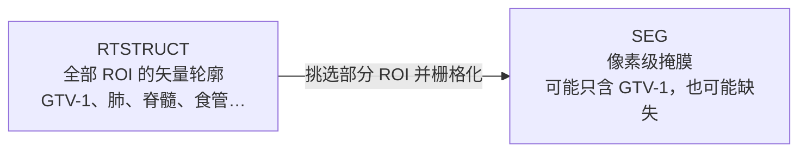

# DICOM 关键字段（D12）

> 用途：`code/01_check_dicom.py`、`code/02_build_index.py` 读元数据时的字段速查。
> 层级：Patient → Study → Series → Instance，每层一个 UID。

## 1. 身份与层级

| 字段 | Tag | 简短解释 |
|---|---|---|
| `PatientID` | (0010,0020) | 患者 ID，如 `LUNG1-001`；与临床表 `merge` 的唯一键 |
| `StudyInstanceUID` | (0020,000D) | 一次检查的唯一编号；同患者多次检查靠它区分 |
| `SeriesInstanceUID` | (0020,000E) | 一个序列（CT / RTSTRUCT / SEG 各一个）的唯一编号；`series_dir` 的来源 |
| `SOPInstanceUID` | (0008,0018) | 单个文件的唯一编号；去重、排序、写清单用 |

## 2. 影像属性（CT）

| 字段 | Tag | 简短解释 |
|---|---|---|
| `Modality` | (0008,0060) | 文件类型：`CT` / `RTSTRUCT` / `SEG` / `RTDOSE`；分流第一判据 |
| `SliceThickness` | (0018,0050) | 标称层厚（mm）；实际层距用相邻切片 z 差更可靠 |
| `PixelSpacing` | (0028,0030) | 面内像素间距（mm/像素），顺序是 **[行, 列] = [y, x]** |
| `ImagePositionPatient` | (0020,0032) | 切片左上角体素中心的患者坐标 `[x, y, z]`（mm）；按 z 排序 |
| `Rows` / `Columns` | (0028,0010) / (0028,0011) | 图像高 / 宽（像素数）；`Rows` 配 `PixelSpacing[0]` |

常配套使用：`ImageOrientationPatient` (0020,0037) 方向余弦、`SpacingBetweenSlices` (0018,0088) 实际层距。

## 3. RTSTRUCT（无像素，只有轮廓）

| 字段 | Tag | 简短解释 |
|---|---|---|
| `StructureSetROISequence` | (3006,0020) | ROI 名单，Item 内含 `ROINumber`、`ROIName`（如 `GTV-1`）；`roi_names`、`gtv1_present` 的来源 |
| `ROIContourSequence` | (3006,0039) | ROI 轮廓，Item 内含 `ReferencedROINumber`、`ContourSequence` |
| `ContourData` | (3006,0050) | 轮廓点坐标 `[x1,y1,z1, ...]`（mm，患者坐标系），需 reshape 成 `(-1,3)` |

- 一个 ROI 在每层切片各有一条闭合轮廓，按 z 分组后栅格化成掩膜。
- `ROIName` 命名不统一（`GTV-1` / `GTV1` / `GTV_1`），不要写死字符串。

## 4. SEG（有像素的掩膜）

| 字段 | Tag | 简短解释 |
|---|---|---|
| `SegmentSequence` | (0062,0002) | 每个 Segment 对应一个 ROI，含 `SegmentLabel`、`SegmentNumber` |
| `PixelData` | (7FE0,0010) | 标签图而非 HU：0 = 背景，1/2/3… = 各 Segment |
| `PerFrameFunctionalGroupsSequence` | (5200,9230) | 每帧记录它对应哪张 CT 切片（`ReferencedSOPInstanceUID`） |

**SEG ⊂ RTSTRUCT**：RTSTRUCT 是全部 ROI 的矢量轮廓；SEG 只是其中一部分 ROI 栅格化后的掩膜，可能只含 `GTV-1`，也可能缺失。故 `has_rtstruct`、`has_seg` 分两列统计，不能互相替代。



| | RTSTRUCT | SEG |
|---|---|---|
| 像素 | 无 | 有（标签图，非 HU） |
| 内容 | 所有 ROI 的轮廓点坐标 | 部分/全部 ROI 的栅格掩膜 |
| 覆盖度 | 全 | 可能只含部分 ROI |
| 用途 | 主数据源 | 快速取掩膜 / 交叉核对 |

## 5. 读取习惯

```python
ds = pydicom.dcmread(f, stop_before_pixels=True)   # 只读元数据，快
val = getattr(ds, "SliceThickness", None)          # 缺失字段不要直接点
```

## 6. ROI 命名观察（Lung1，422 例）

大小写敏感、按原始字符串计数：

| ROIName | 例数 | | ROIName | 例数 |
|---|---:|---|---|---:|
| `GTV-1` | 421 | | `gtv-3` | 23 |
| `Spinal-Cord` | 411 | | `gtv-4` | 9 |
| `Esophagus` | 355 | | `gtv_4r` | 5 |
| `Lung-Left` / `Lung-Right` | 312 / 312 | | `gtv_7` / `gtv-5` | 3 / 3 |
| `gtv-2` | 218 | | `gtv-6` / `gtv_2l` | 2 / 2 |
| `Heart` | 127 | | `Lungs-Total` | 97 |

- `GTV-1` 421 例 + LUNG1-128 的 `gtv-pre-op`，覆盖全部 422 例；
- 后缀可叠加：`gtv-3_2l2`、`gtv-2_4r`（左右 + 序号）；
- `gtv-2..7` 是另一套靶区，**不能并入主靶区**；
- 肺轮廓也有两套：`Lung-Left`（312）与 `Lungs-Total`（97）。

归一化规则（小写 + 去 `-`、`_`、空格）：

```text
GTV-1 / gtv_1 / Gtv 1      -> gtv1       主靶区
gtv-pre-op                 -> gtvpreop   LUNG1-128 专用
gtv-2 / gtv_2l / gtv-3_2l2 -> gtv2 / gtv2l / gtv32l2   不并入 gtv1
```

结论：`gtv1_present` 只认 `gtv1`；`gtvpreop` 单独记录，由 D16 决定是否纳入。

## 7. 本项目数据要点

| 项 | 值 | 处理 |
|---|---|---|
| CT 切片总数 | 51,230 | = 52,073 − 422 RTSTRUCT − 421 SEG |
| CT series | 422 | 无患者多 series |
| 层厚 | 全部 3.0 mm | 与 z 间距一致 |
| 缺层 | 014（16）、021（1）、085（10）、194（1） | 孤立丢层，间距为 6 mm |
| LUNG1-128 | `gtv-pre-op` / `gtv-pre-operat`，无 SEG | 命名回退 + `has_seg=False` |

宽度、层厚、缺层的完整记录见 `journal/day12.md`。

## 8. 临床表缺失率（422 例）

| 列 | 缺失 | 缺失率 |
|---|---:|---:|
| `age` | 22 | 5.21% |
| `Histology` | 42 | 9.95% |
| `clinical.T.Stage` | 1 | 0.24% |
| `gender` / `Clinical.N.Stage` / `Clinical.M.Stage` | 0 | 0.00% |
| `Survival.time` / `deadstatus.event` | 0 | 0.00% |

- 列名实际是小写 `gender`、`clinical.T.Stage`，不要写成 `Gender`；
- `deadstatus.event`：1 = 死亡（373）、0 = 右删失（49）；
- `Survival.time` 单位天，范围 10–4454，无 0/负值。
