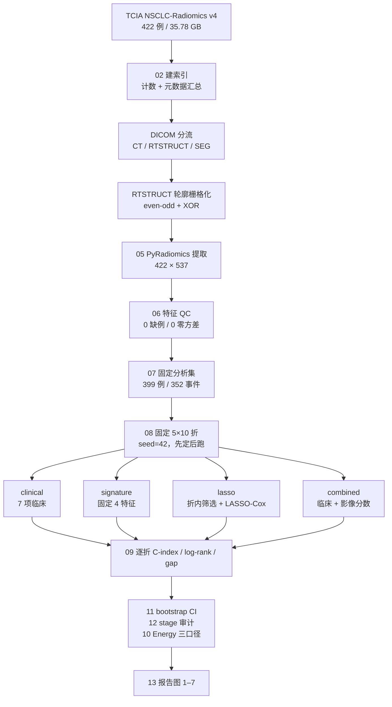
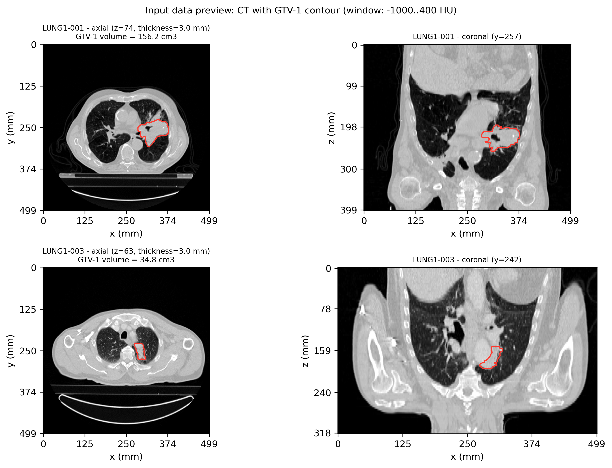
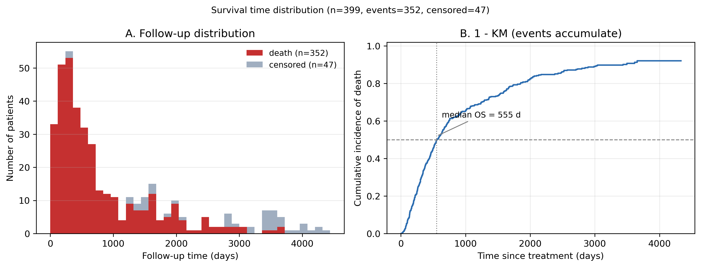
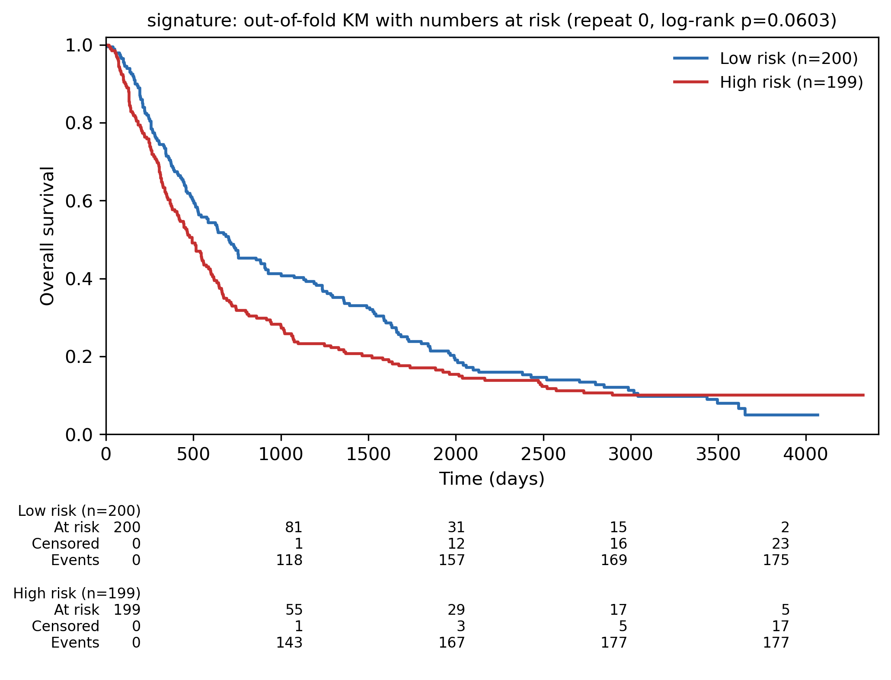
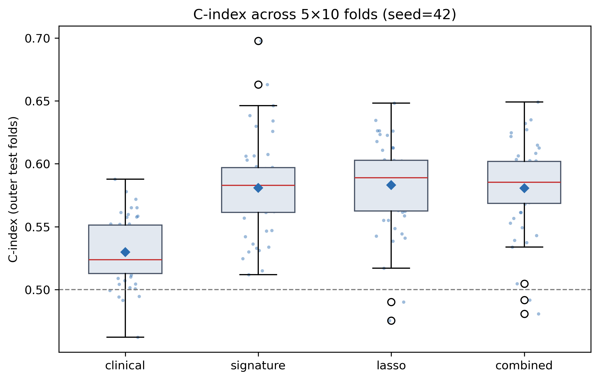
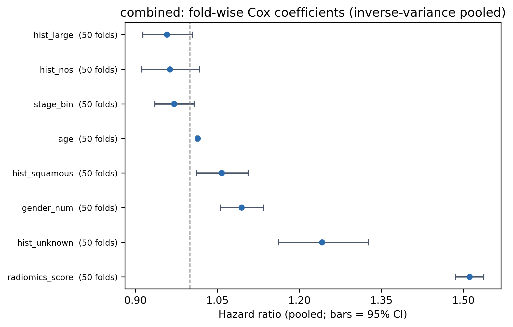
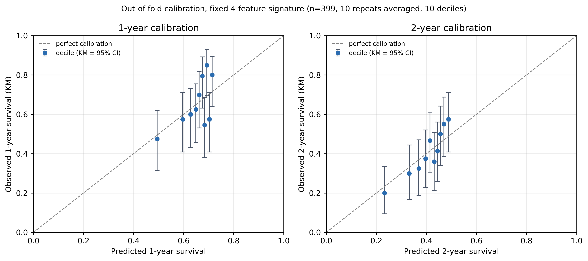
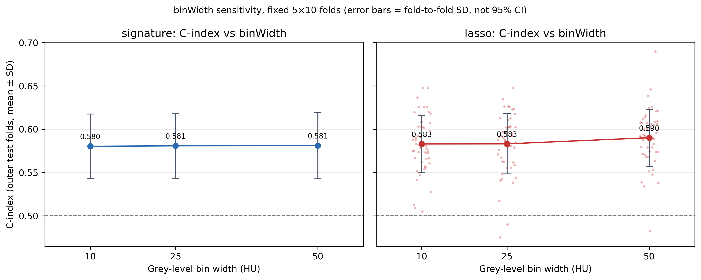

# 基于公开 CT 影像组学的 NSCLC 生存分析复现：实习报告

> 版本：v3.0（2026-11-19，对齐 `notes/nsclc-cox-report-v2.0.md` v2.0 与 `results/` 的 D20 产物）
> 数据：TCIA NSCLC-Radiomics Lung1，原始 422 例，主分析 399 例
> 所有数字都能在仓库找到出处，引用格式 `文件:行号`；口径声明贯穿全文：**SD 不是 95% CI**、**内部交叉验证 ≠ 外部验证**、**399 例分析集 ≠ 422 例队列**。
> 本项目是**方法级复现**（`results/repro/target.md:544-550`），不声称数值一致，也不声称复现了论文的外部验证。

## 目录

- [摘要](#摘要)
- [1 实习概况](#1-实习概况)
- [2 项目背景](#2-项目背景)
- [3 数据与整体管线](#3-数据与整体管线)
- [4 落地中遇到的技术难题](#4-落地中遇到的技术难题)
- [5 我是怎么思考解决方案的](#5-我是怎么思考解决方案的)
- [6 核心算法逻辑（形象讲解）](#6-核心算法逻辑形象讲解)
- [7 方案取舍](#7-方案取舍)
- [8 最终实现的效果](#8-最终实现的效果)
- [9 局限与展望](#9-局限与展望)
- [10 心得体会](#10-心得体会)
- [附录 A 任务表](#附录-a-任务表)
- [附录 B 典型报错原文](#附录-b-典型报错原文)
- [附录 C 复现命令与随机性](#附录-c-复现命令与随机性)
- [附录 D 关键数字—来源对照](#附录-d-关键数字来源对照)
- [附录 E 参考文献与合规](#附录-e-参考文献与合规)

---

## 摘要

本实习在 20 个工作日内（D1–D20，日志 19 篇 + D20 定稿，共约 8,600 行）打通了一条从 TCIA 公开 DICOM 到 Cox 生存模型的可重建管线：Docker + Conda 双层环境、RTSTRUCT 栅格化、PyRadiomics 特征提取、预先固定的 5×10 折交叉验证评估协议。

**六条主结论**（`notes/nsclc-cox-report-v2.0.md` 摘要、`journal/day19.md`）：

1. **方法级复现成立**：固定 4 特征 signature 在 Lung1 内部 5×10 CV 下 C-index **0.581 ± 0.038**，病人层面 bootstrap **95% CI 0.543–0.608**，满足"优于随机"的验收判据。
2. **三条影像路线打平**：LASSO 0.583 ± 0.035、临床+影像 0.581 ± 0.034、临床基线 0.530 ± 0.026；联合模型没有带来增量。
3. **临床基线不能声称优于随机**：bootstrap CI 0.495–0.558 **包含 0.5**；已核对为本队列分期判别力弱（stage_bin 单变量 HR 0.93 [0.74–1.16]、log-rank p≈0.53），**不是编码错误**。
4. **特征映射可核对**：4 个 signature 特征的单变量方向与论文 Supplementary Fig. 1 **4/4 一致**（每 1 SD），Compactness2 为边界证据（HR 0.90，CI 上界 1.00）。
5. **量纲可对齐**：Energy 在统一 `HU+1024` 后中位数为论文的 **1.03×**（同数量级）；HU 口径下为 0.03×，已作为敏感性处理。
6. **判别力稳健，但特征选择不稳健**：binWidth = 10/25/50 HU 下，固定签名 C-index 为 0.580/0.581/0.581（全距 0.0009），LASSO 为 0.583/0.583/0.590（全距 0.007、非单调）；但 LASSO 特征集随分箱重排且非单调——**性能稳健 ≠ 某个 signature 稳健**。

`results/repro/target.md` §6.6 的六条验收判据至此**全部满足**（`journal/day19.md:299-316`）；数值级复现与外部验证**不成立**，报告不作此声称。

## 1 实习概况

### 1.1 基本信息

| 项 | 内容 |
|---|---|
| 学校 / 专业 / 年级 | [学校] / [专业] / [年级] |
| 实习单位 · 部门 | [单位] · [部门] |
| 岗位 | [岗位名称] |
| 导师 | [导师] |
| 起止日期 | 2026-10-19 起，共 20 个工作日（D1–D19 有日志；D20 定稿日见 `journal/day20.md:3`） |

### 1.2 三段式工作阶段

- **第一周（D1–D5）工具链地基**：Markdown、Git、Linux 命令行、SSH 全链路。周复盘自评"手上功夫达标，收尾纪律是短板"（`journal/week1-review.md:16`）。
- **第二周（D6–D10）环境与数据入口**：Kilo 协作、Docker 镜像、Conda 环境、数据获取方案。32 条卡点中网络/出口类约占三分之一（`journal/week2-review.md:23`、`journal/week2-review.md:224`）。
- **第三、四周（D11–D20）数据→特征→建模→归因**：全量核验与传输、DICOM 解析、影像质控、生存分析原理、复现目标锁定、全量特征提取、分析集与折划分、四模型评估、bootstrap/敏感性/校准与差异归因。

### 1.3 交付清单

| 类别 | 交付物 | 说明 |
|---|---|---|
| 日志 | D1–D19 共 19 篇（7,376 行）+ D20（172 行）+ 周复盘 3 篇（601 行） | `journal/` |
| 代码 | `00`–`13` 共 14 个脚本 + `code/params.yaml` 与 `code/params_bw{10,50}.yaml` | `code/`，2,900 余行 |
| 结果 | 性能表、逐折记录、系数表、bootstrap、Energy 三口径、stage 审计、binWidth 三档特征表 | `results/tables/`、`results/repro/` |
| 图形 | 报告 7 图 + CV 图 9 张 + 质控 2 张 | `results/figures/` |
| 环境 | `env/environment.yml` + 镜像 `intern-radiomics:1.0` | `env/` |
| 文档 | 复现协议 v1.11、CV 设计、分析集定义、特征 QC、复现报告 v2.0 | `results/repro/target.md`、`results/tables/{cv_design,analysis_set,features_qc}.md`、x |

## 2 项目背景

### 2.1 临床问题

NSCLC 的预后判断主要依赖 TNM 分期，但同一分期的病人结局差异很大。CT 是诊疗路径中的常规检查，若能从中提取可重复的定量表型，就相当于以零额外检查成本获得预后信息。Aerts 等人 2014 年的论文是这一思路的代表作（`results/repro/target.md:27-35`）。

### 2.2 论文口径

- **题名**：*Decoding tumour phenotype by noninvasive imaging using a quantitative radiomics approach*，*Nature Communications* 2014;5:4006，DOI `10.1038/ncomms5006`。
- **队列**：1,019 例，7 个数据集；Lung1（422）为**训练集**，生存验证为 Lung2（225）、H&N1（136）、H&N2（95），外部 C-index **0.65 / 0.69 / 0.69**（`results/repro/target.md:78-84`）。
- **特征**：440 个、四类，从中筛出 4 个构成 signature；4 个特征的 Cox 权重**未公开**（`results/repro/target.md:30-31`）。
- **训练集 C-index 未报告**：正文与补充材料都没有，因此不存在"目标数字—实测数字"的可对齐单元（`results/repro/target.md:78-82`）。
- **实现语言**：作者用 Matlab 自研实现，PyRadiomics 当时尚未发布（`results/repro/target.md:536`）。

### 2.3 本项目的三重目标与边界

1. **打通并固化链路**：DICOM → 掩膜 → 特征 → Cox，环境可重建、结果可复算。
2. **方法级复现**：用 Lung1 + PyRadiomics + Cox 重建同类型的 signature 与风险分层。
3. **量化增量判别力**：影像签名相对常规临床变量能多提供多少区分信息。

边界（`results/repro/target.md:544-550`）：

> 我们复现的是**方法层面**：用公开数据 Lung1（422 例）+ PyRadiomics + Cox 模型，重建与原论文**同类型**的 radiomic signature 与风险分层，并**量化**差距，逐项分析差异来源。我们**不声称**数值一致；任何不一致都必须被解释，而不是被隐藏。

`notes/nsclc-cox-report-v2.0.md` §2.2 进一步明确四件**不做**的事：外部验证、数值级复现、临床可用性声称、与 0.65/0.69/0.69 的差值计算。

## 3 数据与整体管线

### 3.1 队列画像与一致性核对

| 项 | 数值 | 出处 |
|---|---|---|
| 原始队列 | 422 例 / 1,265 series / 52,073 DICOM / 35.78 GB | `journal/day11.md:20-27` |
| CT 切片 | 51,230 层（= 52,073 − 422 RTSTRUCT − 421 SEG） | `journal/day12.md:98` |
| 层厚 | 全部 3.0 mm，无病例被拆成多个 CT series | `journal/day12.md:20-21` |
| 主分析集 | **399 例 / 352 事件 / 47 删失** | `results/tables/analysis_set.md` |
| 排除 | age 缺失 22 例、Overall.Stage 缺失 1 例 | `results/tables/analysis_set.md` |
| 临床 v2 子集 | 395 例（再排除 T 缺失 1、N=4 共 3），事件 348 | `journal/day19.md:286-298` |
| 孤立缺层 | 4 例：LUNG1-014(16)、-021(1)、-085(10)、-194(1) | `journal/day12.md:177-186` |

**与论文 Table 4 逐项核对**（`notes/nsclc-cox-report-v2.0.md` §3.3）：男 68.7%、女 31.3%、I 期 22.0%、II 期 9.5%、IIIa 26.5% 全部一致；IIIb 为 176 例（41.7%），比论文 41.9% 低 0.2pp。421 比 422 少 1 例，正好对应 stage 缺失的那一例，0.2pp 差异由此解释。**索引表与论文 Lung1 队列一致，不存在接错队列的风险。**

选择偏倚需要如实记录：被排除的 23 例事件率 91.3%，纳入的 88.2%（`notes/nsclc-cox-report-v2.0.md` §3.4），因此 399 例是**完整病例分析**，不是随机子集。

### 3.2 全管线



### 3.3 环境与可重建

| 组件 | 版本 |
|---|---|
| Python | 3.10.22（conda env `radiomics`） |
| pyradiomics / numpy | 3.0.1 / 1.26.4 |
| SimpleITK / pydicom | 2.5.6 / 3.0.2 |
| lifelines / scikit-survival | 0.30.0 / 0.25.0 |
| 镜像 | `intern-radiomics:1.0`（ID `f7ee2f9daa9e`） |

证据：`notes/nsclc-cox-report-v2.0.md` §4.1、附录 C；同一份 `env/environment.yml` 在 linux-64 与 osx-arm64 上都重建成功，顶层版本一致（`journal/week2-review.md:100`）。迁移前的单文件版本保留为 `env/environment.nsclc-cox.yml`。

## 4 落地中遇到的技术难题

按阶段分四组，共 10 个坑；每个坑统一按"现象 → 根因 → 破局动作 → 沉淀的判据"写，报错原文均引自日志。

### 4.1 组一：环境与网络

**① 四源异构网络故障。** 现象：Docker Hub、GitHub raw、TCIA、PyPI 四个源分别以不同方式失败——190 到 TCIA 是 `curl: (28) SSL connection timeout`、`HTTP 000`（`journal/day10.md:229-237`），Python 侧是 `[SSL: CERTIFICATE_VERIFY_FAILED] unable to get local issuer certificate`（`journal/week2-review.md:194`）。根因不同：TCIA 是 TCP 能到 443 但 TLS 握手完不成；证书错误是 macOS 的 Python 安装包不把系统 CA 装进信任库。破局：TCIA 改 Mac 下载 + 局域网 HTTP 中转（`journal/day10.md:243-255`）；脚本优先用 `certifi.where()` 建 SSLContext，回退系统 CA 路径。**判据：先探测 DNS / TCP / TLS / 应用层，再决定换什么工具；能上 GitHub 不等于能上 TCIA**（`journal/week2-review.md:224`）。

**② PyRadiomics 3.0.1 的"ToS + 构建隔离 + numpy 2.x"三连。** 现象一：`CondaToSNonInteractiveError: Terms of Service have not been accepted for the following channels`（`journal/day09.md:405-409`）。现象二：`ERROR: Failed to build 'pyradiomics' when getting requirements to build wheel`，加 `-v` 先报 `No module named 'numpy'`，改 `--no-build-isolation` 再报 `No module named 'versioneer'`（`journal/day09.md:381-387`）。根因：conda 25+ 在执行前校验 `default_channels` 条款状态，`-y` 非交互无法弹确认；pip 默认 PEP 517 构建隔离，隔离环境里只有 setuptools/wheel；numpy 2.x 移除了 `np.float`。破局：换 Miniforge、`numpy=1.26`、`pip install versioneer` 后 `pip install --no-build-isolation --no-cache-dir pyradiomics`（`journal/day09.md:391-398`）。附带坑：`PIP_NO_BUILD_ISOLATION=1` 对 `conda env create` 无效，日志仍出现 `Installing build dependencies`，最终改两段式（`journal/day09.md:437-457`）。**判据：需要 `--no-build-isolation` 的包不能放进 `env/environment.yml` 的 `pip:` 段**（`journal/week2-review.md:206`）。

**③ Docker build 被误判卡死。** 现象：`docker build` 两次在下载/编译阶段"无错误中断"。根因：客户端进程被 Ctrl-C 或窗口关闭，buildkit 随即取消；另一部分"日志不动"只是 `conda run` 缓冲了子进程 stdout（`journal/day16.md:398-400`）。破局：`nohup ... &` 脱离终端 + `caffeinate -dis` 防休眠 + `--progress=plain`；pip 直接调绝对路径。**判据：日志不动不能判定死活，唯一可靠判据是 `docker ps` 里还有没有 buildkit 容器**（`journal/day16.md:404`）。

### 4.2 组二：影像几何

**④ CT 孤立缺层被参考几何摊平。** 现象：4 例 CT 有孤立缺层，而规则体素栅格只能把缺层平均到整个 z 范围。以 085 为例，spacing 的 z 变成 3.2857 mm，而 345 mm 正好是 116 层 × 3 mm（`journal/day13.md:183-189`）。根因：缺层数可用 spacing 反推，`缺层数 = (spacing_z / 3.0 − 1) × (n_slices − 1)`，085 代入得 10.0，与 D12 断档计数一致（`journal/day13.md:193-200`）。破局：4 例（014/021/085/194）单独标为几何异常，提取后与参考体积对照。**判据：体积差集中在已知几何异常病例且方向一致时，是参考几何被规则化的问题，不是自己的管线写错**（`journal/day13.md:210-216`）。

**⑤ ROI 名称前缀陷阱。** 现象：D11/D12 曾假设 LUNG1-128 的 `gtv-pre-op` 就是 GTV，实际该例有两个 ROI：`gtv-pre-operat` 是 148.458 cm³ 的主靶区，`gtv-pre-op` 只有 2.72942 cm³（954 体素）（`journal/day13.md:76-80`）。根因：前缀匹配会同时命中两者。破局：ROI 匹配改为"归一化 + 优先级"——去大小写/连字符/下划线，按 `gtv1` > 含 `pre` 的唯一候选 > 唯一 `gtv*` 的顺序挑选（`notes/nsclc-cox-report-v2.0.md` §4.2），并记录全部候选。**判据：ROI 选择必须同时记录 `roi_name` 与 `roi_candidates`，让"为什么选这一个"事后可审计**（`journal/day16.md:355-361`）。

**⑥ RTSTRUCT 毫米坐标与 CT 栅格不一致。** 现象：RTSTRUCT 存轮廓点而非像素，无法直接用于逐体素特征。根因：镜像里没有 `rt-utils` / `dcmqi`。破局：pydicom 读轮廓点、SimpleITK 把毫米坐标转索引坐标、numpy 向量化扫描线填充（even-odd），同层多轮廓用 XOR 合并，天然支持孔洞，掩膜与 CT 同网格（`journal/day16.md:235-237`、`notes/nsclc-cox-report-v2.0.md` §4.2）。之后又加 `preCrop: true` 控制内存峰值，并在 `LUNG1-111` 上验证与全图提取等价（最大相对差 3.8e-14，`notes/nsclc-cox-report-v2.0.md` §4.2）。**判据：自写几何代码必须配独立来源的体积对照，否则无法区分"实现正确"与"错得一致"。**

### 4.3 组三：计算资源

**⑦ 8 GB Docker VM 上的 OOM 根因误判链。** 这是本次实习最有说服力的工程叙事，因为结论经历三次推翻。

*现象。* 在 Mac（Docker VM 8 GB，`MemTotal` = 8,319,770,624）上跑全量提取：

- `--jobs 4`：20 秒内全灭，`docker inspect` 得 `OOMKilled=true`（`journal/day17.md:196-201`）。
- `--jobs 2` 10 例短测：141.5 s 通过，单例 27.4 s，峰值 7.46 GiB（`journal/day17.md:176-181`）。
- `--jobs 2` 全量：18 分钟后在第 35 例处 `BrokenProcessPool`，成功 35、失败 388，吞吐从 2.5 例/分钟降到 0.7 例/分钟（`journal/day17.md:280-286`）。
- `--jobs 1`：62 例后死在 `LUNG1-058`，仍是 `OOMKilled=true`（`journal/day17.md:322-330`）。

*假说与被逐个证伪。*

| 假说 | 检验方式 | 结果 |
|---|---|---|
| fork / ITK 不兼容 | 容器内直接测 `fork` 与 `spawn` | 都正常，**否定**（`journal/day17.md:203-206`） |
| `/dev/shm` 太小 | 观察失败所处阶段 | shm 不足会在建池阶段抛 `OSError`，而非任务跑起来后 `BrokenProcessPool`，**否定**（`journal/day17.md:207-211`） |
| 内存泄漏 / 随例数累积 | `--jobs 1` 跑 12 例采样内存 | 曲线锯齿状（4.29 → 2.43 → 1.26 → … → 3.87 GiB），非单调上升，**否定**（`journal/day17.md:292-298`） |
| 两个 worker 峰值重叠 | `--jobs 1` 复跑 | 1 进程同样约 27 例后 OOM，只是加速因素（`journal/day17.md:314-317`） |

*定根因的对照实验。* 用 `--limit 100 --chunk 10` 复跑：`chunk 1`（`LUNG1-058…067`）10 例全灭，`chunk 2`（`LUNG1-068…077`）10 例全成（`journal/day17.md:334-335`）。若是累积，第二块不可能满血。再补单例探针 `--patients LUNG1-058 --jobs 1 --force`，仍 `BrokenProcessPool` + `OOMKilled=true`（`journal/day17.md:340-341`）；`LUNG1-058` 的 CT 为 151 MB / 297 层，是邻例（52–57 MB）的约 3 倍（`journal/day17.md:338`）。结论：**不是累积、不是峰值重叠，而是个别大病例的单例峰值超过 8 GB 上限**。

*收尾。* 12 GB 方案两次都未生效（`MemTotal` 始终 8,319,770,624），放弃调内存（`journal/day17.md:302-307`）。全量改在 190 服务器（40 核 / 125.8 GiB）conda 原生运行，`--all --jobs 4 --chunk 80` 一次完成 422/422，942.6 s（`journal/day17.md:488-500`）；暖缓存下批量提取约 12.3 s/例（x 附录 B #16）。**判据一：并行度上限 ≈ (VM 内存 − 1.5 GB) / 单 worker 峰值，峰值要实测**（`journal/day17.md:277-279`）。**判据二：全量运行不要用 `--rm`，加 `--name` 保留容器**（`journal/day17.md:311-315`）。

### 4.4 组四：统计建模

**⑧ stage 违反 PH 且 HR ≈ 1——核对后确认不是编码错误。** 现象：临床 Cox v1 中 `stage_num` HR 1.036（95% CI 0.821–1.308，p=0.765），Schoenfeld 检验 p=0.006 判定违反 PH（`journal/day15.md:80-83`、`journal/day15.md:107`）。D20 用 `code/12_stage_bin_audit.py` 在 399 例上做独立审计（`journal/day19.md:299-316`）：

- 映射 I/II → 0、IIIa/IIIb → 1 与 `Overall.Stage` 一一对应，**无错配**；
- 单变量 log-rank p=0.528、stage_bin HR 0.93 [0.74–1.16]；4 水平 Cox LRT p=0.574；
- sanity check：age HR 1.20 / 10 岁（p=0.0018）、男性 HR 1.29（p=0.032），方向正常。

根因：D14 的 KM 显示早期/晚期曲线在约 1000–1500 天附近交叉，log-rank p=0.532（`journal/day14.md:255-262`），单一 HR 把两个方向平均掉了。破局：保留主模型并报告 PH 违反，另做按 stage 分层敏感性；对比显示 age/gender/histology 的 HR 变化均小于 0.02。**判据：结果反直觉时先查口径与数据形态，再改模型；不为好看换编码凑指标**（`journal/day15.md:142-146`）。这也是报告中"clinical 只有 0.530"的解释依据（`notes/nsclc-cox-report-v2.0.md` §5.1）。

**⑨ 数据泄漏的隐性入口。** 现象：高维特征进入 Cox 时，若先在**全量**上做方差过滤、去冗余、单变量筛选、标准化或 LASSO 的 alpha 选择，测试折信息已经通过"选了哪些特征"泄漏。根因：这类泄漏不报错，只让 CV 变乐观。破局：整条流水线放进外层训练折——方差过滤 → 贪心相关过滤 `|r|>0.9` → 单变量 Cox `p<0.05` → `StandardScaler.fit(训练折)` → LASSO 内层 5 折选 alpha → 最终 Cox；测试折只预测（`results/tables/cv_design.md:52-60`、`notes/nsclc-cox-report-v2.0.md` §4.5）。**判据：凡是"看过 y 或全量分布才能决定"的步骤，都必须留在训练折里。**

**⑩ 森林图"95% CI"实为跨折 10–90 分位。** 现象：初始实现画的是跨折 HR 的 10–90 分位，即 80% 经验区间，却标注为"95% CI"（`journal/day19.md:213-222`）。根因：把"跨折分位数"当成"参数置信区间"。破局：每折最终 Cox 额外记录 `se(coef)`，改逆方差合并 `w_i = 1/se_i²`、`beta_pooled = Σw_iβ_i / Σw_i`、`var_pooled = 1/Σw_i`，CI = `exp(beta_pooled ± 1.96·sqrt(var_pooled))`（`journal/day19.md:213-216`）；改完完整重跑 2917.6 s，主结果逐字节一致（`journal/day19.md:218`）。同时诚实记录 CI 偏窄：`radiomics_score` 由 1.51 [1.39–1.69] 变为 1.51 [1.49–1.54]，因为把共享病人的 50 折当成了独立样本（`journal/day19.md:220-222`）。**判据：报区间前先问"这个区间在统计上对应什么"；跨折分位数、标准误、bootstrap 三者不可互换——这也是后来补做病人层面 bootstrap（§8.3）的直接原因。**

## 5 我是怎么思考解决方案的

### 5.1 先分层定位，再选工具

网络按 DNS → TCP → TLS → 应用层逐层探测，把失败层级写进日志，再决定换哪个工具（`journal/week2-review.md:224`）。依赖按 conda → pip → 构建隔离逐层拆（`journal/day09.md:386-389`）。价值在于不把时间花在"换一个仍要访问同一域名的工具"上：TDR 包 156 MB 下载中断在 26 MB，而 190 到 TCIA 本身不通，装了也拉不到数据（`journal/day10.md:259-263`）。

### 5.2 用受控对照实验推翻假说

OOM 是标准范例：`--chunk 10` 把"并发问题"与"单例问题"分离，一个实验同时否定两个假说（§4.3）。同类做法还有四处：

- **容器与原生一致性**：5 例 `--jobs 1` + 独立缓存重算，537 列最大相对差 `0.000e+00`（`journal/day17.md:544-549`）。
- **并行是否改变数值**：`--jobs 1 --force` 与 `--jobs 2` 逐值相同（`journal/day17.md:169-174`）。
- **预裁剪是否改变特征**：`preCrop` 前后在 LUNG1-111 上最大相对差 3.8e-14（`notes/nsclc-cox-report-v2.0.md` §4.2）。
- **分箱是否改变结论**：binWidth 三档重提全量 422 例再重跑两条路线（§8.4）。

### 5.3 先定口径，再跑结果

建模**之前**固定三件事：399 例分析集（`results/tables/analysis_set.md`）、`RepeatedStratifiedKFold(n_splits=5, n_repeats=10, random_state=42)`（`results/tables/cv_design.md:36-49`）、禁止 seed shopping（`results/tables/cv_design.md:90-96`）。`07`/`08` 两步单独封板，`09` 只读不写（`journal/day19.md:252-253`）。5×10 是建模前从 5×5 改的，变更记录进协议而非事后改写（`results/repro/target.md:263`）。代价是运行时间翻倍，收益是"结果不好时没有可调空间"。D20 的 binWidth 敏感性同样先明确"这是敏感性、不是对齐协议"（`notes/nsclc-cox-report-v2.0.md` §5.4）。

### 5.4 结果与结论分离，不用调参掩盖不一致

两个例子。第一，stage 反直觉时先做独立编码审计（`journal/day19.md:299-316`），而不是换编码。第二，Energy 中位数比论文低约 30 倍时，没有删特征也没有改分箱，而是提出"论文在未转 HU 的存储像素值上求和"的假设，用 `code/10_energy_scale_check.py` 对 422 例算三种口径验证：HU 0.03×、按各例 intercept 0.41×、统一 HU+1024 **1.03×**（`journal/day19.md:248-267`）。intercept 分布为 −1024 共 325 例、0 共 97 例，97 例把"按 intercept"的中位数拉低到 0.41×——这一步同时解释了"为什么有两种口径都能自圆其说"。处理原则：主结果保持 HU 口径，stored 作敏感性，方法节声明偏离（`notes/nsclc-cox-report-v2.0.md` §6.2）。

### 5.5 AI 协作的边界

截至第二周累计 8 条 Kilo 抓错记录（W1 5 条、W2 3 条，`journal/week1-review.md:185-194`、`journal/week2-review.md:207-216`），W2 复盘明确说明 D10 的 ≥10 条目标**未达标**，原因是"不是 Kilo 没出错，而是没有每天记录"（`journal/week2-review.md:216-217`）。最危险的一类不是"命令写错"，而是"命令完全正确但缺前提"：`git show` 该填占位符处没写、`git add` 的文件尚未创建（`journal/week1-review.md:190`）；只标【Mac】没写"先进入仓库"，在 `~` 下执行报 `fatal: not a git repository`（`journal/week1-review.md:191`）。由此形成三条原则：先解释再执行、占位符自补、工作目录先确认。另一典型是 DOI 差一位（`10.1038/ncomms4006` vs `10.1038/ncomms5006`），格式合法、能解析，所以引用前必须打开页面核对标题与作者（`journal/week2-review.md:212`）。

## 6 核心算法逻辑（形象讲解）

按"最贴项目 → 最基础 → 最底层"排序：评估协议 → 生存分析 → 影像特征。

### 6.1 怎么知道模型不是"背答案"（评估协议）

**直觉**：模型在一批病人上表现好，可能只是记住了这批病人；要证明它会"举一反三"，必须让它在没见过的病人上打分。

**类比**：题库锁起来，每次只给 80% 的题练习，剩下 20% 考前才发。若发卷前用全部题目挑过重点，考分就虚高了。

- **训练折 / 测试折**：399 例按事件分层切 5 份，训练折 319–320 例、测试折 79–80 例，测试折事件 70–71 个（`results/tables/cv_audit.csv`）。
- **防泄漏**：方差过滤、去冗余、单变量筛选、标准化、alpha 选择全部只在训练折内完成（`notes/nsclc-cox-report-v2.0.md` §4.5）。
- **50 折**：5 折 × 10 次重复，每例被测 10 次；SD 描述"换一种划分结果会抖多少"，**不是 95% CI**。
- **两种区间不能换着用**：50 折 SD 反映"折划分"的波动；病人层面 bootstrap 反映"如果再抽一批病人"的波动（§8.3）。前者答不了后者的问。

### 6.2 怎么把一群病人压成一个风险分数（生存分析）

**直觉**：每个人有两件事——活了多久、有没有等到事件。只随访到结束还没出事的人，信息是"不完整"的，不能当成"活到了那天"。

**类比**：三台机器同时收到同样订单，A 慢、B 中、C 快，总吞吐可能是 A 也可能是 C——只看"最后一份订单由谁完成"会误判瓶颈。

- **KM 曲线**：每级台阶对应一次死亡事件，台阶高度 = 当时仍在风险集的 1/n；删失只让人退出风险集，不产生台阶（`journal/day14.md:44-60`）。
- **log-rank**：逐时点比较两条曲线的实际死亡数与按比例该有的死亡数，累加成卡方统计量（`journal/day14.md:140-160`）。
- **C-index**：在所有可比对上，模型给短命者更高风险的比例；0.5 等于抛硬币。
- **Cox 模型**：`h(t|x) = h0(t)·exp(βx)`，只估 β 不估基线；4 个特征只要方向对、相对大小对，就能给出排序。
- **PH 假设**：任意两人风险比不随时间变；违反时 HR 只能理解为"被平均后的效应"（§4.4 ⑧）。
- **Breslow 基线**：Cox 不估基线，但可事后估累积风险，把风险分数换算成"1 年 / 2 年生存概率"——校准图就是这么来的（`notes/nsclc-cox-report-v2.0.md` §5.1 图 6）。

### 6.3 一张 CT 怎么变成一个数字（影像特征）

**直觉**：同一肿瘤可以用很多把尺子量——大小、灰度分布、纹理粗糙程度；每把尺子给一个数字，几百把叠起来就是一幅定量画像。

**类比**：把像素灰度想成地形高度图：Energy 是"高差平方总和"，GLN 是"同高度地块大小是否均匀"，Compactness2 是"形状离球有多远"。

- **掩膜**：先在每层 CT 上把肿瘤填成 0/1 图，之后只在这块区域计算（`journal/day16.md:235-237`）。
- **分箱**：灰度量化成等宽箱，`binWidth=25` HU；箱宽决定纹理特征的粒度，也是 D20 敏感性分析的对象（§8.4）。
- **四类**：一阶统计、形状、GLCM（相邻像素对）、GLRLM（同灰度连续长度）（`notes/nsclc-cox-report-v2.0.md` §4.3）。
- **小波**：Coif1 单层离散小波，8 个频段子图各算一遍纹理，分别刻画"粗略结构"与"细节纹理"。
- **量纲校验**：拿到 537 个数字后，先用 4 个 signature 特征的中位数与论文值对照，确认"是同一把尺子"而不是另一个量——Energy 的 1.03× 就是这一步做出来的（§8.5）。

**图 1（`results/figures/report/data_preview_ct_gtv.png`）回答的问题**：输入长什么样？CT 与 GTV-1 轮廓在哪一层、范围多大？**图 4（箱线图）回答的问题**：四种模型各 50 折的分布有多宽、重叠多少？

## 7 方案取舍

| # | 抉择点 | 选定方案 | 被放弃的方案 | 理由与代价 |
|---:|---|---|---|---|
| 1 | 复现层级 | 方法级复现（同类型 signature + 量化差异） | 数值级逐位复现 | 论文用自研 Matlab、440 特征，本项目 537 特征，逐位对齐在物理上不可能；改为"可解释的差异归因"后结论仍然可交付 |
| 2 | 终点 | 总生存（`Survival.time` + `deadstatus.event`） | 局部控制 / PFS | 数据集只提供 OS 与死亡标志，改用其他终点等于换问题 |
| 3 | 特征提取器 | PyRadiomics 3.0.1 | 复刻 Matlab 实现 | 复刻成本与可验证性都不划算；PyRadiomics 的 IBSI 兼容性反而是可辩护性的来源 |
| 4 | 特征空间 | 537 特征全量 + 折内筛选 | 只留论文 4 特征 / 预选 30 个 | 全量给 LASSO 路线公平基线；预选会把"选择本身"泄漏进评估 |
| 5 | 验证方式 | Lung1 内部 5 折 × 10 次 | 单次 hold-out / 5×5 | 5×10 把折划分波动压到 SD ≈ 0.035，且 5×5 未跑（缺失已声明）；每例被测 10 次，代价是 50 折共享病人 |
| 6 | 预处理位置 | 全部筛选/标准化/LASSO alpha 放进训练折 | 全量预处理一次再切分 | 后者会通过"选了哪些特征"泄漏；代价是 200 条模型-折记录耗时 2917.6 s |
| 7 | Cox 正则化 | 惩罚阶梯 0.1 / 1 / 10，实际停在 0.1 | 无惩罚 Cox | 小样本高维无惩罚 Cox 易发散；论文未公开惩罚，这一偏离在 §8.6 声明 |
| 8 | 区间口径 | 50 折 SD + 病人层面 bootstrap 双报 | 只报 SD / 只报 bootstrap | 两者回答不同问题（折划分 vs 病人抽样），混用会误导；双报的代价是要多跑一次 B=2000 的重采样 |
| 9 | 计算资源 | 190 服务器 conda 原生（40 核 / 125.8 GiB） | 本机 Docker VM（8 GB）继续调参 | 8 GB 上限下单个大病例就 OOM，调内存两次未生效；转到 190 后一次跑通 422/422 |
| 10 | 分箱敏感性 | 三档全量重提特征 + 重跑两条路线 | 只改参数做近似换算 | 纹理特征对箱宽是非线性响应，换算不成立；全量重提的代价约 47 min + 14 min |

## 8 最终实现的效果

### 8.1 主结果：四个模型同一分析集

399 例 / 352 事件 / 5×10 / seed=42，全部在外层测试折上打分（`results/tables/perf.md:13-16`）：

| model | 输入 | C-index（50 折 mean ± SD） | median | train−test gap | log-rank p<0.05 折占比 | 惩罚 |
|---|---|---:|---:|---:|---:|---|
| clinical | 7 项临床 | 0.530 ± 0.026 | 0.524 | 0.026 | 10% | 0.1 |
| **signature** | 固定 4 特征 | **0.581 ± 0.038** | 0.583 | 0.003 | 20% | 0.1 |
| lasso | 537 影像特征 | 0.583 ± 0.035 | 0.589 | 0.049 | 18% | 0.1 |
| combined | 7 项临床 + 影像分数 | 0.581 ± 0.034 | 0.585 | 0.057 | 28% | 0.1 |

训练折 C-index 均值分别为 0.556 / 0.584 / 0.632 / 0.637（`journal/day19.md:62`）。三条影像路线测试 C-index 相差 ≤0.002，箱线图大幅重叠（`notes/nsclc-cox-report-v2.0.md` §5.1）；LASSO 与联合模型的 gap 明显更大，说明它们在训练折上更"贴合"，但没转化成折外收益。**联合模型没有带来增量**，这是本项目最实的一个负面结果。



*图 1 怎么读*：红线是 GTV-1 轮廓在 CT 上的位置与范围，左轴位、右冠状位，窗宽窗位 −1000…400 HU，坐标单位 mm，层厚 3.0 mm。它回答的是"输入长什么样、掩膜落在哪里"，不代表模型输出。

图 2 为生存时间质控分布，图 3 为固定签名在 repeat 0 的折外 KM（含风险表），图 4 为 50 折 C-index 箱线图，图 5 为联合模型森林图（跨折逆方差合并）。



*图 2 怎么读*：A 是随访时间直方图，按结局分层，看删失是否集中在短随访；B 是累积死亡曲线（1 − KM），点线落在 555 天。A 用计数、B 用点估计，都**没有误差线**——这不是区间图，别把曲线读成"估计 ± 不确定度"。



*图 3 怎么读*：两组曲线在这个 repeat 下的 log-rank p=0.060，是**单次划分的描述值**，不是合并检验；报告正文的判别力证据是 50 折 C-index，不是这张图的 p 值。下方风险表要跟着看——随访后期剩余人数少，曲线尾部的抖动不代表趋势。



*图 4 怎么读*：箱体为 IQR、红线中位数、蓝菱形均值、散点为单折。**SD 描述折间波动，不是 95% CI**；箱体大范围压在 0.5 以上的只有三条影像路线，clinical 的箱体跨过 0.5。



*图 5 怎么读*：`radiomics_score` HR 1.51 的单位是"每增加 1 个训练折标准差"，不是原始特征单位；误差条是合并后的解析 CI，因 50 折共享病人且带惩罚而**偏窄**，不能替代 §8.3 的 bootstrap；`hist_unknown` HR 1.24 [1.16–1.33] 需要结合其 8.3% 的占比谨慎解读。

### 8.2 四个 signature 特征的方向与量纲

**方向**（单变量 Cox，每 1 SD，399 例，`notes/nsclc-cox-report-v2.0.md` §5.2）：

| 特征 | 论文方向 | HR/SD [95% CI] | p | 与论文 |
|---|---|---|---|---|
| Energy | 高值更差 | 1.13 [1.04–1.22] | 0.0025 | 一致 |
| Compactness2 | 越不规则越差（<1） | 0.90 [0.81–1.00] | 0.047 | 一致（边界） |
| GLRLM GLN | 异质性高更差 | 1.20 [1.09–1.32] | 1.3e-4 | 一致 |
| wavelet-HLH GLN | 异质性高更差 | 1.21 [1.10–1.33] | 8.5e-5 | 一致 |

**4/4 一致**。判据用单变量而非多元系数，因为多元 HR 会随 Energy 基准重分配：把 Energy 换成 `HU+1024` 后，Energy 1.09→1.23、GLN 1.09→0.98、wavelet 1.06→1.00（`journal/day19.md:262-266`）。所以"方向一致"必须写在单变量口径上，多元系数不作稳健结论。

**量纲**（全量 422 例，`journal/day19.md:250-256`）：

| 口径 | 中位 Energy | 相对论文 1.2133×10¹⁰ |
|---|---:|---:|
| HU | 3.78×10⁸ | 0.03× |
| 按各例 DICOM intercept | 5.03×10⁹ | 0.41× |
| 统一 HU+1024（论文口径） | **1.249×10¹⁰** | **1.03×** |

逐例看：`LUNG1-001` 的 intercept 为 −1024，`Energy_hu` = 2.284×10⁹，`Energy_stored` = 5.291×10¹⁰，`ratio_stored` = 4.36；`LUNG1-002` 的 intercept 为 0，`ratio_stored` = 0.62（`results/repro/energy_scale_check.csv:2-3`）。这支持"论文在未减 rescale intercept 的存储像素值上求和"的假设：对 intercept = −1024 的病例，HU+1024 与存储值相同；对 intercept = 0 的病例，两者差一个平移量的平方效应。422 例中间为 −1024 的 325 例、为 0 的 97 例，这正是"按各例 intercept"中位数只有 0.41× 的原因。敏感性重跑显示 signature C-index 0.5808 ± 0.0377（HU）vs 0.5813 ± 0.0390（stored），**无实质影响**。

### 8.3 区间估计：50 折 SD 与病人层面 bootstrap

`code/11_cindex_bootstrap.py`：病人层面重采样 B=2000、seed=42，同一组重采样用于所有模型，每个模型取 10 个 repeat 的 OOF C-index 均值作为一个复制（`journal/day19.md:269-285`）：

| model | pooled OOF C-index | bootstrap 95% CI | 排除 0.5 |
|---|---:|---|---|
| clinical | 0.527 | [0.495, 0.558] | **否** |
| signature | 0.576 | [0.543, 0.608] | 是 |
| lasso | 0.579 | [0.551, 0.608] | 是 |
| combined | 0.577 | [0.548, 0.605] | 是 |

`results/repro/cindex_bootstrap.csv:2-5`。三点必须写清：

1. **clinical 的 CI 包含 0.5**，因此不能声称临床基线优于随机。已排除编码错误的可能（§8.6）。
2. bundled OOF C-index（0.576）与 50 折均值（0.581）略有差异，是聚合方式不同（前者先对每 repeat 的 399 例算 OOF 再平均，后者对 50 个折直接平均），不是矛盾。
3. 该 CI **只反映病人抽样不确定性**，不含折划分与模型拟合的变异；与 50 折 SD 是两种口径，不可互相替代。

### 8.4 binWidth 敏感性：判别力稳健，特征选择不稳健

固定 399 例、固定 5×10 折、seed=42，只改 `binWidth` 重提全量 422 例特征再重跑两条路线（`journal/day20.md:63-75`）。**这是敏感性分析，不是对齐协议**；论文口径是 25 HU。

| binWidth | 路线 1 signature | 路线 2 lasso | 路线 2 特征数 mean [min–max] | 路线 2 log-rank p<0.05 |
|---:|---|---|---|---:|
| 10 | 0.5803 ± 0.0372 | 0.5830 ± 0.0328 | 11.6 [2–47] | 24% |
| 25（主结果） | 0.5808 ± 0.0377 | 0.5831 ± 0.0348 | 11.3 [2–42] | 18% |
| 50 | 0.5812 ± 0.0384 | 0.5901 ± 0.0328 | 11.5 [2–53] | 30% |

- 路线 1 全距 **0.0009**；路线 2 全距 **0.007**（≈0.2 个折间 SD），且 0.583→0.583→0.590 **非单调**。因此**不得挑 bw50 作为主结果**。
- 特征选择的反向证据（`journal/day20.md:77-88`）：`wavelet-LHL_glcm_MCC` 的入选频率为 0.08 / 0.60 / 0.76（**V 形**），`wavelet-HHH_glcm_Idn` 为 0.00 / 0.32 / 0.04（**非单调**）；稳定项是小波一阶特征 `HHL_TotalEnergy`（0.90/0.86/0.84）、`LHL_Skewness`（0.82/0.78/0.88）、`LLH_Variance`（0.74/0.68/0.60）。"掉下去又跳回来"说明中频 GLCM 特征的选择接近随机。
- 量纲锚点只在 bw25 上成立：original GLN 中位数 bw10 499.2 / bw25 953.7 / bw50 1225（论文 984.7，bw25 为 0.97×）；wavelet-HLH GLN 1184 / 2085 / 2897（论文 1111）。GLN 是计数类量、随灰度级数减少而升高，**不能跨分箱比较倍数**，也不能用"bw50 偏离论文几倍"评价实现正确性。

结论：**性能稳健 ≠ 某个 signature 稳健**。这与 §8.1"三条影像路线打平"、D19 "固定签名与 LASSO 特征集几乎不重叠"完全一致（`journal/day19.md:98-103`）。



*图 6 怎么读*：横轴组内平均预测生存率、纵轴 KM 观测值，误差线为 Greenwood 95% CI，灰虚线为理想校准，每组 39–40 例。ICI = 0.076（1 年）/ 0.050（2 年）；1 年预测值域仅 0.49–0.71，与 C-index≈0.58 的低判别力一致。不是外部校准，**不据此声称临床可用**；LASSO 路线未做校准。



*图 7 怎么读*：点与折线为 50 折均值，误差线为**折间 SD 而非 95% CI**，淡色散点为各折，虚线为 0.5。左图三点几乎重合（全距 0.0009）；右图第三点略高但偏离不到 0.2 SD，且非单调，不足以支持"bw50 更好"。

**另外三张质控图**（均在 `results/figures/`）：`results/figures/km_by_stage.png` 看早/晚期两组 KM 在 1000–1500 天附近的交叉（即 §8.6 stage 判别力弱的直接证据）；`results/figures/km_6patients_handcalc.png` 是 6 例手算 KM 与代码输出的对照；`viewer/LUNG1-*_3plane_*.png` 是三平面阅片截图，用于核对掩膜位置（含 `LUNG1-128` 的 `gtv-pre-operat` 与 4 例几何异常病例）。这些不进正文，只作质控留痕。

### 8.5 验收判据对照（`results/repro/target.md` §6.6）

| 判据 | 状态 | 证据 |
|---|---|---|
| 1. 4 个特征可提取且映射一致 | 满足 | `notes/nsclc-cox-report-v2.0.md` §4.3、§6.1 |
| 2. 量纲同数量级 | 满足 | Energy 统一 HU+1024 = 1.03× 论文（§8.2） |
| 3. 方向与 Supplementary Fig. 1 一致 | 满足（定性） | 单变量 4/4（§8.2） |
| 4. Track A 的 C-index 95% CI 不含 0.5 | **满足** | signature [0.543, 0.608]（§8.3） |
| 5. 与临床基线同分析集 | 满足 | 四模型统一 399；395 已核对为子集（§8.6） |
| 6. 差异按五类归因写入报告 | 满足 | `notes/nsclc-cox-report-v2.0.md` §6.1–§6.5，汇总见 §6.6 |

六条全部满足（`journal/day19.md:299-316`）。需要强调"满足"指**方法级**判据，不等于数值复现；D20 补做的 bootstrap 正是判据 4 的最后一个缺口。

### 8.6 差异归因与 stage 审计

**五类差异**（`notes/nsclc-cox-report-v2.0.md` §6.1–§6.5）：

| 差异来源 | 我们的设置 | 论文设置 | 影响 | 是否验证 |
|---|---|---|---|---|
| 特征实现 | PyRadiomics 3.0.1，537 特征 | 自研 Matlab，440 特征 | 数值不可比 | 不可逐位验证；**方向 4/4 一致** |
| 预处理参数 | 不重采样、binWidth 25、起点 ROI 内最小值 | 不重采样、25 HU、起点未说明 | 纹理数值 | binWidth 已做 10/25/50（§8.4）；起点不可验证 |
| 队列版本 | 399 例 | 422 例（训练集） | 病例集合不同 | 395⊂399 已核对 |
| 切分方式 | Lung1 内部 5×10，折内重拟合 | Lung1 训练 + 外部验证，5×5 | CV 与外部验证不可相减 | 已声明 |
| 指标定义 | Harrell's C + 50 折 SD + bootstrap CI | 仅外部 C-index | 口径不同 | 已记录，不计算 `Difference` |

差异来源 7 项中，重采样、ROI 来源、事件定义三项已对齐；binWidth 与指标口径已量化；特征实现与队列版本不可逐位对齐。**没有任何一项是靠调参掩盖的。**

**stage 审计**（`results/repro/stage_bin_audit.csv`，399 例）：

| stage | n | events | 事件率 | 占比 | 论文 n |
|---|---:|---:|---:|---:|---:|
| I | 84 | 80 | 95.2% | 21.1% | 93 |
| II | 37 | 33 | 89.2% | 9.3% | 40 |
| IIIa | 109 | 97 | 89.0% | 27.3% | 112 |
| IIIb | 169 | 142 | 84.0% | 42.4% | 176 |

映射 I/II→0、IIIa/IIIb→1 与 `Overall.Stage` 一一对应、**无错配**；单变量 log-rank p=0.528、HR 0.93 [0.74–1.16]，4 水平 Cox LRT p=0.574；sanity check 的 age（HR 1.20/10 岁，p=0.0018）与男性（HR 1.29，p=0.032）方向正常。所以 clinical 的 0.530 与 CI 含 0.5 **不是编码错误**，而是本队列分期判别力弱；报告不把它当作"临床基线应更高"的证据，也不据此调整模型。

### 8.7 工程侧指标

| 指标 | 值 | 出处 |
|---|---|---|
| 特征提取（bw10 冷读线） | 422 例 / 26.3 s 例 / 2820.1 s（47.0 min） | `journal/day20.md:47-49` |
| 特征提取（bw50 暖缓存） | 422 例 / 7.5 s 例 / 818.8 s（13.6 min） | `journal/day20.md:48-49` |
| 特征 QC | 422/422 命中、0 缺例、0 缺失率>20%、0 零方差、538 列 | `results/tables/features_qc.md:9-21` |
| 四模型 5×10 CV | 200 条模型-折记录 / 2917.6 s | `results/tables/perf.md:7` |
| LASSO 单路线 | bw25 2590.9 s；bw50 3166.1 s | `journal/day20.md:55-58` |
| signature 单路线 | bw10 19 s；bw50 20 s | `journal/day20.md:56-57` |
| bootstrap B=2000 | 4 模型 × 10 repeat | `results/repro/cindex_bootstrap.csv` |
| 报告图生成（含校准重拟合） | 7 张 / 约 40 s | x 附录 C.3 |
| 容器与原生一致性 | 537 列最大相对差 0.000e+00 | `journal/day17.md:544-549` |

## 9 局限与展望

### 9.1 五类归因能解释什么、不能解释什么

| 差异来源 | 能否解释差距 | 边界 |
|---|---|---|
| 特征实现（Matlab 440 vs PyRadiomics 537） | 能解释"数值不可比" | 不能解释为"实现写错了"：方向 4/4 一致、量纲 1.03× |
| 预处理参数（分箱起点等） | 分箱已量化（§8.4） | 起点规则论文未说明，无法验证 |
| 队列版本（399 vs 422） | 能解释样本数与事件数差异 | 无法替代外部队列 |
| 切分方式（内部 CV vs 外部验证） | 能解释为何不与 0.65/0.69/0.69 相减 | 内部 CV 的天花板就是本队列 |
| 指标定义（SD / bootstrap / 外部 C） | 能解释所有"区间"口径 | 三种区间不可互换 |

**核心边界**：这些归因解释了"为什么不能数值级复现"，但没有一条改变方向性结论（方向 4/4、量纲 1.03×、signature CI 不含 0.5、binWidth 稳定）。

### 9.2 四处口径冲突（已记录，不掩盖）

1. **HR 两套口径并存**：`results/tables/perf.md` §3 的跨折逆方差合并 HR（signature：Energy 1.09、GLN 1.09、Compactness2 0.95、wavelet GLN 1.06）与单变量 HR/SD（1.13 / 1.20 / 0.90 / 1.21）。两者都正确，回答不同问题：前者是"控制其余三项后的多元效应"，后者是"单独看的方向"。**报告一律标注口径**，方向判据只用单变量（§8.2）。
2. **Compactness2 的边界性**：单变量 CI 上界恰为 1.00（p=0.047），日报记"一致"、另一份笔记记"borderline"，两种说法都成立但必须写"边界证据"，不能写成"稳健一致"。
3. **`cindex_obs` 与 50 折均值不同**：0.576 vs 0.581（§8.3），是聚合方式差异（先按 repeat 聚合 399 例再平均 vs 直接平均 50 折），不是数据错误。
4. **森林图 CI 偏窄**：跨折逆方差合并把共享病人的 50 折当独立样本，`radiomics_score` CI 仅 [1.49–1.54]，必须与 bootstrap 并列声明（§4.4 ⑩）。

### 9.3 未完成项（不影响主结论）

| 项 | 状态 | 影响 |
|---|---|---|
| 422 例 signature-only | 未运行 | 可选稳健性检查，不会改变 399 例的主结论 |
| 5×5 重复敏感性 | 未运行 | 主结果已用 5×10（建模前固定），5×5 仅作对照 |
| apparent C-index | 未计算 | 过拟合的另一种描述，已有 train−test gap（0.003–0.057）可替代 |
| LASSO 路线校准 | 未做 | 校准只对固定签名做（ICI 0.076/0.050） |

### 9.4 后续可做

1. **外部验证**：接入 Lung2 / H&N1 / H&N2，才能与论文 0.65/0.69/0.69 同口径比较——本项目最大的空白。
2. **稳定性建模**：以 bootstrap 入选频率做特征稳定性筛选，或改用弹性网，缓解 §8.4 的特征选择非单调。
3. **样本量扩容**：399 例对高维 LASSO 偏小，是选择不稳定的根本原因；扩队列或做多中心合并。
4. **区间口径统一**：把 bootstrap 做成"折内重采样"以同时反映抽样与训练变异，替代 §9.2 第 4 条中偏窄的解析 CI。

## 10 心得体会

1. **可复现的前提是先定口径，再跑结果**。`07`/`08` 单独封板、`09` 只读不写、5×10 在建模前固定，这些"自缚手脚"的动作让结果不好时没有可调空间，也让后续所有追加分析（bootstrap、binWidth、校准）都能干净地叠加在同一套折上。
2. **"结果不对"不等于"代码不对"**。stage 的 HR≈1 与 clinical 的 0.530 看起来都像 bug，审计后确认是队列本身的判别力弱。区分"实现错误"与"数据不支持"是这次学到的核心判断，也是为什么报告里 CI 含 0.5 会如实写出来。
3. **区间有语义**。把 10–90 分位写成"95% CI"是最容易犯、最难自查的错；标准误偏窄、跨折分位数、bootstrap 区间三者回答的问题不同。现在的原则是：报区间之前先问"它在统计上对应什么"。
4. **性能稳健不等于某个 signature 稳健**。binWidth 三档下 C-index 几乎不动，但 LASSO 特征集却在"掉下去又跳回来"。如果不做稳定性分析，很容易把"指标稳"误读为"特征稳"，进而编出一个不存在的生物学解释。
5. **受控实验比经验调参可靠**。OOM 的最后结论来自一次 `--chunk 10` 对照，而不是继续试 `--jobs 3`。同理，Energy 量纲用 422 例三口径逐例对照才解释清 ✓ 0.03× / 0.41× / 1.03× 的分歧。
6. **AI 协作要盯"缺失的前提"**。8 条抓错里最危险的不是命令写错，而是命令正确但环境不对（`~` 下执行 `git add`），以及格式合法但内容错的 DOI。结论是：先解释再执行、占位符自补、引用前打开原文核对。

## 附录 A 任务表

| 日 | 日期 | 主题 | 关键产出 |
|---:|---|---|---|
| D1–D5 | 2026-10-19 起 | 工具链地基 | 命令行、Git、SSH；周复盘 1 |
| D6–D10 | — | 环境与数据入口 | Docker/Conda、数据获取方案；周复盘 2 |
| D11 | — | 全量核验与传输 | 422 例 / 35.78 GB 入库 |
| D12 | — | DICOM 解析 | 索引表、CT/RTSTRUCT/SEG 分流 |
| D13 | — | 影像质控 | 孤立缺层、ROI 前缀问题定位 |
| D14 | — | 生存分析原理 | KM、log-rank、C-index、Cox |
| D15 | — | 复现目标锁定 | `results/repro/target.md`、PH 检验 |
| D16 | — | RTSTRUCT 栅格化 | 掩膜管线、容器构建 |
| D17 | — | 全量特征提取 | 8 GB OOM 归因、190 上跑通 422/422 |
| D18 | 2026-11-13 | 分析集与折划分 | 399 例 / 352 事件、5×10 折封板 |
| D19 | 2026-11-16 | 四模型评估 | 主结果表、系数、森林图、方向核对、Energy 三口径、bootstrap、stage 审计 |
| D20 | 2026-11-17 | 敏感性、校准与定稿 | binWidth 三档、选择稳定性、校准 ICI、7 张报告图、v2.0 |

## 附录 B 典型报错原文

| # | 报错原文 | 出处 | 根因 |
|---:|---|---|---|
| 1 | `curl: (28) SSL connection timeout` / `HTTP 000` | `journal/day10.md:229-237` | TCIA 侧 TLS 握手无法完成 |
| 2 | `[SSL: CERTIFICATE_VERIFY_FAILED] unable to get local issuer certificate` | `journal/week2-review.md:194` | Python 未加载系统 CA |
| 3 | `CondaToSNonInteractiveError: Terms of Service have not been accepted` | `journal/day09.md:405-409` | conda 25+ 渠道条款未接受 |
| 4 | `No module named 'versioneer'`（`--no-build-isolation` 下） | `journal/day09.md:381-387` | PEP 517 构建隔离缺构建依赖 |
| 5 | `OOMKilled=true`（`docker inspect`） | `journal/day17.md:196-201` | 单例峰值超 8 GB |
| 6 | `BrokenProcessPool` | `journal/day17.md:280-286` | worker 被 OOM killer 杀掉 |
| 7 | `fatal: not a git repository` | `journal/week1-review.md:191` | 工作目录不是仓库根 |
| 8 | `docker build` 无错误日志中断 | `journal/day16.md:398-400` | 客户端进程被杀 / 输出被缓冲 |

## 附录 C 复现命令与随机性

在项目根目录、`radiomics` 环境下（`notes/nsclc-cox-report-v2.0.md` §8.1）：

```bash
RAW=<TCIA_ROOT>   # 本地 DICOM 根目录，<PatientID>/{CT,RTSTRUCT}
PY=python

$PY code/02_build_index.py --root "$RAW" --expect 422
$PY code/05_extract_features.py --all --raw-root "$RAW" \
    --params code/params.yaml --jobs 4 --chunk 80 --expect 422
$PY code/07_analysis_set.py --expect-n 399 --expect-events 352
$PY code/08_cv_split.py --n-splits 5 --n-repeats 10 --seed 42
$PY code/09_cv_models.py
$PY code/11_cindex_bootstrap.py
$PY code/10_energy_scale_check.py
$PY code/12_stage_bin_audit.py
$PY code/13_report_figures.py
```

`05` 必须显式给 `--raw-root`：默认值 `data/raw/full` 在本机不存在，原始 DICOM 在 `/home/jiaqiwang/tcia/full`（`journal/day20.md:39-44`）。子集运行 `09` 时强制要求非默认 `--out-dir`，且 50 折结束才一次性落盘（`notes/nsclc-cox-report-v2.0.md` §8.2）。

binWidth 敏感性另需两步（`notes/nsclc-cox-report-v2.0.md` §8.3）：用 `code/params_bw10.yaml`/`code/params_bw50.yaml` 重提特征到 `results/tables/features_all_bw10.csv` 与 `results/tables/features_all_bw50.csv`，再用 `--out-dir results/cache/sens_bw*` 分别跑 `lasso` 与 `signature`。

| 环节 | 种子 |
|---|---|
| 外层 CV（`RepeatedStratifiedKFold`） | 42 |
| LASSO 内层 alpha 选择 | 42（继承） |
| bootstrap（B=2000） | 42 |
| 特征提取 | 无随机 |

## 附录 D 关键数字—来源对照

`mean ± SD` 为 50 折折间波动；`[a, b]` 为 bootstrap 95% CI。

| # | 数字 | 含义 | 来源 |
|---:|---|---|---|
| 1 | 0.581 ± 0.038 | signature 5×10 折测试 C-index | `results/tables/perf.csv`（model=signature） |
| 2 | 0.576 [0.543, 0.608] | signature pooled OOF + CI | `results/repro/cindex_bootstrap.csv:3` |
| 3 | 0.527 [0.495, 0.558] | clinical CI（含 0.5） | `results/repro/cindex_bootstrap.csv:2` |
| 4 | 0.583 ± 0.035 / 0.581 ± 0.034 / 0.530 ± 0.026 | lasso / combined / clinical | `results/tables/perf.md:13-16` |
| 5 | 1.03× | Energy 中位数 / 论文（HU+1024，422 例） | `results/repro/energy_scale_check.csv`；`journal/day19.md:250-256` |
| 6 | 4/4 | 四特征单变量方向一致数 | `notes/nsclc-cox-report-v2.0.md` §5.2 |
| 7 | 0.5803/0.5808/0.5812 | 路线 1 在 bw10/25/50 | `journal/day20.md:69-71` |
| 8 | 0.5830/0.5831/0.5901 | 路线 2 在 bw10/25/50 | `journal/day20.md:69-71` |
| 9 | 0.08/0.60/0.76 | `wavelet-LHL_glcm_MCC` 入选频率 | `journal/day20.md:82` |
| 10 | 0.076 / 0.050 | 1y / 2y 校准 ICI | `results/figures/report/calibration_points.csv` |
| 11 | 84/37/109/169 | stage 分布（399 例） | `results/repro/stage_bin_audit.csv` |
| 12 | 0.93 [0.74–1.16], p=0.528 | stage_bin 单变量 HR / log-rank | `journal/day19.md:305-306` |
| 13 | 352 / 47 / 399 | 事件 / 删失 / 分析集 | `results/tables/analysis_set.md` |
| 14 | 555 天 | 中位总生存（KM） | `notes/nsclc-cox-report-v2.0.md` §3.3 图 2 |
| 15 | 537 | 每例特征数（73 original + 464 wavelet） | `results/tables/feature_columns.txt` |
| 16 | 2917.6 s | 四模型 5×10 CV 耗时 | `results/tables/perf.md:7` |

## 附录 E 参考文献与合规

1. Aerts HJWL, Rios Velazquez E, Leijenaar RTH, et al. Decoding tumour phenotype by noninvasive imaging using a quantitative radiomics approach. *Nature Communications*. 2014;5:4006. DOI: 10.1038/ncomms5006.
2. Corrigendum to ref. 1. *Nature Communications*. 2014;5:4644. DOI: 10.1038/ncomms5644（仅作者拼写更正）。
3. TCIA NSCLC-Radiomics (Lung1), v4. DOI: 10.7937/K9/TCIA.2015.PF0M9REI.
4. van Griethuysen JJM, Fedorov A, Parmar C, et al. Computational Radiomics System to Decode the Radiographic Phenotype. *Cancer Research*. 2017;77(21):e104–e107. DOI: 10.1158/0008-5472.CAN-17-0339.
5. Davidson-Pilon C. lifelines: survival analysis in Python. *JOSS*. 2019;4(40):1317. DOI: 10.21105/joss.01317.

**合规**：数据许可 CC BY-NC 3.0，仅限非商业研究；原始 DICOM、逐例缓存与运行日志不入仓库；本报告为方法学复现，**不构成诊断或治疗建议，不得用于临床决策**；TCIA 数据已去标识，本文不含患者身份信息。
